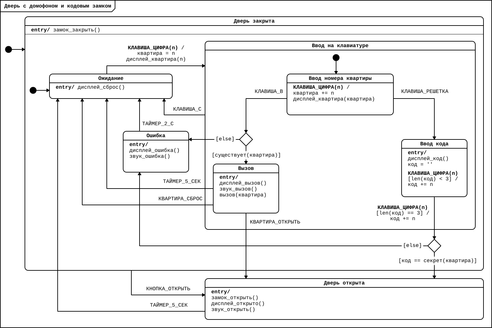

# Промежуточный тест оценки знаний

(1)  Выберите, для каких устройств корректнее использовать событийную парадигму программирования:
  - сборщик кубика-рубика
  - марсоход
  - конвейер на заводе
  - лифт

(2) Сколько состояний в представленной ниже диаграмме? Ответ введите числом

(3) Какие бывают переходы в ПРИМС?
  - внешние и внутренние
  - родительские и дочерние
  - экзотермические и эндотермические
  - событийные и императивные
  
(4) Как расшифровывается аббревиатура ПРИМС?

  - Протокол Распределенного Индексирования Магистральных Синхроструктур
  - Программируемый Реверсивный Интегральный Модуль Сопряжения
  - Программирование Расширенных Иерархических Машин Состояний
  - Промежуточный Репозиторий Интерцепторов Масштабируемых Служб

(5) Какие элементы НЕ относятся к ПРИМС:
  - Цикл
  - Состояние
  - Событие
  - Условный оператор
  - Класс
  - Ограждающие условия

## Правильные ответы:
1. **марсоход** и **лифт**
2. **8**
3. **внешние и внутренние**
4. **Программирование Расширенных Иерархических Машин Состояний**
5. **Цикл**, **Условный оператор**, **Класс**

