# 4. Язык программирования машин состояний (ПРИМС) для реальных устройств

Это занятие посвящено углублению в язык ПРИМС. Мы изучим третий ключевой элемент —
действие, а также познакомимся с рядом второстепенных, но не менее важных элементов. В
практической части запрограммируем устройство для игры «Захват флага» (англ. Capture the
flag).

## Теоретическая часть

Для погружения в программирования контроллера Arduino с использованием машин состояний и
прохождения модуля онлайн вы можете познакомиться только с теоретической частью занятия.

### 4.1. Действия

Хотя на предыдущих занятиях в наших диаграммах уже неоднократно реализовывались
**действия** разными устройства, есть еще многое, что мы можем узнать про этот третий
важнейший элемент машин состояний.

Как правило, мы легко можем наблюдать, что *делает* наша система — поехала, нагревает,
зажглась и т.д. Эти действия являются следствием выполнения **команд** подсистем
устройства — «`двигаться к цели`», «`включить_печь`», «`включить_лампочку`». В средах
разработки действия обычно составные и собираются по формуле: модуль/компонент + команда +
параметр (при необходимости). Например, включение светодиода в Cyberiada IDE задается
следующим образом: «`Светодиод.Зажечь(красный)`». А вот действие отключения таймера не
требует указания параметра— «`Таймер.Отключить`» .

Чаще всего действия располагаются на **входе** и **выходе** состояния. *Действия на входе*
запускаются, когда машина состояний переходит ***в*** данное состояние. Например, в
диаграмме работы микроволновой печи с гриллем при попадании в состояние «`нагрев`»
включается печка («`heater_on()`»), а в «`дверца_открыта`» — включается лампа
(`internal_lamp_on()`). Обратите внимание, эти действия идут после косой черты
специального значка «`entry/`».

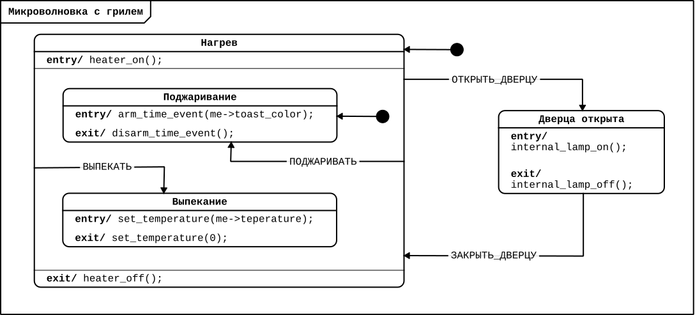

*Действия на выходе* срабатывают, когда текущее состояние ***сменяется*** другим благодаря
произошедшему событию. Например, при выходе из «поджаривания» отключается таймер прожарки
(«`disarm_time_event()`), а при выходе из «выпекания» — устанавливается температура 0℃
(`set_temperature(0)`). Эти действия располагаются после значка «`exit/`».

Отметим, что в диаграммах машин состояний **вход и выход — это не события**, а специальные
технические обозначения, позволяющие выполнять действия при переключении
состояний. Действие на входе и выходе может включать последовательное выполнение
нескольких команд.

Кроме входа и выхода действия также могут располагаться после событий — на переходах и
внутри состояний. Тогда действия указываются после имени события и символа косой
черты. Рассмотрим это на примере простейшей диаграммы работы маяка.

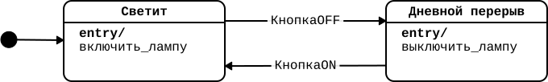

У маяка есть два базовых состояния — «`Светит`», когда ночь и корабли необходимо
навигировать на свет, и «`Дневной перерыв`» — когда из-за солнца свет маяка не заметен, и
поэтому его разумно выключить. Эта программа похожа на умную лампочку, рассматриваемую на
предыдущем занятии: действия включения и выключения реализуются внутри соответствующих
состояний. Однако эту программу можно собрать и по-другому:

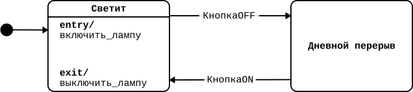

Во втором случае действия выключения лампы осуществляется на выходе из состояния
«`Светит`», а состояние «`Дневной перерыв`» остается пустым. Такая организация программы
очень логична с точки зрения управления состоянием — мы доделываем все действия в старом
состоянии, чтобы в новом реализовывать принципиально новые команды.

И даже существует третий вариант структурирования этой диаграммы, при котором выключение
лампы происходит не внутри состояний, а на переходе после события «`КнопкаOFF`».

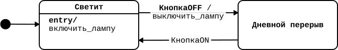

Все три программы реализуют одно и то же поведение системы. Таким образом, программист,
создающий диаграмму машины состояний, может сам выбрать наиболее соответствующий решаемой
задаче, удобный и лаконичный способ описания действий в программе.

### 4.2. Другие элементы ПРИМС

Как мы упоминали в предыдущих занятиях, ключевых элементов ПРИМС три — состояния, события
и действия. Однако существует еще несколько важных элементов, которые позволяют создавать
сложные и интересные программы.

#### Ограждающие условия

События могут иметь **ограждающие условия срабатывания** — фильтр, который позволяет
игнорировать события, если условие не выполняется. Обозначаются условия в квадратных
скобках после имени события.

Ограждающие условия удобно комбинировать с регулярными событиями таймера, чтобы совершать
действия в связи с достижением порогового значения какого-то параметра дрона (дистанции до
цели, уровень заряда батареи, пройденного расстояния и т. п.)

Например, наш маяк может включаться и отключаться не вручную, а при помощи автоматического
мониторинга уровня освещенности.

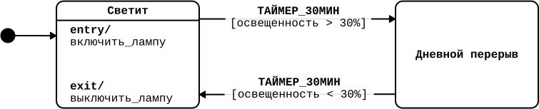

Для этого на переход между состояниями будет осуществлять по событию «`ТАЙМЕР_30МИН`» с
ограждающими условиями «`освещенность >30%`» и «`освещенность <30%`». Это означает, что
раз в 30 минут система проверяет уровень внешней освещенности. Когда она становится больше
30% (наступает день), маяк выключается, а когда меньше (наступает ночь) — включается. Если
пороговое значение не достигнуто, то переход не будет реализован – событие переход будет
проигнорировано.

#### Псевдосостояние выбора

Другим интересным элементом является **псевдосостояние выбора**. Оно позволяет
реализовывать ветвления — когда в зависимости от определенного параметра, у нас есть
разные сценарии работы системы. Псевдосостояние выбора обозначается в виде символа ромба и
расходящимися от него стрелочками к соответствующим состояниям.

Например, представим, что нашему маяку в плохие погодные условия, когда в порт нельзя
пришвартоваться, необходимо зажигать красный свет, а во всех остальных случаях гореть
белым. Чтобы не создавать отдельные состояния и дополнительные переходы с ограждающими
условиями, воспользуемся псевдосостоянием выбора.

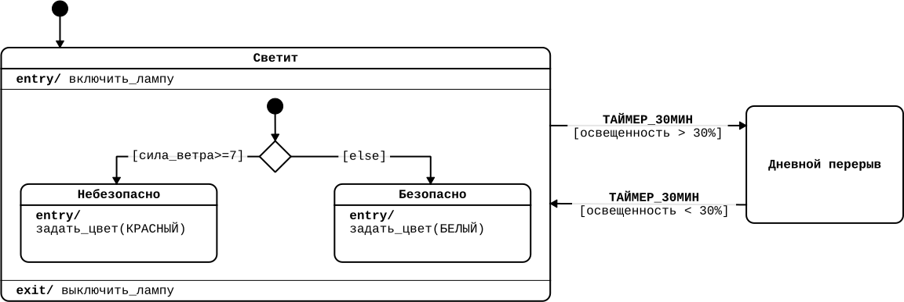

В случае если на море штормовое предупреждение (условие «`сила ветра >=7`» ), реализуется
переход в состояние `«Светит::Небезопасно»` и зажигается красный свет. В ином случае
(условие «`else`») зажигается белый свет.

#### Начальное и конечное состояние

**Начальное** и **конечное** состояние — это способ обозначить в диаграмме начало и
завершение работы машины состояний. С *начальным* состоянием мы уже встречались ранее в
программах: это состояние, которое становится активным при запуске машины состояний или
при входе в родительское состояние. Оно обозначается стрелкой от закрашенного кружка и
есть в *каждой* диаграмме — без него исполнение программы просто не начнется.

Полезно указывать начальное состояние не только в начале программы, но и внутри каждого
родительского — это позволит упростить переходы. В последней диаграмме маяка есть
начальное псевдосостояние для состояния «`Светит`» — это позволяет вести переход не к
конкретному дочернему состоянию и иметь корректную программу.

В машине состояний может быть задано и *конечное состояние*, хотя на практике его
добавляют не всегда. Оно позволяет финально завершить работу машины состояний и
обозначается закрашенным кружком, обведенным еще одним кружком.

### 4.3. Программирование реального устройства

#### Как компьютер все запоминает?

У автономных систем, как и у человека, есть *память* — специальное хранилище, куда
сохраняются данные для последующего использования. Там используется специальный язык —
двоичное кодирование, то есть все описано в виде единиц и нулей. Это нужно, чтобы
процессор (мозг системы) мог читать данные из памяти и записывать их в память. Для доступа
к памяти программы используют ***переменные***.

Переменная — это ячейка памяти, в которой хранятся определенные данные. В машинах
состояний часто для таких ячеек используется модуль «Счетчик». С его помощью можно хранить
значения, а также производить с ними математические операции — в первую очередь, сложение
и вычитание.

В начале счетчик важно *инициализировать* — задать ему начальное значение перед стартом
программы, обычно «0». Если этого не сделать, программа может выдать ошибку или
использовать случайные данные из памяти.

#### Решение задачи

Теперь давайте используем знание обо всех новых элементах и попробуем решить задачу на
программирование реального устройства — определитель победителя для игры «Захват флага».

«Захват флага» — это командное соревнование, цель которого как можно дольше удерживать
флаг. Как только флаг переходит к одной из команд, та нажимает на специальные часы,
похожие на шахматные — только в них используется секундомер, а не таймер обратного
отсчета. Стандартно игра длится около 5 минут, и побеждает команда, которая большее
количество времени владела флагом.

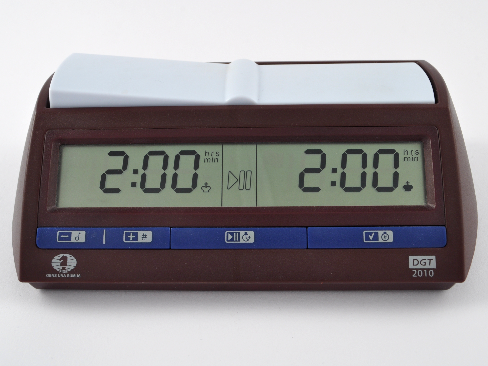

Давайте попробуем запрограммировать такой определитель победителя:

> **Захват флага**
>
> Продумайте программу определителя победителя игры «Захват флага», которая реализует
> следующую работу системы:
>
> - отсчитывает время игровой сессии (стандартно 5 минут)
> - ведет подсчет времени владения флагом для каждой из двух команд;
> - объявляет победителя, зажигая соответствующий светодиод.

Дадим небольшую подсказку: подсчет времени владения необходимо реализовать с помощью
переменной. Рекомендуем сперва попробовать решить задачу самостоятельно и лишь затем
знакомиться с предложенным нами решением.

Исходя из условия задачи можно выделить три ключевых режима работы будущей системы:

1.  Ожидание старта;
2.  Игра — запуск таймера и подсчет владения командами флагом;
3.  Результаты — объявление победителя данной игровой сессии.

На основе данных режимов можно изобразить следующую диаграмму машины состояний:

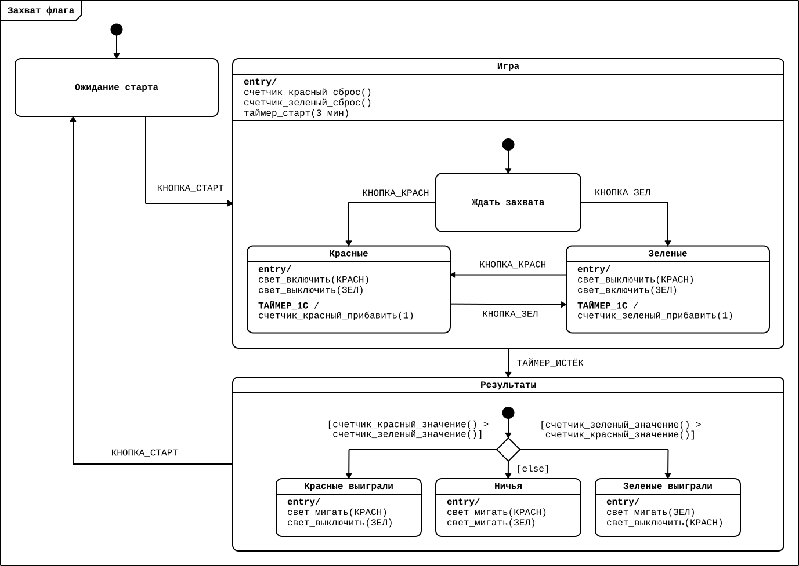

Кратко прокомментируем диаграмму:

| **Состояние** | **Пояснение к работе** |
|----|----|
| Ожидание старта | Пустое состояние для ожидания. Как только нажата кнопка старт, запускается таймер на 3 минуты и реализуется переход в следующее состояние «Игра». |
| Игра | Родительское состояние, содержащее три дочерних состояния — «Ожидание захвата», «Красные» и «Зеленые». Когда время игровой сессии заканчивается, реализуется переход к псевдовыбору в состоянии «Результаты» |
| Ожидание захвата | С этого состояния начинается игра, так как еще никто из команд не владеет флагом. Выход из состояния наступает, когда одна из команд первый раз нажмет свою кнопку. |
| Красные | На входе в состояние зажигается красная лампочка. Раз в секунду обновляется счетчик (красн), прибавляя единицу. Выход из состояния реализуется, если зеленая команда нажмет свою кнопку. |
| Зеленые | На входе в состояние зажигается зеленая лампочка и гаснет красная. Раз в секунду обновляется переменная green», прибавляя единицу. Выход из состояния реализуется, если красная команда нажмет свою кнопку. |
| Результаты | Переход в состояние происходит по истечению таймера. Содержит псевдосостояние выбора, сравнивающее значение счетчиков двух команд. |
| Победили красные | Если счетчик (красн) больше счетчика (зел) реализуется переход в данное состояние. На входе мигает красная лампочка. |
| Победили зеленые | Если счетчик (зел) больше счетчика (красн) реализуется переход в данное состояние. На входе мигает зеленая лампочка. |
| Ничья | Если значения счетчиков равны, реализуется переход в данное состояние и мигают обе лампочки. |

Обратите внимание, что в этой версии диаграммы использовались все изученные нами элементы:
состояния, внутренние и внешние события, действия, начальное псевдосостояние, ограждающие
условия, псевдосостояние выбора и иерархия состояний.

В практической части соберем из данной диаграммы полноценное устройство для определения
победителя.

## Практическая часть

Для прохождения практической части вы можете использовать любой из доступных электронных
конструкторов, основанных на контроллере Arduino или воспользоваться самим контроллером и
простыми электронными компонентами. Также вы можете воспользоваться редактором Cyberiada
IDE для того, чтобы научиться работать с диаграммами, а онлайн-симуляторы Arduino можно
использовать для сборки электронных схем.

### 4.4. Сборка устройства

Для сборки понадобятся следующие компоненты:

- микроконтроллер Arduino Uno;
- тактовая кнопка – 3 штуки;
- светодиод — 2 штуки;
- резистор около 220 Ом – 2 штуки
- резистор около 10 кОм – 3 штуки;
- макетная плата – 1 штука.

Затем соберем следующую схему подключения с Arduino:

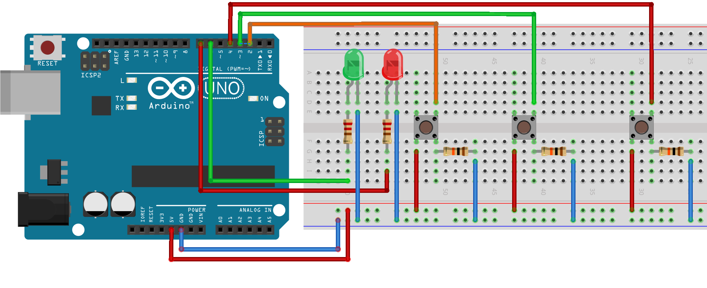

Ей соответствует электрическая схема:

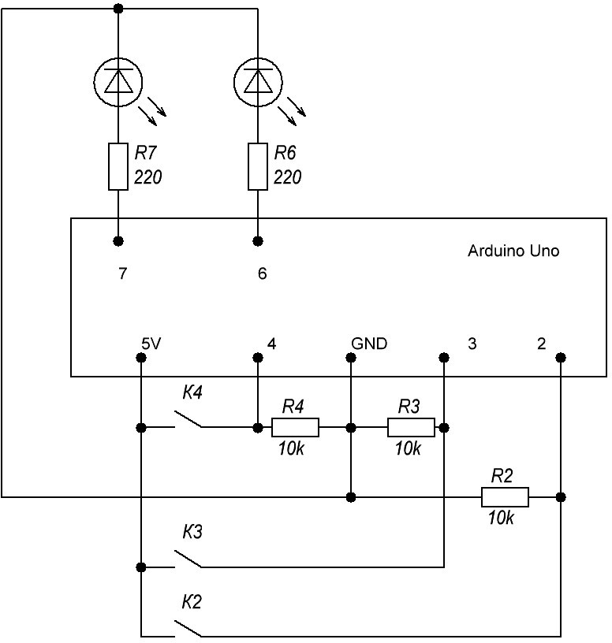

### 4.5. Перенос диаграммы в редактор «Cyberiada IDE»

Откройте редактор «Cyberiada IDE» и создайте новый файл на платформе «Arduino
Uno». Добавьте в программу необходимые компоненты:

- Кнопка старт
- Кнопка красные
- Кнопка зеленые
- Таймер сессии
- Таймер секунда
- Красный светодиод
- Зеленый светодиод
- Красный счетчик
- Зеленый счетчик

Поскольку мы добавляем много компонентов одного типа (два счетчика, два светодиода, два
таймера, три кнопки), это может затруднять их быстрое опознание на диаграмме. Чтобы
избежать ошибок, можно добавить подпись — надпись до 3-х символов с возможностью выбора
цвета. Подпись можно настроить при создании или редактировании компонента.

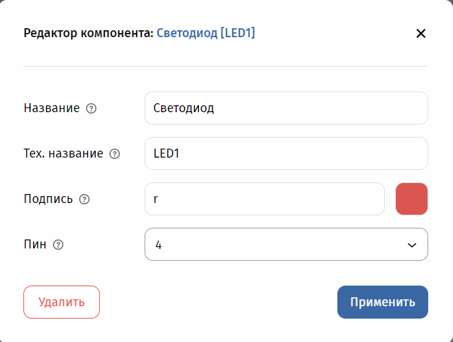

Перечень добавленных компонентов светодиодов:

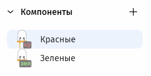

Перечень добавленных компонентов светодиодов:

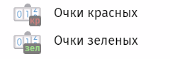

Затем создадим следующую программу работы:

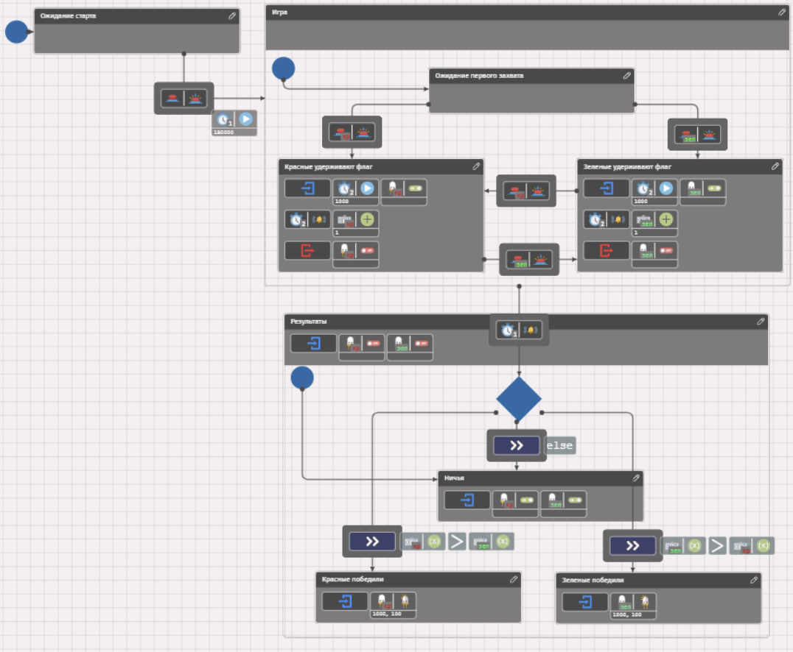

Более детальные скриншоты отдельных состояний:

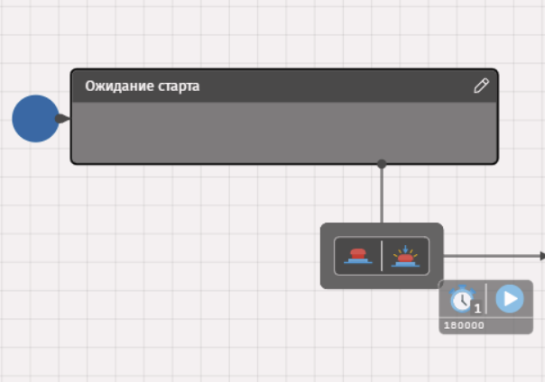

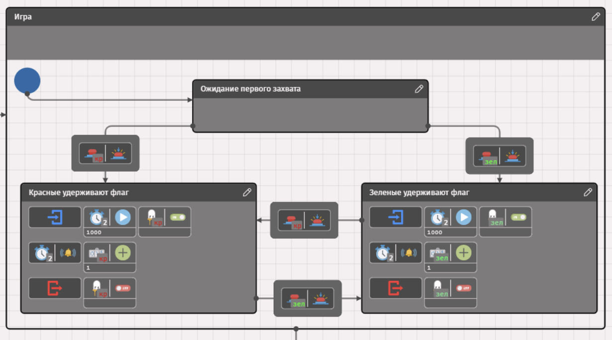

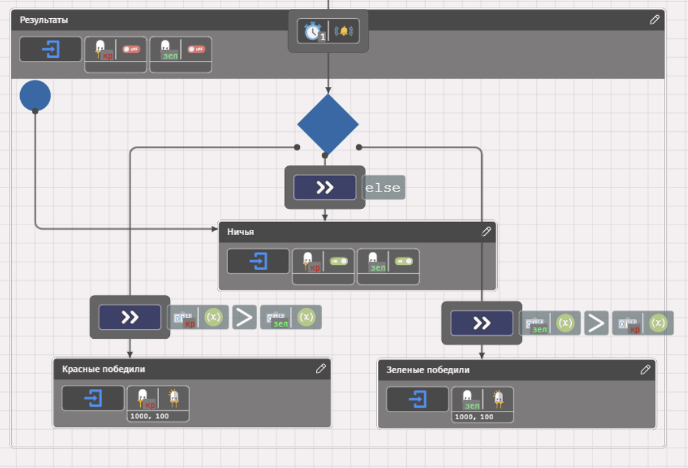

Если у вас есть желание, можно реализовать более интересную и сложную программу для
определителя победителя. Обратный отсчет, текущее количество очков команд и результаты
должны выводиться на мини-экран (LCD1602 c i2c подключением). В Cyberiada IDE подобного
компонента пока нет, но попробуйте модифицировать диаграмму письменно или в электронном
редакторе.

Примером решения может быть следующая диаграмма:

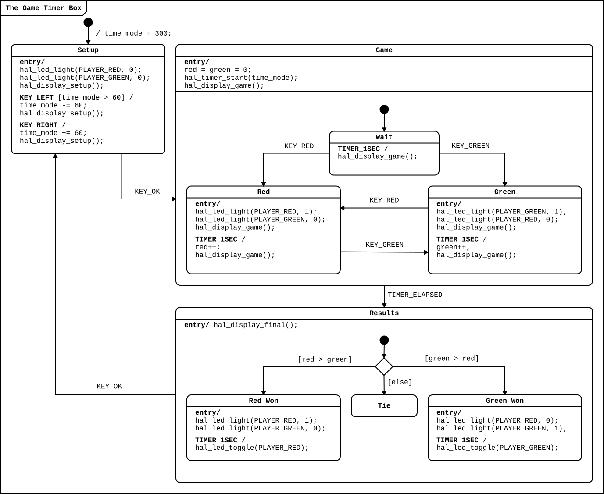

Кроме того, само устройство можно поместить в пластиковый корпус

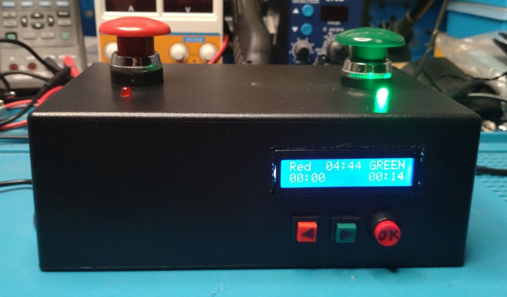

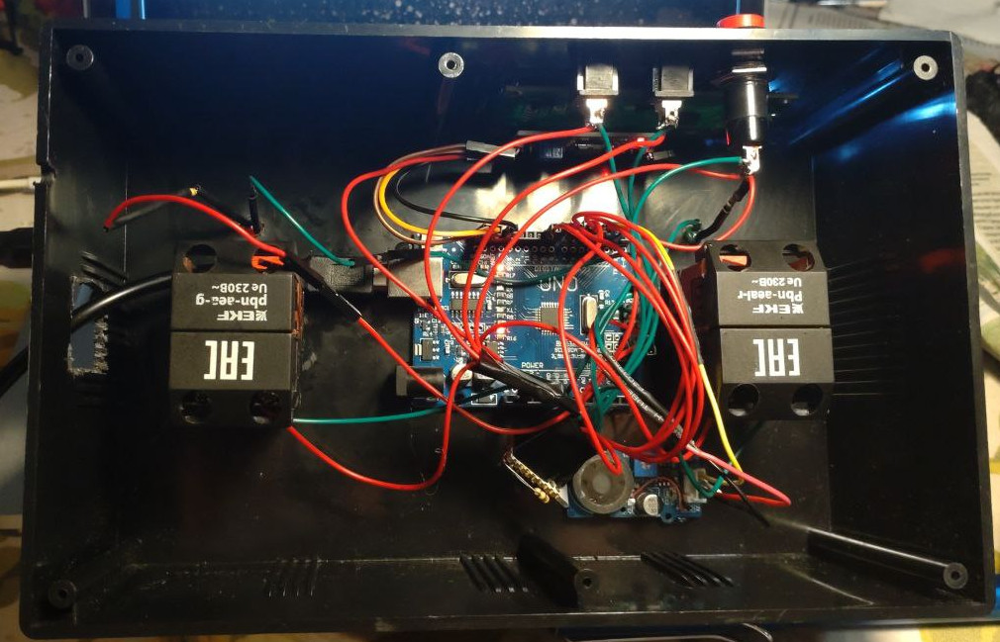

Подробнее познакомиться с документацией по данному проекту можно в .

В модуле, посвященном программированию контроллеров Arduino на ПРИМС и C++, данный пример
будет разобран подробнее.

## Подведение итогов

На этом занятии вы завершили освоение всех наиболее важных элементов ПРИМС. Теперь вы
можете создавать программы с более интеллектуальной логикой — сложной организацией
состояний, ветвлениями в сценариях работы, проверкой условий на переходах, расположением
действий в разных частях диаграммы. Это модуль завершается, но вы можете продолжить
изучение в следующем модуле, посвященном продолжению программирования контроллеров Arduino
на ПРИМС и С++.

Впереди вас ждет небольшой тест для проверки усвоенных знаний. Мы верим, что у вас все
получится :)

## Дополнительные материалы

- 
-  //
  Альманах киберфизики: Выпуск 1, 2024 год / Ред.: А. И. Федосеев, О. Е. Кускова — М.:
  Ассоциация участников технологических кружков, Национальная киберфизическая платформа,
  2025.
- Воеводин, И.Г., Воеводина, А.И., Цырульников, Е.С., Шумак, К.А. . М.:
  Ассоциация участников технологических кружков, 2024.
  
