# 5. Управление с использованием датчиков: аналоговые и цифровые порты

Теперь, когда база ПРИМС и простые программы на Arduino нами уже изучены, мы готовы
двигаться дальше! Это занятие открывает второй модуль нашего курса, посвященный более
глубокому и прикладному программированию микроконтроллера Arduino: работе с внешними
датчиками, изучению основ языка C++, подключению реле и сервопривода. При должной практике
вы сможете создавать автоматические системы даже у себя дома.

## Теоретическая часть

Для погружения в программирования контроллера Arduino с использованием машин состояний и
С++ и прохождения модуля онлайн вы можете познакомиться только с теоретической частью
занятия.

### 5.1. Что такое датчики?

Редко в каком доме сейчас нет «умной» техники:

- *кухонная плита*, автоматически прекращающая нагрев, как только кастрюля убрана;
- *фитнес-браслет* или *смартфон*, считывающий пульс, количество пройденных шагов и даже фазы сна;
- *робот-пылесос*, сохраняющий карту комнаты, чтобы при уборке не сталкиваться с препятствием;
- и т.д.

Список можно продолжать довольно долго, и с каждым годом подобных интеллектуальных
устройств становится все больше. Это стало возможно благодаря развитию электроники, в
частности различного типа **датчиков**.

Люди уже столетиями создают автоматические устройства управления. Еще до появления
электроники можно вспомнить первые машины *с обратной связью*, например, знаменитый
регулятор Ватта. Это изобретение положило начало эпохе индустриализации: автоматический
регулятор сам менял угол заслонки, подававшей в воздух в печь. Такие автоматы позволили
легко управлять сложными производствами, повысить точность работы машин.

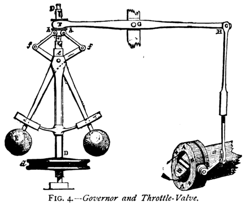

Чем быстрее крутится вал, тем меньше нужно подавать в печь кислород, и наоборот. В
результате скорость вращения вала стабилизировалась у определенной величины. Можно
считать, что эта механическая машина «учитывала» скорость вращения вала, как современные
контроллеры ориентируются на показатели датчиков при принятии решений.

Большинство современных систем автоматизированного управления немыслимы без
датчиков. Именно они подсказывают контроллеру, где нужно срочно остановить работу, а где —
наоборот, запустить какие-то процессы. Главная суперсила датчиков — это умение переводить
язык физических явлений на язык электрических сигналов. Разберемся подробнее, в чем
заключается эта способность.

### 5.2. Порог в работе датчиков

У каждого объекта и процесса в мире есть множество граней и измерений. К примеру, солнце
дает свет, тепло, ультрафиолетовое излучение, связано с магнитными бурями и т. п. Однако
для автоматической работы умной лампочки или маяка достаточно единственного параметра
солнца — *уровня освещенности*. Опора на определенную характеристику объекта или процесса,
при которой мы отсекаем все остальные незначимые параметры, называется **моделированием**.

На рисунке представлен пример диаграммы машины состояний автоматизированной теплицы:

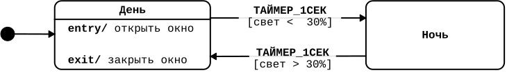

Разработчик системы, моделируя реальность внутри программы через выделение наиболее
значимых параметров, решает сложную задачу по соотнесению физического мира и цифровой
системы управления. Например, освещенность — это *непрерывная* физическая величина
(измеряется в люксах), а «день» или «ночь» в режиме работы — это *бинарный* параметр
(строгий выбор из двух), и становится непонятно, как же их соотнести между собой: при
каком значении люксов должна происходить смена суток в программе?

Поэтому для корректного переключения между режимами работы необходимо установить **порог**
— значение измеряемой характеристики, переходя которое программа будет четко определять
время суток.

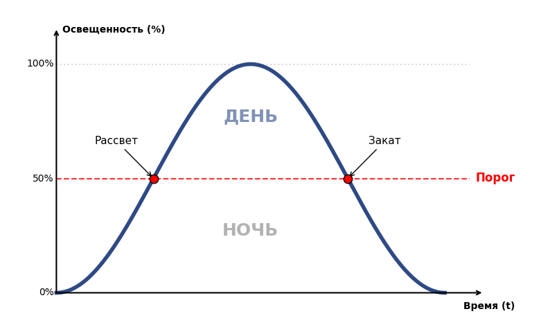

Например, когда освещенность достигла 50 % от нормы, мы будем считать, что наступили
сумерки, и система должна перейти в ночной режим работы. Наоборот, когда значение величины
превосходит порог 50 % от нормы, система должна перейти в режим «День».

Одним из наиболее простых датчиков, позволяющий определять уровень освещенности, является
**фоторезистор**. Главной особенностью фоторезистора является возможность менять свое
сопротивление в зависимости от внешнего освещения: чем темнее вокруг, тем выше
сопротивление, и наоборот.

На рисунках показаны условное обозначение фоторезистора на электрических схемах и его
внешний вид:

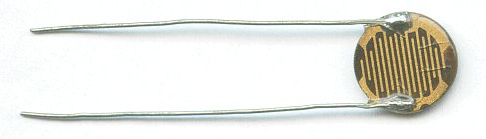

Используя фоторезистор, мы можем снимать данные об уровне освещенности и обрабатывать их в
программе управления двумя способами — через **аналоговый** и **цифровой** порт.

### 5.3. Различия аналогового и цифрового ввода

#### Аналоговый ввод

На следующем занятии мы подробнее поговорим про внутреннее устройство контроллеров. Сейчас
достаточно будет сказать, что контроллеры способны работать с двумя типами входной
информации: *цифровой* и *аналоговой*.

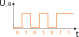

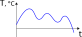

С цифровым представлением сигнала мы уже знакомились в предыдущем модуле – так
представляется информация в компьютере. Аналоговый сигнал обычно связан с реальностью – с
какой-то физической величиной, например, температурой, освещенность или громкостью звука.

Современные контроллеры умеют преобразовывать измеряемый аналоговый сигнал в цифровое
значение, но делают это с определенной точностью, ведь любую цифру в памяти компьютера
придется сохранить в виде конечного набора 0 или 1.

| Исходный аналоговый сигнал  | Оцифрованный сигнал 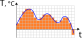 |
|----|----|

Поэтому, прежде программа сможет работать с измеренным сигналом, он должен быть оцифрован
– переведен в последовательность цифр с заданной *частотой* (как часто делаем «отсечки») и
*точностью* (на какие уровни сможем «побить» величину сигнала).

Контроллер Arduino поддерживает такое преобразование. Для этого используются *аналоговые
порты* – контроллер измеряет текущий уровень напряжения в порту, которое как правило
зависит от измеряемой величины, и превращает этот уровень в число. Контроллер Arduino Uno
имеет 10-разрядный аналогово-цифровой преобразователь, поэтому из аналогового порта в
каждый момент времени можно прочитать число – от 0 до 1023.

Попробуем применить это к измерению уровня освещенности.

Cyberiada IDE позволяет нам выводить данные об уровне освещенности прямо внутри
редактора. Для этого напишем специальную программу, которая будет измерять уровень
напряжения на фоторезисторе и выводить полученное аналоговое значение на экран:

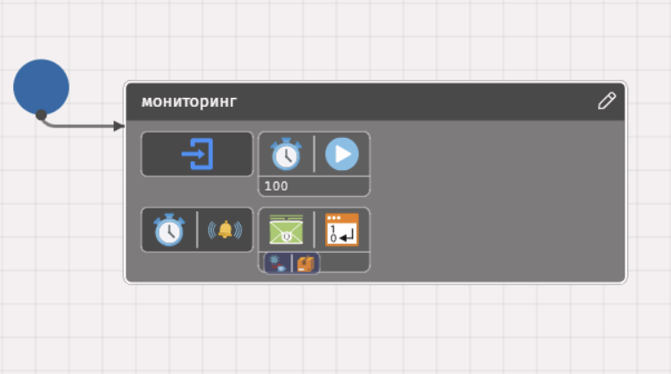

Раз в заданный промежуток (0,1 секунды) при помощи компонента для передачи и чтения данных
с последовательного порта передается текущее значение с фоторезистора. В мониторе порта
это будет выглядеть так:

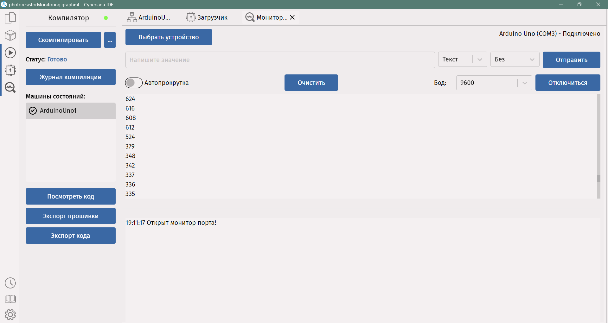

> **Вопрос:** Что означают полученные цифры на экране? Какие величины за ними скрываются?

Как мы уже обсудили, естественный ответ на этот вопрос – уровень освещенности. Но в чем он
измеряется? Вряд ли речь идет о величине напряжения на проводе, ведь к фоторезистору было
подведено исходное напряжение в 5 В, никак не сотни вольт.

Выше мы уже говорили, что контроллер Arduino преобразует значение измеренного напряжения в
условные единицы – в диапазоне от 0 до 1023. Поэтому 0 будет соответствовать напряжению в
0 В, а 1023 – напряжению в 5 В. Так мы можем понять уровень измеренного напряжения – оно
постепенно падает от 3 В до 1,6 В. Но что это говорить об освещенности?

Ответить на этот вопрос невозможно, не обращаясь к устройству самого датчика. В нашем
случае фоторезистор менял свое сопротивление в зависимости от освещенности. На самом деле
в технической документации фоторезистора указано, как меняется от уровня света это
сопротивление, что дает возможность составить формулу и рассчитать исходное значение
физической величины.

#### Цифровой ввод

Цифровой вход — это ключевой элемент любого контроллера или процессора еще со времен
архитектуры первых компьютеров, придуманной фон Нейманом. На вход поступают цифровые
сигналы 0 или 1, которые интерпретируются выполняемой программой. Цифровой вход может быть
подключен к различным устройствам – коммуникационным каналам, устройствам хранения или,
как в нашем случае, датчикам.

Важным отличием цифрового входа от аналогового является наличие заданных уровней,
т. н. высокого (`HIGH`) и низкого (`LOW`). Уровень напряжения, превышающий высокий уровень
интерпретируется как 1, тогда как напряжение ниже низкого уровня считается
за 0. Напряжение, не попадающее в заданные уровни, считается неопределенным значением.

Таким образом, при чтении данных из цифрового ввода контроллера программа может получить
только одно из двух значений – `LOW` или `HIGH` – в зависимости от текущего уровня входного
сигнала.

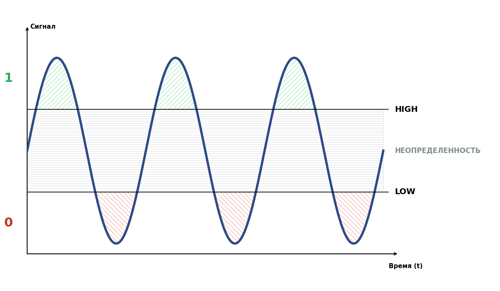

Снимая те же значения напряжения с фоторезистора, подключенного к цифровому порту,
программа будет проверять условия перехода не по порогу, заданному в условных единицах, а
через уровни `HIGH` (1) и `LOW` (0), как в программе ниже:

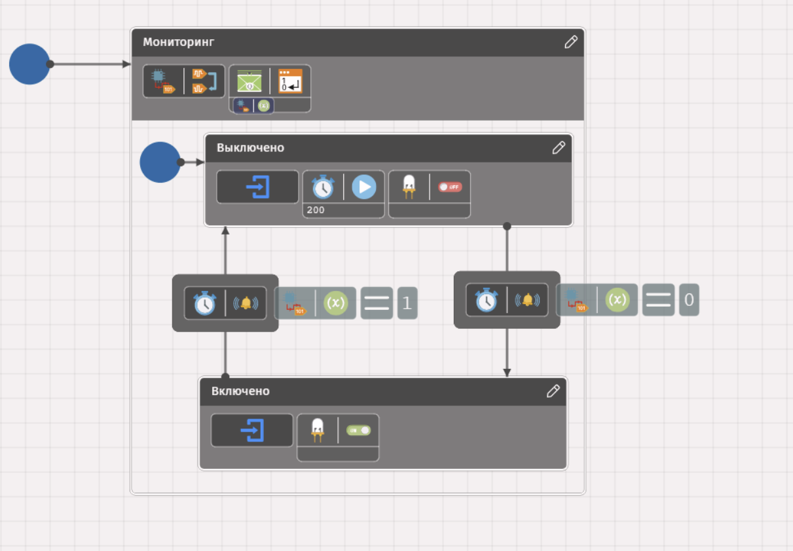

Как же программа определяет, какой уровень напряжения высокий, а какой низкий? Цифровой
ввод определяет логический 0 и логическую 1 с помощью пороговых уровней напряжения,
которые жестко заданы физической архитектурой микросхемы. Для Arduino Uno пороги заданы
следующим образом:

- **Логический 0 (`LOW`):** входное напряжение должно быть **ниже 1.5 В** (если вы подаете
  выходное напряжение уровня LOW, оно будет равно 0 В).
- **Логическая 1 (`HIGH`):** входное напряжение должно быть **выше 3.0 В** (если вы
  подаете выходное напряжение уровня HIGH, оно будет равно 5 В).
- **Зона неопределенности:** диапазон **от 1.5 В до 3.0 В**. Если напряжение на пине
  окажется в этом промежутке, Arduino может считать его как случайный 0 или 1.

#### Калибровка датчиков

Важно отметить, что вне зависимости от используемого ввода датчики требуют
*калибровки*. Простыми словами, это проверка точности устройства — когда мы связываем
цифровые измерения с реальностью, чтобы убедиться, что прибор не врет, и исправить ошибку,
если она есть.

Для калибровки фоторезистора можно сопоставить различное освещение, напряжение на выходе
из датчика и получаемые в программе числа. Например, важно проверить, как будет изменяться
значение в мониторе порта, если мы закроем фоторезистор ладошкой или, наоборот, направим
на него свет яркого фонарика. Можно провести набор измерений при известных условиях
(прямой солнечный свет, домашняя лампа, полная темнота и пр.) и составить таблицу
сопоставления получившиеся средних значений и описаний внешних условий.

> **Совет:** Всегда калибруйте датчики перед стартом работы

Однако случается, что работа датчика в норме, но в системе наблюдаются хаотические
«перепрыгивания» из состояния в состояние. Это может быть связано с **дребезгом
контактов**.

### 5.4. Проблема дребезга

#### Что такое дребезг?

> **Интерактив:** Ниже представлен фрагмент программы для цепочки из 4-х светодиодов,
> которые зажигаются последовательно по одному при нажатии на концевик (концевой
> переключатель). При реализации данной программы наблюдается «перескакивание»
> светодиодов: они зажигаются в неверном порядке.
>
> Ответьте на следующие вопросы:
>
> - Программа использует аналоговый или цифровой ввод? На основе чего вы делаете такой
>   вывод?
> - Каковы условия переключения между состояниями «Выключено» и «Включено»?
>
> 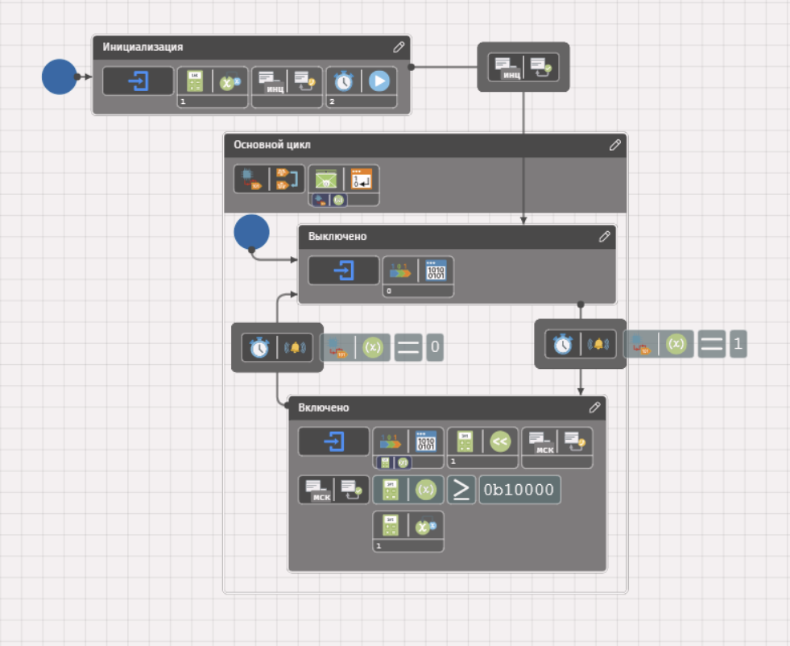
>
> Программа использует *цифровой* ввод, что можно понять по условиям переключения. Мы
> помним, что на цифровом вводе у нас существует два уровня — `HIGH` (1) и `LOW` (0), смена
> которых (изменение уровня напряжения) приводит к переключению состояний. Поскольку это
> единственное условие перехода, значит, что быстрая смена состояний связана как раз с
> колебанием между этими уровнями.Такой эффект называется **дребезгом**.

**Дребезг** возникает из-за неверных коммутаций в контактах электроники. При
соприкосновении жестких контактов может возникать серия колебаний, которые провоцируют
последовательность размыканий цепи. Итогом этих размыканий является целая серия импульсов,
которую можно проиллюстрировать так:

Помимо непосредственного наблюдения дребезга существует также специальный прибор, с
помощью которого можно уловить колебания в напряжении — *осциллограф*.

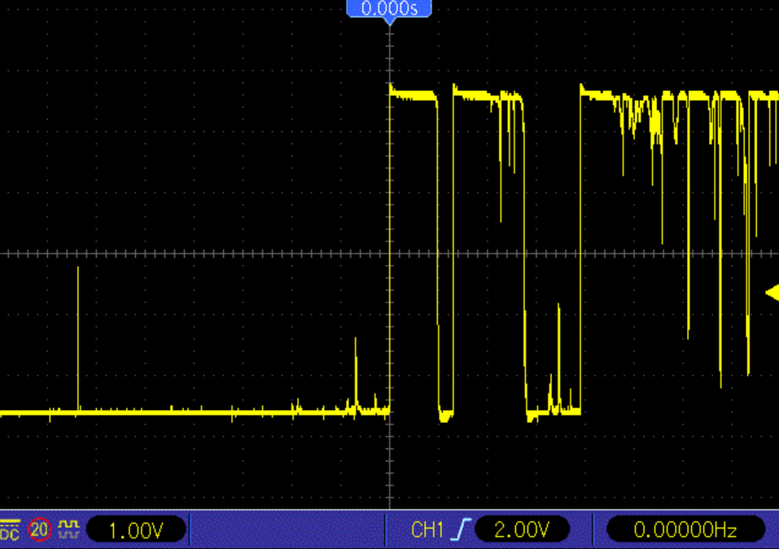

*Эффект дребезга на данных с осциллографа*

На графике можно наблюдать частокол из хаотичных импульсов (сигнал многократно прыгает
вверх и вниз). Это и провоцирует резкие переключения между состояниями.

Представьте, если бы в сложных система с множеством состояний — например, в стиральной
машине или микроволновке — переключение состояний было бы беспорядочным? Это приводило бы
к крайне опасным ситуациям. Поэтому важно *подавлять* дребезг.

#### Способы борьбы с дребезгом

В реальных системах дребезг преодолевается *аппаратным* или *программным* путем. Первый
заключается в создании таких компонентов, в которых существенно повышается качество
контакта, снижается вероятность колебаний, используются специальные электронные схемы с
триггерами. Программные же решения помогают обойти дребезг с помощью специальных задержек
— подобное решения можно называть программным фильтром против дребезга. В практической
части нашего занятия мы попробуем собрать такой фильтр.

## Практическая часть

Для прохождения практической части вы можете использовать любой из доступных электронных
конструкторов, основанных на контроллере Arduino или воспользоваться самим контроллером и
простыми электронными компонентами. Также вы можете воспользоваться редактором Cyberiada
IDE для того, чтобы научиться работать с диаграммами, а онлайн-симуляторы Arduino можно
использовать для сборки электронных схем.

### 5.5. Знакомство с новыми компонентами

Задача для практической части звучит следующим образом:

> **Цепочка светодиодов**
>
> Напишите программу для цепочки из четырех светодиодов, которые зажигаются
> последовательно по нажатию концевика, используя компонент «Цифровой ввод». Предусмотрите
> для программы создание «антидребезгового» фильтра.
>
> Затем соберите схему на макетной плате с помощью микроконтроллера Arduino и
> протестируйте работу программы.

Перед тем, как приступать к решению, необходимо познакомиться с двумя важными компонентами
— **концевиком** (концевой переключатель) и **сдвиговым регистром.**

#### Концевик

Поскольку дребезг — это довольно распространенная проблема, большинство компонентов имеют
внутреннее подавление дребезга: за счет изменения их геометрии, материалов и внутренней
механики. Поэтому, чтобы поймать дребезг «за хвост», мы будем использовать простейшее
устройство — *микропереключатель*, который также называют концевым переключателем или
*концевиком*.

Внешний вид и внутреннее устройство микропереключателя:

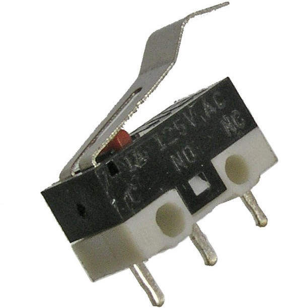

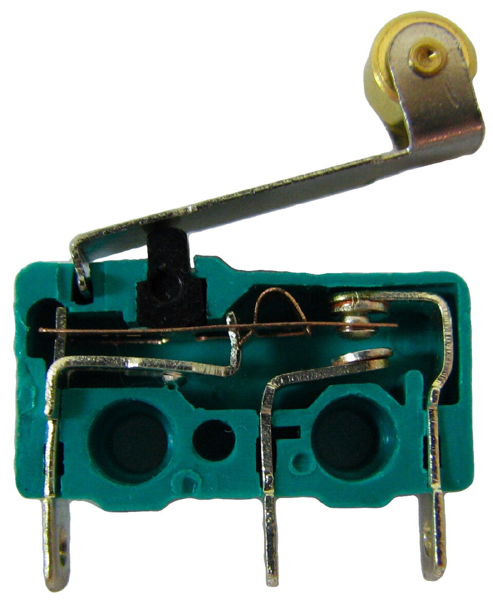

Как и тактовая кнопка, концевик представляет собой электромеханическое устройство, которое
замыкает и размыкает электрическую цепь. Особенностью концевика является его внутренний
пружинный механизм — при нажатии энергия накапливается, а затем пружина мгновенно
«отстреливает» контакты в новое положение. Подобная конструкция очень прочная —
микропереключатели выдерживают более 1 миллиона циклов, а для моделей для тяжелых условий
эксплуатации — до 10 миллионов циклов.

#### Сдвиговый регистр

Когда мы работали со светофором, было удобно подключать светодиоды к Arduino напрямую. Но
в этот раз занимать на прямое подключение сразу четыре контакта было бы
нецелесообразно. Чтобы сократить количество активных пинов, сохранив нужное число
светодиодов, можно использовать особенный компонент — *сдвиговый регистр*.

Функциональная схема регистра и его внешний вид:

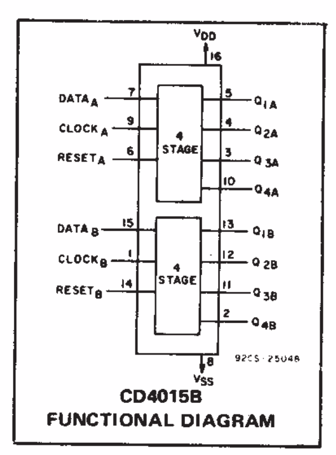

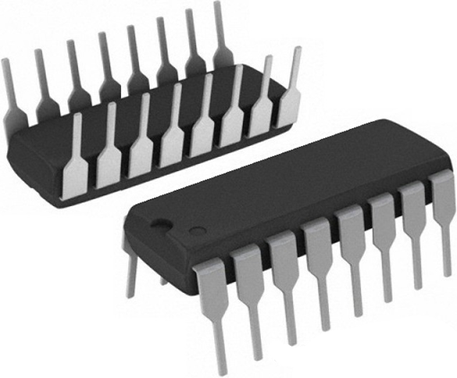

В микропроцессорных системах сдвиговый регистр используется как расширитель портов
ввода-вывода. Если микроконтроллеру не хватает собственных физических выводов для
управления множеством периферийных устройств (например, светодиодов), регистр позволяет
управлять 8 выходами, используя всего 2 сигнальные линии контроллера.

Это происходит за счет преобразования последовательного кода (биты передаются поочередно)
в параллельный (каждый бит передается одновременно). На входной контакт (`Data`/`Вход`)
поступает информация, а когда приходит тактовый импульс (`Clock`/`Такт`), регистр берет бит со
входа и «заталкивает» его в свою первую ячейку памяти. Если там уже что-то было, оно
сдвигается во вторую ячейку, из второй — в третью и так далее. Такой сдвиг называется
**побитовым**.

Ниже представлена машина состояний устройства сдвигового регистра с последовательных
входом, следует отметить, что «стрелки» сдвига срабатывают одновременно, а не
последовательно. Во время включения сдвигового регистра «вход», ячейки получают значения
из внутренней физической конфигурации регистра, зависящей от многих случайных факторов,
поэтому не следует рассчитывать, что на ножках регистра изначально будут нули.

На схеме показана логика побитового сдвига:

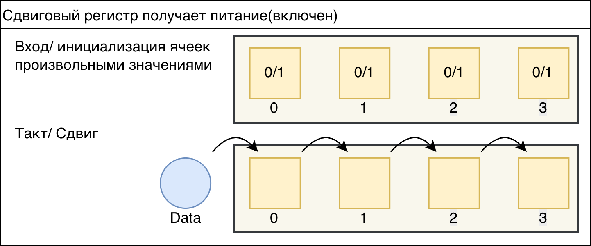

В редакторе Cyberiada IDE для сдвигового регистра существует отдельный компонент — именно
его и стоит использовать при создании программы.

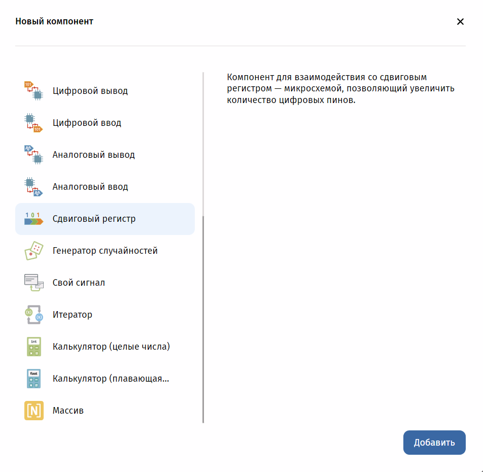

#### Сборка схемы на Arduino

Для сборки вам понадобятся следующие компоненты:

- микроконтроллер Arduino Uno;
- микропереключатель DM-03P (концевик) — 1 штука;
- сдвиговый регистр CD4015BE – 1 штука
- резистор около 10 кОм – 1 штука;
- резистор около 220 Ом – 4 штуки;
- светодиод – 4 штуки;
- провода папа-папа – 20 штук;
- макетная плата – 1 штука.

Для тестирования и отладки программы соберите следующую схему на макетной плате:

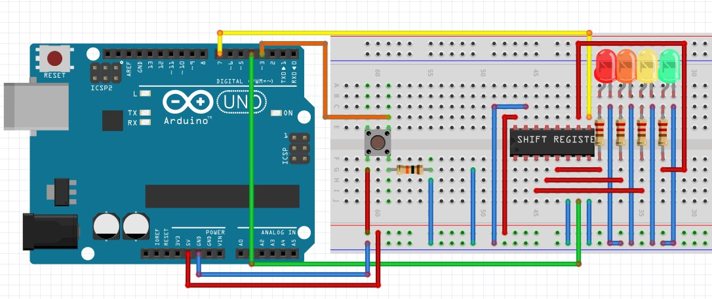

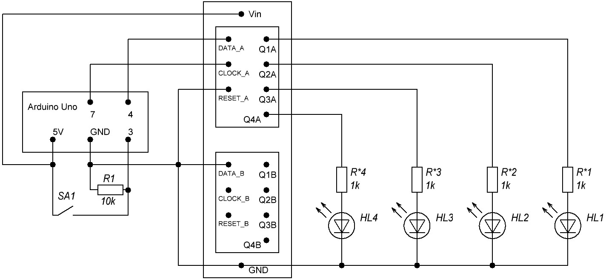

> **Вопрос:** Как можно нивелировать проблему дребезга? Какие модули в Cyberiada IDE
> помогают это осуществить?

Поскольку для преодоления дребезга нам необходимо дождаться четко установившегося значения
напряжения, необходима проверка изменения значения во времени. Для подобного мониторинга
можно использовать таймеры.

Теперь попробуйте создать тестовую программу в Cyberiada IDE самостоятельно. Рекомендуем
знакомиться с предложенным нами решением только после собственной попытки.

#### Решение для базовой программы

Откройте редактор «Cyberiada IDE» и создайте новый файл на платформе «Arduino
Uno». Добавьте в программу необходимые компоненты:

- Таймер — их понадобится два: долгий и короткий (рекомендуем добавить к каждому подпись,
  чтобы легко различать их в программе)
- Светодиод (достаточно лишь одного)
- Цифровой ввод
- Последовательный порт со скоростью передачи 9600
- Калькулятор (целые числа), далее в программе будет называться «Битовое поле»
- Сдвиговый регистр (вход — 4, такт — 7, строб — 0, порядок битов — первый бит)
- Свои события — «Битовое поле сдвинуто» и «Иниц. Завершена» (рекомендуем добавить к
  каждому подпись, чтобы легко различать их в программе)
  
Затем создайте в редакторе следующую программу, пройдя через следующие этапы.

##### Этап 1: Инициализация

Инициализируем последовательность в битовом поле:

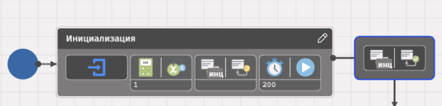

На вход в состояние «`Инициализация`» добавляем:

- компонент «`Битовое поле`» – действие «`Установить`» – значение «1»;
- компонент «`Долгий таймер`» – действие «`Старт`» – интервал 200 мс;
- компонент «`Иниц.Завершена`» - действие «`Вызов`».

По событию «`Вызов`» для компонента «`Иниц. Завершена`» реализуется переход в следующее
состояние.

##### Этап 2: Выключение светодиодов

Создаем состояние, в котором все светодиоды выключаются:

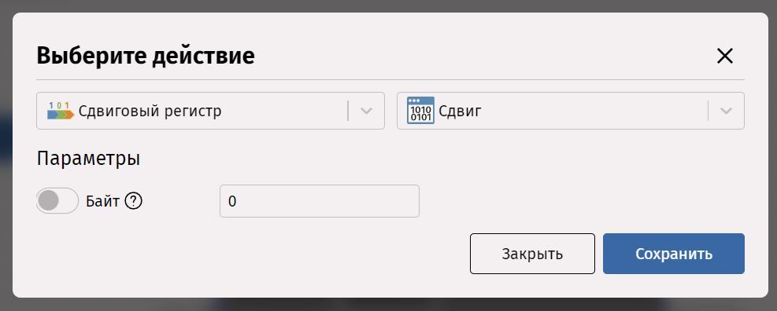

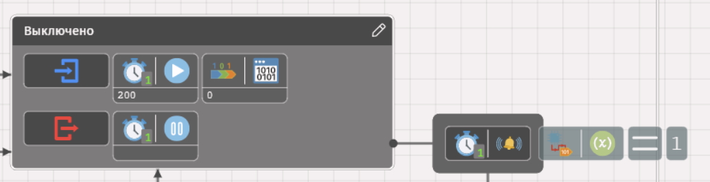

На вход в состояние «`Выключено`» добавляем:

- компонент «`Сдвиговый регистр`» – действие «`Сдвиг`» – параметр «0»;
- компонент «`Долгий таймер`» – действие «`Старт`» – интервал 200 мс.

На выходе из состояния добавляем:

- компонент «Долгий таймер» – действие «Отключить».

По событию «Тайм-аут» для компонента «Долгий таймер» с ограждающими условиями по уровню
напряжения на цифровом вводе (равен 1).

##### Этап 3: Фильтрующее состояние

Создаем первое фильтрующее состояние:

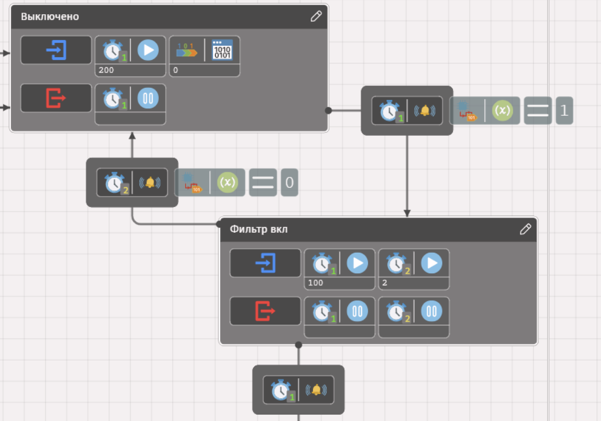

На вход в состояние «`Фильтр вкл`» добавляем:

- компонент «`Долгий таймер`» – действие «`Старт`» – интервал 100 мс;
- компонент «`Быстрый таймер`» – действие «`Старт`» – интервал 2 мс;

На выходе из состояния добавляем:

- компонент «`Долгий таймер`» – действие «`Отключить`»;
- компонент «`Быстрый таймер`» – действие «`Отключить`»;

По событию «`Тайм-аут`» для компонента «`Быстрый таймер`» с ограждающими условиями по уровню
напряжения на цифровом вводе (равен нулю) реализуется переход обратно в состояние
«`Выключено`».

По событию «`Тайм-аут`» для компонента «`Долгий таймер`» реализуется переход в следующее
состояние «`Включено`». Фактически, в этом состоянии «`Быстрый таймер`» используется для
мониторинга отпуска кнопки — раз в 2 мс идет проверка, разошлись ли контакты. Если
разошлись, то программа вернется в состояние «Выключено».

Если же «`Долгий таймер`» истечет успешно, то будет реализован переход к следующему
состоянию — «`Включено`».

##### Этап 4: Следующий светодиод

Создаем состояние, в котором зажигается следующий светодиод в цепи:

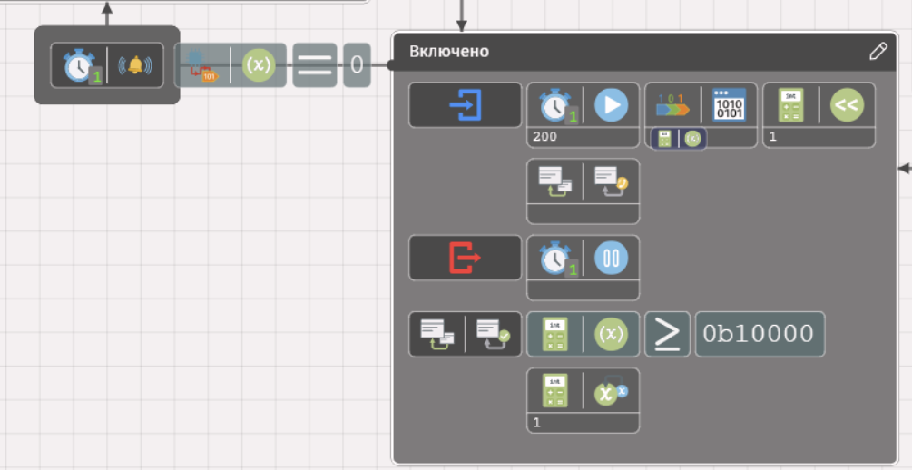

Управление сдвиговым регистром:

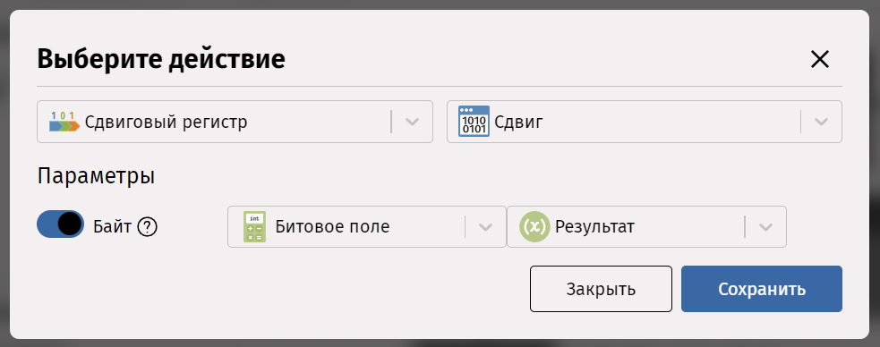

Сдвиг значения битового поля:

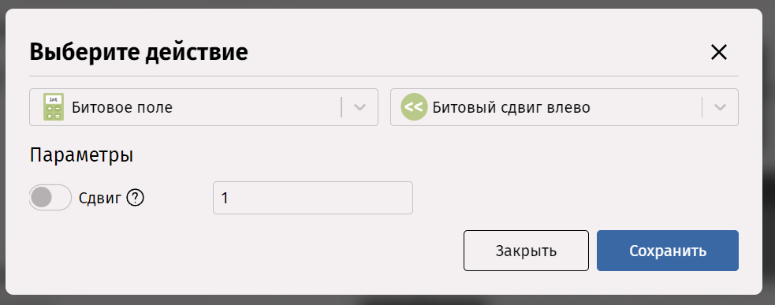

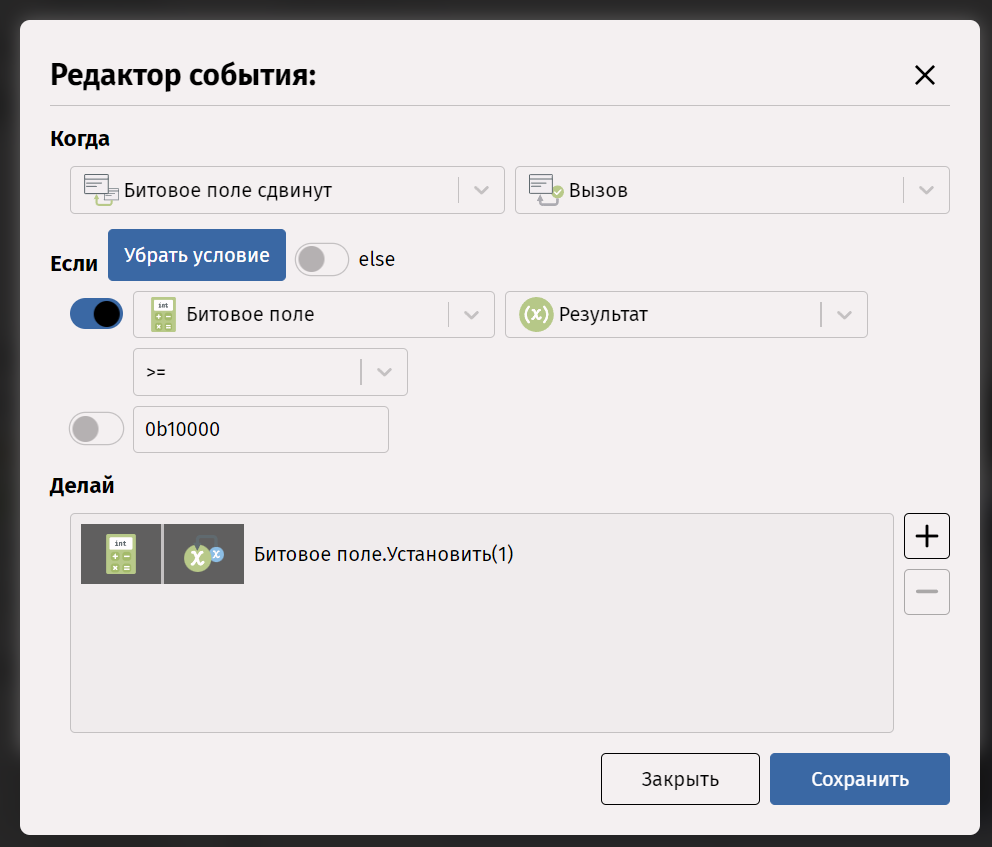

Промежуточный вид состояния:

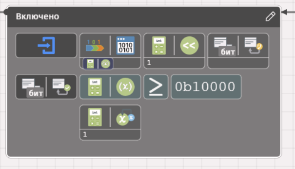

На вход в состояние «`Включено`» добавляем:

- компонент «`Долгий таймер`» – действие «`Старт`» – интервал
200 мс;
- компонент «`Сдвиговый регистр`» – действие «`Сдвиг`» – параметр от компонента «`Битовое
поле`» с атрибутом «`Результат`» — передаем текущую последовательность бит на сдвиговый
регистр, чтобы зажечь соответствующий светодиод;
- компонент «`Битовое поле`» - действие «`Битовый сдвиг влево`» - параметр «1» — меняем на
следующий светодиод; Компонент «`Битовое поле сдвинуто`» - действие «`Вызвать`».

По внутреннему событию «`Вызов`» для компонента «`Битовое поле сдвинуто`» проверяется
ограждающее условие с компонентном «`Битовое поле`», атрибутом «`Результат`» и параметром
«`>= 0b10000`». Если оно истинно, то битовое поле возвращается в исходное положение
(параметр «1»), соответствующее первому светодиоду. Ложность условия означает, что
последовательность бит еще не дошла до четвертого светодиода в цепи.

По событию «`Тайм-аут`» для компонента «`Долгий таймер`» проверяется ограждающее условие с
компонентном «`Цифровой ввод`», атрибутом «`Напряжение`» и параметром «0». Если условие
истинно, то реализуется переход в следующее состояние.

##### Этап 5: Втрое фильтрующее состяние

Создаем второе фильтрующее состояние:

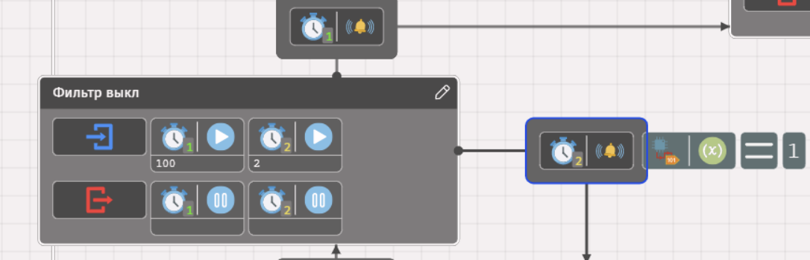

На вход в состояние «`Фильтр выкл`» добавляем:

- компонент «`Долгий 	таймер`» – действие «`Старт`» – интервал 100 мс;
- компонент «`Быстрый 	таймер`» – действие «`Старт`» – интервал 2 мс.

На выходе из состояния добавляем:

- компонент «`Долгий таймер`» – действие «`Отключить`»;
- компонент «`Быстрый таймер`» – действие «`Отключить`».

По событию «`Тайм-аут`» для компонента «`Быстрый таймер`» с ограждающими условиями по
уровню напряжения на цифровом вводе (равен единице) реализуется переход обратно в
состояние «`Включено`».

По событию «`Тайм-аут`» для компонента «`Долгий таймер`» реализуется переход в следующее
состояние «`Выключено`».

##### Этап 6: События перехода

Создаем события перехода:

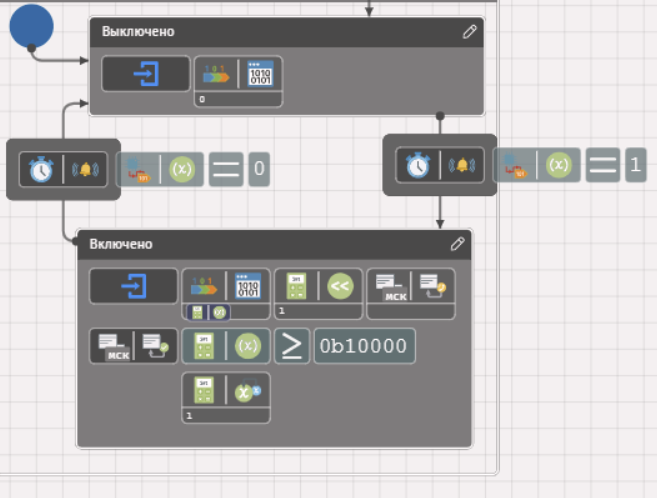

Переход между состояниями осуществляем по событию «`Тайм-аут`» с ограждающими условиями по
уровню напряжения на цифровом вводе.

На переходе «`Выключено`» → «`Включено`»: напряжение должно быть равно нулю (`LOW`), а на
обратном — единице (`HIGH`).

##### Этап 7: Обрамляющее состояние

Добавляем обрамляющее состояние для мониторинга изменения переменной:

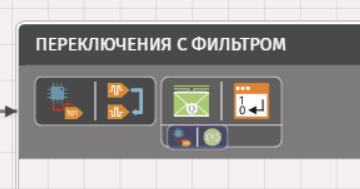

Добавление действия записи в последовательный порт:

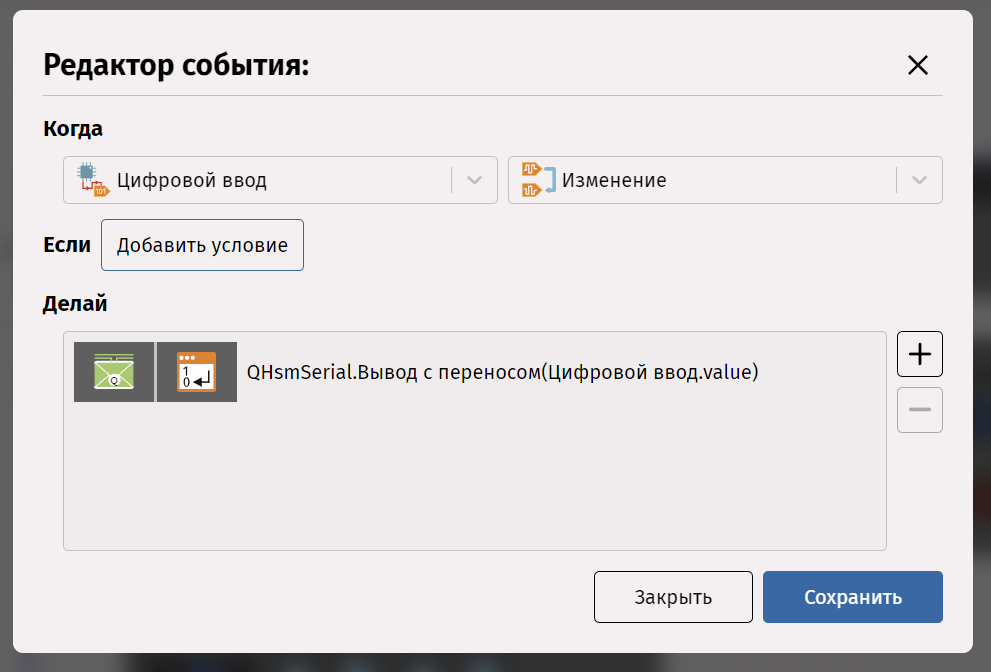

Параметр записи в порт для вывода переменной:

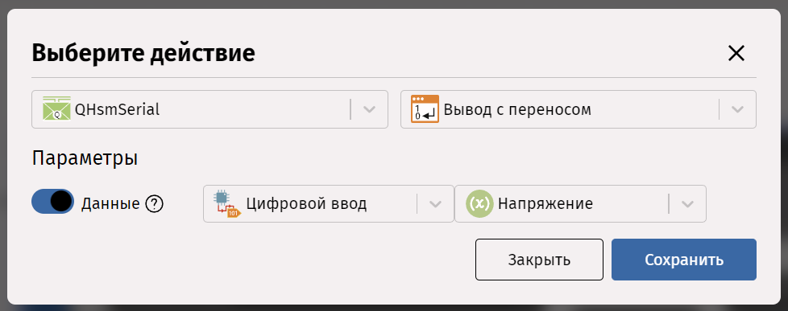

В родительском состоянии «Переключения с фильтром» по событию «`Изменение`» для компонента
«`Цифровой ввод`» добавляем:

- компонент «`Последовательный порт`» – действие «`Вывод с переносом`» – параметр
«`Напряжение`» от компонента «`Цифровой ввод`».

Это обновление переменной нужно нам для выведение актуального напряжения в монитор порта.

##### Итог

Финальная диаграмма для «антидребезгового» фильтра:

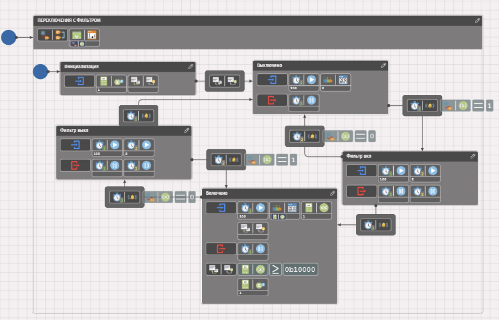

## Подведение итогов

На этом занятии мы не просто изучали ПРИМС, а использовали его в качестве инструмента для
управления реальными устройствами. Для соотнесения физической реальности и цифровой
программы вы познакомились с различиями между аналоговым и цифровым вводом, а также
поработали с фоторезистором, концевиком и сдвиговом регистром.

Впереди нас ждет погружение в два других языка, с помощью которых также можно
программировать микроконтроллеры — языки С и С++.

## Дополнительные материалы

- 
  
