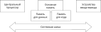
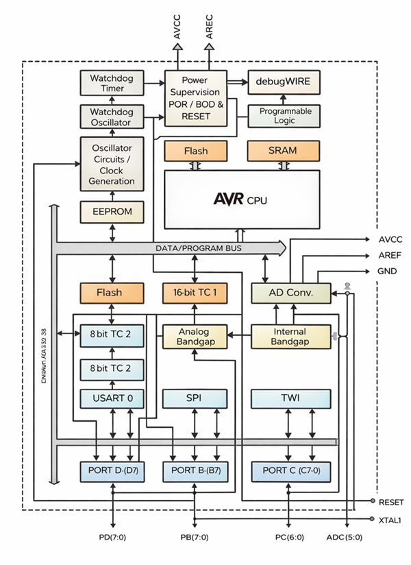
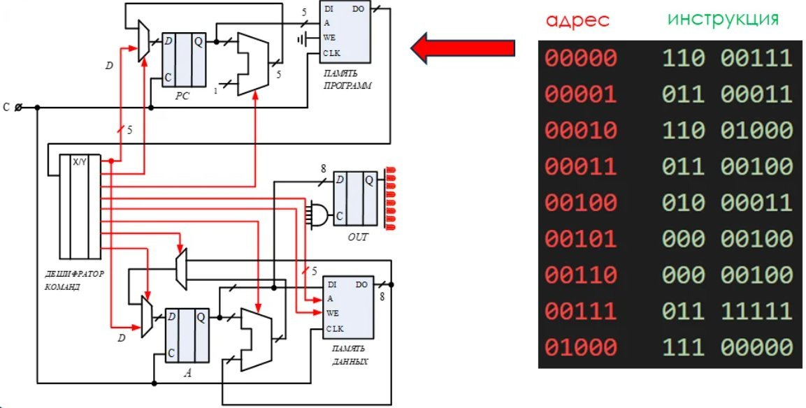
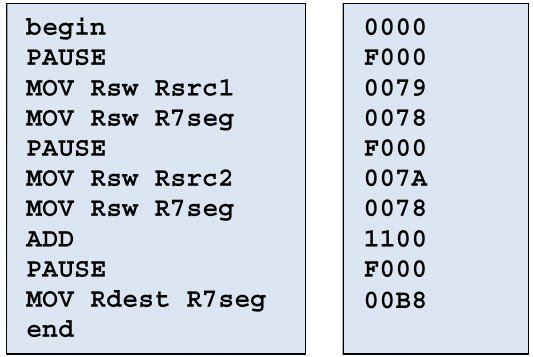
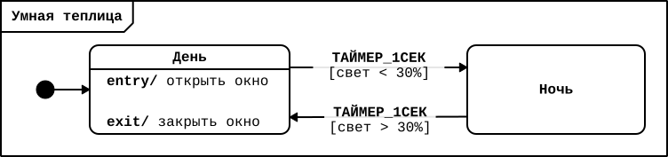
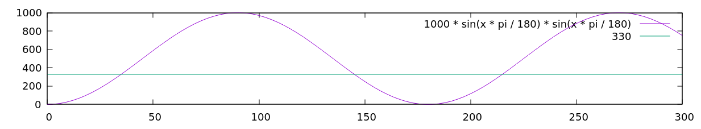
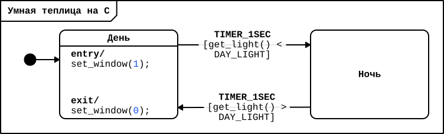
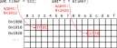
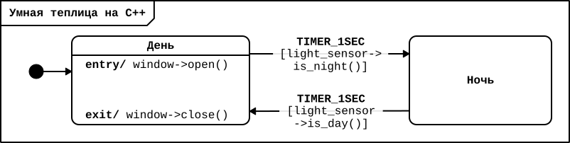

[Введение в программирование машин состояний (ПРИМС) в Arduino]: #
[Авторы курса: Алексей Федосеев aleksey@fedoseev.net и Анита Ходова anita-hodova@inbox.ru]: #
[Текст распространяется под лицензией GNU Free Documentation License (версия 1.3)]: #

# 6. Устройство микроконтроллера. Язык программирования С++

Данное занятие посвящено более глубокому знакомству с устройством цифровой электроники и
программируемых микроконтроллеров на примере Adruino. В ходе занятия вы познакомитесь с
системными языками программирования C и C++, а на следующем занятии перейдете к
программированию контроллера Arduino.

Для погружения в устройство контроллера Arduino и изучение основ языка С++ можно
ограничиться только с теоретической частью занятия. Рекомендуем также выполнить
практические упражнения, используя свободное ПО – операционную систему Linux и компиляторы
GNU в командной строке.

### 6.1. Что внутри микроконтроллера

На первом занятии модуля «Язык машин состояний (ПРИМС)» мы кратко говорили о цифровой
электронике и устройстве компьютера. Напомним, что каждый контроллер строится на той же
архитектуре, что и любой современный компьютер:



В основе любого контроллера лежит шина, по которой передаются управляющие цифровые
сигналы. Шина связывает:

1.  главный цифровой автомат – **процессор** (или CPU = Central Processing Unit,
    *центральное обрабатывающее устройство*), который выполняет программу;
2.  **память**; в контроллерах часто используют так называемую *гарвардскую архитектуру*,
    в которой память для загруженной программы (кода) и память для оперативных данных
    (переменных) физически разделена и часто устроена физически по-разному;
3.  внешние устройства, которые подключаются через **порты ввода-вывода**.

Давайте чуть подробнее рассмотрим схему устройства простого контроллера, такого как
ATMega328P, который составляет основу контроллерной платы Arduino Uno:



Мы видим на схеме пунктирные контуры микросхемы и доступные по периметру выходы-ножки. Но
куда интереснее внутреннее устройство микроконтроллера. На этой схеме видна шина,
обозначенная серым цветом и соединяющая процессор (AVR CPU) с обозначенной оранжевым
цветом памятью – оперативной (SRAM) и постоянной флеш-памятью (Flash), – а также рядом
дополнительных блоков, такими как генераторы тактовой частоты, преобразователь питания и
т.п.

Контроллер ATMega328P имеет следующие важные для инженера или программиста параметры:

- **разрядность процессора** – 8 бит, т.е. процессор оперирует 8-битными командами и
  числами, собирая более сложные вычисления из элементарных;
- **тактовая частота** – до 20МГц, то есть *20 миллионов* операций в секунду;
- **объем оперативной памяти** – 2 Кб (2048 байт), так мало ячеек памяти доступно для
  работы программы (используемых переменных и пр.);
- **объем флеш-памяти** - 32 Кб (32 768 байт), этой памяти чуть больше, в ней хранится
  загружаемая программа с исходными параметрами;
- **порты ввода-вывода** – 23 порта доступны для подключения устройств;
- **аналого-цифровой преобразователь** (АЦП) – контроллер имеет 6 входов на которых
  преобразует поступающий аналоговый сигнал (синусоиду) в последовательность цифровых
  величин, при этом разрешающая способность преобразователя – 10 двоичных разрядов,
  т.е. аналоговый сигнал будет превращаться в целые числа в диапазоне от 0 до 1023;
- **питание** – поддерживает диапазон от 1.8 до 5.5 В; нам важно, что на портах
  ввода-вывода мы работаем с уровнем питания до 5 В, а высокий сигнал (`HIGH`) на
  входе/выходе цифрового порта имеет значение около 5 вольт.

> **Вопрос:** В вашей программе строковый буфер из 60 байт, 10 числовых переменных по 2
> байта каждая, а также набор из 250 чисел, каждый длиной 4 байта. Влезут ли эти данные в
> память контроллера Arduino Uno?

Схема устройства контроллера выглядит на первый взгляд сложно, но работает контроллер
довольно примитивно. Если мы заглянем внутрь центрального процессора, то увидим, что в
каждый момент времени (в электронике это называется *тактом*, происходит он с тактовой
частотой, см. выше) на вход центрального процессора подается и дешифруется очередная
инструкция, именуемая *машинным кодом*. Отдельные 0 и 1, входящие в этот код, инициируют
различные действия внутри процессора, а главное – меняют его *состояние*. Например, в
результате одной инструкции процессор передаст по шине адрес и будет ожидать на шине
значения ячейки памяти по этому адресу. В результате другой инструкции процессор будет
складывать два числа во внутренних ячейках памяти и т.д.

На рисунке показано, как машинный код декодируется внутри контроллера и управляет его
работой:



Получается, что контроллер – это всего лишь сложная машина состояний, которая получает на
вход коды инструкций, которые, как события в ПРИМС, могут приводить к смене текущего
состояния контроллера или не приводить.

Программистам неудобно работать с машинными кодами, поэтому были придуманы языки
программирования. Самые примитивные языки – языки ассемблера – представляют собой просто
буквенные обозначения для машинных кодов:



Слева написана последовательность машинных команд с операндами, а справа их машинный код в
16-ричной записи. В 8-разрядных процессорах с архитектурой RISC каждый код будет занимать
2 байта (1 байта не хватит для кодирования всех вариантов команд с операндами). Кстати,
если вы хотите научиться программировать на ассемблере, рекомендуем вам замечательную игру
[«Human Resource Machine»](https://tomorrowcorporation.com/humanresourcemachine),
доступную на Steam.

Программы на ассемблере писать долго и сложно. Каждое действие в программе приходится
разбивать на элементарные инструкции вроде `MOV` («положи число в ячейку памяти»), `JMP`
(«перейти по адресу, взятому в ячейке памяти») и т.д. Поэтому программисты начали
использовать языки высокого уровня, позволяющие уделять больше внимания логике работы
программы, а затем перешли и на визуальные языки, в которых код генерируется из
диаграмм. Далее мы с вами познакомимся с наиболее популярными языками для программирования
контроллеров – C и C++.

### 6.2. Языки программирования высокого уровня. Язык программирования C

Языки программирования высокого уровня, такие как C или Python, представляют собой
специально конструируемые предложения на искусственном языке, отдаленно напоминающем
английский. Пример программы на языке С, которая всего лишь выводит на экран строку
`«Hello, World!»` представлен ниже:

```c
#include <stdio.h>

int main()
{
    printf("Hello, world!\n");
    return 0;
}
```

Язык С был создан во второй половине XX века для программирования компьютеров, созданных
на разных центральных процессорах и архитектурах. Идея этого языка была в том, чтобы можно
было написать программу один раз, а затем без изменений переиспользовать для множества
компьютеров с разными архитектурами и соответствующими машинными кодами. Поэтому, написав
код на С для Arduino, вы сможете использовать одну ту же программу вне зависимости от
того, какой именно контроллер стоит на вашей плате. На языке C было создано множество
программ и операционных систем, наиболее известные из которых UNIX и Linux, чей исходный
код на C может изучить каждый.

Тиражируемость программ требует особого способа работы – при написании программы на C
нужно пройти несколько этапов:


Сперва программист *создает текст программы* (код) и сохраняет на диск исходные
тексты. Программа может состоять из нескольких модулей, расположенных в различных
файлах. Традиционно для языка C используются файлы с расширением `.h` (заголовки) и `.c`
(тексты программ). Помимо файлов с кодом могут потребоваться файлы настроек или сборочные
инструкции (например, `Makefile` или конфигурационные файлы `cmake`).

Затем программисту необходимо *скомпилировать программу*. То есть превратить исходный код
на C в набор машинных кодов для выбранной аппаратной платформы. То есть одну и ту же
программу для Arduino, для смартфона, для ПК под управлением ОС Windows и ОС Linux
придется компилировать отдельно. В ходе компиляции может происходить дополнительная
генерация кода по заданным правилам, а также добавление к программе скомпилированного
ранее кода нужных библиотек (т.н. линковка). В результате получится исполняемый файл,
который можно запускать.

В случае программирования контроллеров обычно присутствует еще один промежуточный этап
перед использованием программы – загрузка *прошивки* в контроллер. Прошивка представляет
собой специально упакованный исполняемый код, который автоматически загружается и начинает
исполняться при включении контроллера.

Далее мы попробуем разобраться подробнее с языком программирования C, написать свою первую
программу, скомпилировать и запустить ее.

### 6.3. Пример программы на языке C

В языке C есть все элементы популярных языков высокого уровня. Вы можете описывать
переменные и выполнять математические операции, можете управлять выполнением программы с
помощью условий и циклов, структурировать программу через вызываемые функции и
модули. Разберем простой пример программы, характерной для программирования контроллеров.

> **Симулятор умной теплицы**
>
> Напишите программу на C, которая будет симулировать управление умной теплицей, открывая
> и закрывая окна в зависимости от времени суток.

Представим, что программа на языке С должна управлять умной теплицей и будет открывать и
закрывать окна в зависимости от времени суток: утром окна должны открываться, а на ночь –
закрываться. День и ночь будем определять по значению датчика освещенности (см. предыдущее
занятие). Диаграмма машины состояний для управления теплицей представлена на рисунке:



Попробуем написать и исполнить программу на C пока без реального контроллера, исполняя
программу в командной строке. Сам код программы можно будет писать в любом удобном
текстовом редакторе. Мы начнем написание программы с двух функций, заменяющих
взаимодействие с реальным оборудованием теплицы:

```c
#include <stdio.h>
#include <math.h>

#define DAY_LIGHT 330
int time = 0;

/* функция виртуально открывает и закрывает окно */
void set_window(int open)
{
    if (open) {
        printf("Time %d: Window opened!\n", time);
    } else {
        printf("Time %d: Window closed!\n", time);
    }
}

/* функция возвращает виртуальный уровень освещенности */
int get_light()
{
    float s = sin((float)time * M_PI / 180.0);
    return (int)(1000 * s * s);
}
```

В самом начале программы мы подключаем необходимые для работы библиотеки – стандартного
ввода/вывода текста и математики.

Перед объявлением функции задаются константа `DAY_LIGHT` и целочисленная переменная
`time`. Они пригодятся позже. Также в программе можно увидеть комментарии – они выделяются
символами `/* … */` и содержат пояснения к коду.

Первая функция принимает на вход аргумент и всего лишь выводит текстовые сообщения. Вторая
функция не принимает аргумента, но возвращает целое число. В C функция определяется
следующим образом:

```c
тип_возвращаемого_значения имя_функции(тип1 аргумент1, ...)
{
    выражения внутри функции, разделяемые ;
    [return возвращаемое_значение;]
}
```

У каждой функции есть имя, оно должно быть уникально в рамках модуля. Функции должны
возвращать значения (да, как в математике), и при определении функции указывается тип
возвращаемого функцией значения. Результат работы функции в этом случае возвращается с
помощью оператора `return`, исполнение функции в этот момент закончится. Исключение – если
функция определена с пустым типом (`void`), то она не будет возвращать конкретное
значение.

Функции могут иметь аргументы, тогда в определении функции они перечисляются вместе с
типами через запятую. У функции может не быть аргументов, тогда скобки остаются пустыми.

Функции нужны, чтобы выполнять какие-то действия, которые описываются в теле функции,
ограниченном символами фигурных скобок (`{}`). Каждое из действий описывается выражением,
которое должно заканчиваться знаком точки с запятой (`;`).

Функции могут вызывать функции, в этом случае за именем функции указываются ее аргументы в
скобках через запятую.

В примере выше первая функция вызывает стандартную функцию `printf`, которая печатает
строку, указанную в скобках. В языке C строки указываются в двойных кавычках. В конце
строки указан специальный символ `\n`, который означает перевести курсор на новую
строку. В функцию `printf` вторым параметром передается переменная `time`, значение
которой подменяет специальный код `%d`, указанный перед этим в строке. Таким образом,
сообщение об открытии или закрытии окна будет сопровождаться текущим временем.

Функция `set_window `устроена так, что печатаемая строка зависит от ее аргумента – если в
качестве аргумента `open` передать `1` или любое ненулевое значение, то будет напечатано,
что окно открыто, иначе – закрыто. В С условное выражение `if` работает так, что нулевое
значение аргумента считается `ЛОЖЬЮ`, а любое ненулевое – `ИСТИНОЙ`.

Вторая функция интереснее – она возвращает результат вычислений. Вычисление производится в
два шага. На первом шаге переменной `s`, содержащей дробное число, присваивается результат
вычислений синуса (вызов стандартной функции `sin`) от глобальной переменной `time`,
переведенной из градусов в радианы (т.е. умноженное на константу пи и разделенное на
`180`). Затем полученное значение возводится в квадрат и умножается на `1000`, после чего
приводится к целому числу и возвращается как результат функции.

На графике ниже показано, какие значения будет принимать эта функция в зависимости от
значений переменной `time`. Эта функция будет колебаться в диапазоне от `0` до `1000`, при
этом максимум будет приходиться на значения `90`, `270` и т.д.:



Фактически с помощью этой функции мы создали симуляцию колебания освещения, что позволит
проверить работу программы, если переменная `time` будет последовательно расти. Сравнивая
результат функции `get_light()` с константой `DAY_LIGHT `можно определять наступление дня
и ночи.

> **Вопрос:** Изучите график освещенности, симулируемый в программе. Сколько раз машина
> состояний перейдет из состояния день в состояние ночь за 300 секунд работы программы?

Если мы перерисуем диаграмму машины состояний с использованием написанных функций, получится следующее:



Прежде чем «оживить» эту машину состояний разберемся с еще одной очень важной концепцией
языков C и C++, которая одновременно делает эти языки очень удобными для программирование
контроллеров и называют их проклятием. Речь пойдет об *указателях*, то есть возможности
хранить в памяти адрес других ячеек памяти и обращаться к ним.

Память компьютера или контроллера устроена как большой набор ячеек, в каждой из которых
хранится отдельный байт информации. Каждая такая ячейка имеет свой порядковый номер или
*адрес*. На рисунке ниже память изображена строками по 16 байт, каждая ячейка имеет адрес
из 2 байт, записанный в шестнадцатеричной записи.



Когда вы объявляете переменную в программе, компилятор будет при каждом использовании
переменной подставлять адрес, по которому это число или строка находятся. К примеру,
переменная `timer` будет иметь адрес `0x1012` (кстати, в языке C именно так можно записать
шестнадцатеричное число – с префиксом `0x`). Так, программисту не нужно думать над тем,
где именно загрузчик или операционная система расположит переменную.

В памяти микроконтроллера ATMega328P, используемого в Arduino Uno, данные хранятся от
меньших байтов к большим (т.н. порядок little-endian), поэтому число `511` (или `1ff` в
шестнадцатеричном виде) будет записано как 2 последовательных байта `ff` и `01`.

Но что, если вы захотите сохранить сам адрес в переменной? Это возможно, ведь адрес –
всего лишь еще одно число. Более того, можно затем запрашивать данные, которые находятся
по этому адресу и совершать с адресом любые арифметические операции. Такая переменная,
которая хранит адрес другой переменной, называется *указателем*. На рисунке выше
переменная` t` хранит адрес `0x1012` другой переменной как число. Благодаря специальному
объявлению (`int*`) компилятор знает, что это не просто целое число в памяти, а указатель
на переменную с целым числом в памяти.

В C и C++ для работы с указателями используются следующие выражения:

| **Способ работы с указателем** | **Запись на языке С/С++** | **Пример** |
|----|----|----|
| Объявление переменной-указателя | Знак `*` после имени типа при объявлении переменной | `int* t`; |
| Инициализация несуществующим адресом | Присвоить указателю константу `NULL`. Обычно так делают для временно неиспользуемых указателей | `int* t = NULL;` |
| Получение адреса другой переменной | Знак `&` перед именем переменной возвращает ее адрес в памяти | `t = &time`; |
| Получение содержимого ячейки памяти, на которую указывает указатель | Знак `*` перед именем указателя возвращает значение памяти по этому адресу или позволяет записать новое значение по адресу | `count = *t;`<br>`*t = 20;` |

Сложность работы с указателями состоит в том, что обращение по неправильному адресу может
вызвать критическую ошибку. К примеру, если выполнить следующий код:

```c
int *t = NULL;
...
int a = *t;
```

Компилятор в этом случаем может не выдать ошибки при сборке программы, тогда как при ее
исполнении на выражении `*t` программа внезапно прекратит исполнение или, что может быть
еще хуже, переменная `a` получит неопределенное значение.

> **Вопрос:** Сколько байт понадобится для хранения в памяти целого десятичного числа
> 60200? Как это число будет последовательно записано в памяти контроллера Arduino?

Где чаще всего используются указатели? Представим, что нам нужно не просто передать
аргумент в функцию, но и изменить значение переданной переменной. Сравните два варианта
определения и вызова функции:

```c
/* 1: определение функции с числовым аргументом */
void next_number(int a)
{
    a++;
}
/* вызов функции */
int x = 5;
next_number(x);
/* после вызова будет x == 5 */
/* 2: определение функции с аргументом-указателем на число */
void next_number_ptr(int* a)
{
    (*a)++;
}
/* вызов функции */
int x = 5;
next_number(&x);
/* после вызова будет x == 6 */
```

В первой функции аргумент в виде целочисленной переменной будет увеличен на 1. Но это не
повлияет на значение передаваемой переменной `x`, поскольку при вызове функции ее значение
будет скопировано в переменную `a`. Если же воспользоваться указателем, как втором
примере, в функцию будет скопирован адрес, поэтому можно изменять непосредственно
содержимое ячеек памяти, в которой находится переменная `x`.

Теперь осталось только реализовать главный цикл управления машиной состояний. Добавим вот
такую функцию `main`:

```c
/* продолжение программы */
#include <unistd.h>

/* увеличиваем счётчик и ждем секунду */
void next_second(int* time)
{
	(*time)++;
	sleep(1);
}

#define STATE_INIT  0
#define STATE_DAY   1
#define STATE_NIGHT 2

int main(int argc, char** argv)
{
    int state = STATE_INIT;

    time = 0;
    while (time < 300) {
        /* этот цикл будет выполняться раз в секунду */
        switch (state) {
        case STATE_INIT:
            state = STATE_DAY;
            set_window(1);
            break;
        case STATE_DAY:
            if (get_light() < DAY_LIGHT) {
                set_window(0);
                state = STATE_NIGHT;
            }
            break;
        case STATE_NIGHT:
            if (get_light() > DAY_LIGHT) {
                state = STATE_DAY;
                set_window(1);
            }
            break;
        default:
            printf("Unknown state %d!\n", state);
            return 1;
        }
        next_second(&time);
    }
    return 0;
}
```

В каждой программе на C должна быть функция `main` – с нее начинается выполнение
программы. В этой функции мы реализовали главный цикл while, который будет выполняться,
пока значение переменной `time` не достигнет `300`.

В конце цикла мы вызываем специальную функцию `next_second`, которая делает паузу на `1`
секунду и увеличивает при этом переменную `time, `передаваемую по указателю, на
`1`. Программа должна проработать всего `300` секунд (если вы не прервете ее исполнение
ранее нажатием `Ctrl+C`). В функцию main передаются из операционной системы аргументы – их
число и массив строк аргументах передаются в переменные `argc` и `argv`. Но в данной
программе они нам не понадобятся.

В теле цикла задан оператор выбора `switch`, который в зависимости от значения переменной
`state` выполняет действия и проверки. Видно, что для каждого из состояний делаются
проверки ограждающих условий и при их срабатывании – смена состояний вместе с действиями
на входе и выходе.

Константу состояния `STATE_INIT` пришлось добавить для того, чтобы реализовать вход в
начальное состояние на диаграмме.

Далее мы попробуем скомпилировать и запустить эту программу в командной строке.

### 6.4. Работа с компилятором в командной строке

Попробуем скомпилировать программу, запуская компилятор в командной строке. Для работы в
командной строке удобно использовать операционную систему Linux, также подойдет Mac OS X
или симулятор WSL в Windows. Иначе для сборки программы придется устанавливать среду
разработки, такую как VS Code.

Допустим, вы сохранили программу в файл под именем `cleverfarm.c`. Тогда скомпилировать и
слинковать ее, получая исполняемый файл, можно следующей командой:

```sh
$ gcc -Wall -o cleverfarm cleverfarm.c -lm
```

Команда `gcc` вызывает компилятор GNU C Compiler – пожалуй самый распространенный сейчас в
мире компилятор C, входящий в набор свободного программного обеспечения GNU и операционную
систему Linux. Команде передаются несколько параметров:

- `-Wall` говорит компилятору проверять код тщательнее и выводить предупреждения о
  возможных ошибках и некорректном коде;
- `-o cleverfarm` указывает на имя будущего исполняемого файла;
- `cleverfarm.c` задает имя компилируемого файла;
- `-lm` подключает математическую библиотеку, это необходимо, поскольку мы воспользовались
  функцией `sin` из нее.

В результате запуска мы получим предупреждения и сообщения об ошибке, но можем не получить
никакого сообщения. Последнее значит, что все хорошо: в UNIX и Linux принято, что
программы не сообщают ничего лишнего, поэтому отсутствие вывода как правило значит успех.

Типичное сообщение компилятора об ошибке выглядят так:

```text
cleverfarm.c: In function ‘main’:
cleverfarm.c:40:26: error: expected ‘;’ before ‘break’
   40 |         	set_window(1)
      |                      	^
      |                      	;
   41 |         	break;
      |         	~~~~~
```

В данном случае программист забыл поставить `;` после выражения на строке 40 программы
`cleverfarm.c`. Это легко исправить.

Когда все удалось, программу можно запустить с помощью команды:

```sh
$ ./cleverfarm
```

Какой вывод у вас получился? С чего он начинается?

Вывод программы выглядит так:

```text
Time 0: Window opened!
Time 1: Window closed!
Time 36: Window opened!
Time 145: Window closed!
Time 216: Window opened!
```

Видно, что программа начинается с пары на первый взгляд странных сообщений, а затем
выходит на базовую последовательную логику работы – работает правильно в соответствии с
графиком функции, который мы показывали выше.

> **Вопрос:** Как вы думаете, почему у программы получился такой вывод и как он связан с
> исходной предложенной диаграммой машины состояний?

Мы познакомились с самыми простыми возможностями языка C. На самом деле это очень мощный
язык, позволяющий создавать быстрые и элегантные программы. При этом язык C один из самых
сложных для написания программ и их отладки – одной небольшой ошибки, скажем, обращения по
несуществующему адресу в памяти, будет достаточно для того, чтобы программа вызывала
системное исключение и останавливала свое выполнения. Поэтому на смену языку C при
написании прикладных программ стали приходить другие популярные языки, такие как С++.

### 6.5. Язык программирования С++. Объектно-ориентированное программирование

Язык С++ был предложен как усовершенствование С при сохранении всей его гибкости и других
достоинств. В название языка С++ вложена любимая программистами игра слов – ведь оператор
`++` в языке С означает «увеличить значение переменной на 1». Одним из наиболее важных
расширений в языке C++ стала поддержка *объектно-ориентированного программирования*
(ООП). Этот популярный стиль программирования предполагает задание *объектов* и *классов*
объектов, которые хранят всю необходимую информацию о себе, изменяются путем вызова
специальных функций-действий, таким образом взаимодействуют друг с другом и поддерживают
внутреннее состояние. Благодаря ООП программисты могут представить весь программируемый
мир в виде объектов и их взаимодействий.

Попробуем «перевести» нашу диаграмму машины состояний теплицы на язык ООП, реализованный в
С++:



Что изменилось в этой диаграмме? Управление окном и получение информации от сенсора теперь
«упаковано» в вызовы функций у одноименных объектов `window` и `light_sensor`. В С++ вы
можете вызывать заранее определенные функции (или, как они называются в С++, *методы*
классов) у объектов через символ точки (`.`) и стрелки (`->`), если мы вызываем через
указатель на объект.

Теперь создадим новую программу уже на С++, которая будет реализовывать тот же
функционал. Сперва напишем первую часть программы с переопределением функций умной
теплицы:

```cpp
#include <cstdio>
#include <cmath>

// класс управления окном
class Window {
public:
    Window(const int* t):
        time(t)
    {
    }

    void open()
    {
        printf("Time %d: Window opened!\n", *time);
    }

    void close()
    {
        printf("Time %d: Window closed!\n", *time);
    }
    
private:
    const int* time;
};

// класс датчика освещенности
class LightSensor {
public:
    const int DAY_LIGHT = 330;

    LightSensor(const int* t):
        time(t)
    {
    }
    
    bool is_day()
    {
        return get_level() > DAY_LIGHT;
    }
    bool is_night()
    {
        return get_level() < DAY_LIGHT;
    }

private:
    int get_level()
    {
        float s = sin(float(*time) * M_PI / 180.0);
        return int(1000 * s * s);
    }
    const int* time;
};
```

Разберем отличия этой программы от программы на С.

В начале программы также вызываются нужные библиотеки – стандартного ввода и математики, в
C++ стандартные библиотеки названы несколько иначе. Еще можно заменить, что в С++ возможны
однострочные комментарии, обозначаемые двумя символами косой черты `//`.

Перед использованием объектов в С++ нужно сперва определить класс объектов, фактически,
задать свой сложный тип данных с помощью слова `class` с именем класса. Класс может
содержать внутренние константы и переменные, а также функции или методы, внутри которых
можно обращаться не только к аргументам, но и к описанным в классе константам и
переменным.

Описание первого класса `Window` начинается со специальной функции, имя которой совпадает
с именем класса. Это конструктор, эта функция будет вызвана при инициализации объекта. В
данном случае конструктор локально сохраняет *указатель* на переменную, содержащую текущее
время. В С++, как в C указатели обозначаются символом звездочки (`*`) после имени типа и
используются для работы с переменными, расположенными непосредственно в памяти, а не с их
временными копиями. Служебное слово `const` показывает, что объекты класса `Window` будут
использовать данные по указателю только для чтения, если же программист по ошибке
попробует их поменять, произойдет ошибка компиляции.

В записи конструктора может использоваться специальная форма инициализации собственных
переменных объекта класса: перечисление инициализации переменных через запятую после имени
конструктора, скобок с аргументами и символа двоеточия `: time(t)`.

В C++ вводится отдельный тип для логических переменных – `bool`, который может принимать
значения `false` или `true` и, конечно, использоваться в условиях операторов `if` или
`while`.

В описании класса С++ можно задать области видимости переменных и методов. К переменным и
методам после `public:` можно обращаться из других объектов и функций. Напротив, все, что
указывается после `private:` может использоваться только внутри методов класса. Так,
вычисление уровня освещения было перенесено в приватный метод, который уже вызывается в
публичных и доступных извне методах `is_day()` и `is_night()`.

Осталось реализовать на языке С++ управление машиной состояний и старт программы:

```cpp
// продолжение программы

const int STATE_INIT = 0;
const int STATE_DAY = 1;
const int STATE_NIGHT = 2;

// класс машины состояний
class StateMachine {
public:
	StateMachine(const int* t, Window* w, LightSensor* ls):
    	state(STATE_INIT), time(t), window(w), light_sensor(ls)
	{
	}
    
	void step_sec()
	{
    	    switch (state) {
         case STATE_INIT:
        	   set_state(STATE_DAY);
        	   window->open();
        	   break;
    	    case STATE_DAY:
        	   if (light_sensor->is_night()) {
                 window->close();
                 set_state(STATE_NIGHT);
        	   }
             break;
    	    case STATE_NIGHT:
             if (light_sensor->is_day()) {
                 set_state(STATE_DAY);
                 window->open();
             }
             break;
    	    default:
             throw "Unknown state!";
   	    }
	}
    
private:

	void set_state(int s) { state = s; }

	int state;
	const int* time;
	Window* window;
	LightSensor* light_sensor;
};

#include <unistd.h>

int main(int argc, char** argv)
{
    int time = 0;
    Window window(&time);
    LightSensor sensor(&time);
    StateMachine sm(&time, &window, &sensor);
    
    while (time < 300) {
        // этот цикл будет выполняться раз в секунду
        try {
            sm.step_sec();
        } catch(const char* e) {
            printf("Ошибка в программе: %s\n", e);
            return 1;
        }
        sleep(1);
        time++;
    }
    return 0;
}
```

В уже привычное нам описание класса – для машины состояний `StateMachine` – был перенесен
код управления машиной состояний. Из интересных нововведений здесь используется
конструкция `throw` – это способ аккуратной обработки ошибок в С++, который называется
исключениями. В любой момент программа может «выбрость» исключение с помощью оператора
`throw` вместе с каким-нибудь аргументом. Это похоже на события в машине состояний,
которые могут быть перехвачены и обработаны на каких-то более верхних уровнях. При этом
выполнение программе в месте выбрасывания исключения прекращается. Обрабатывается
исключение далее в коде `try { ... } catch(...) { ... }`.

В программах на C++ также используется функция `main`. В данном случае функция `main`
содержит объявление переменной `time` с глобальным временем в секундах, объявление объектов
классов окна, датчика освещения и машины состояний, а также базовый цикл выполнения
программы.

Попробуем скомпилировать программу, запуская компилятор С++ в командной строке. Допустим,
вы сохранили программу в файл под именем `cleverfarm.cpp`. Тогда скомпилировать и
слинковать ее, получая исполняемый файл, можно следующей командой:

```sh
$ g++ -Wall -o cleverfarm++ cleverfarm.cpp
```

Команда `g++` вызывает компилятор GNU C++ Compiler, входящий в набор свободного
программного обеспечения GNU и операционную систему Linux. Команде передаются несколько
параметров:

- `-Wall` говорит компилятору проверять код тщательнее и выводить предупреждения о
  возможных ошибках и некорректном коде;
- `-o cleverfarm++` указывает на имя будущего исполняемого файла;
- `cleverfarm.cpp` задает имя компилируемого файла.

В результате запуска мы также можем получить предупреждения и сообщения об ошибке, но
можем не получить никакого сообщения, если ошибок не было. Теперь новую программу можно
запустить с помощью команды:

Эта программа производит точно такой же вывод, что и программа на С, что мы и ожидали.

> **Вопрос:** Представьте, что вы должны запрограммировать на C++ движение робота по
> складу. Какие объекты и классы объектов вы бы тогда описали в своей программе управления
> роботом?

## Подведение итогов

На этом занятии вы более глубоко познакомились с устройством микроконтроллера на примере
Arduino, а также увидели возможности языков С и С++ для написания простых программ
управления в опоре на логику машин состояний. Мы рекомендуем попрактиковаться с написанием
собственных простых программ с компиляцией их в командной строке, прежде чем переходить к
программированию Arduino.

На следующем модуле мы перейдем к теории и практике использования языка программирования
С++ для управления контроллером Arduino.

## Дополнительные материалы

- Б. Керниган, Д. Ритчи. Язык программирования С. 2-е изд. М.: Вильямс, 2016.
- Б. Страуструп *Программирование. Принципы и практика использования C++*. Litres, 2015.
