[Введение в программирование машин состояний (ПРИМС) в Arduino]: #
[Авторы курса: Алексей Федосеев aleksey@fedoseev.net и Анита Ходова ]: #
[Текст распространяется под лицензией GNU Free Documentation License (версия 1.3)]: #

# Программирование Arduino на С++. Генерация кода из машин состояний

На этом занятии мы применим язык С++ для программирования контроллеров Arduino, для чего
воспользуемся средами Arduino IDE и Cyberiada IDE. Мы рассмотрим отличие программ для
Arduino от других программ на С++, изучим подключение внешних библиотек для компонентов
Arduino и их применение в практических задачах.

## Теоретическая часть

Для погружения в программирование контроллера Arduino с использованием языка С++ и
прохождения модуля онлайн вы можете познакомиться только с теоретической частью занятия.

### 7.1. Программирование контроллера Ardunio. Среда Arduino IDE

С момента появления контроллера Arduino, его разработчики предполагали программирование
контроллера на языке С++. Для удобства начинающих разработчиков была создана
интегрированная среда разработки (IDE), адаптированная для программирования контроллера –
Arduino IDE.

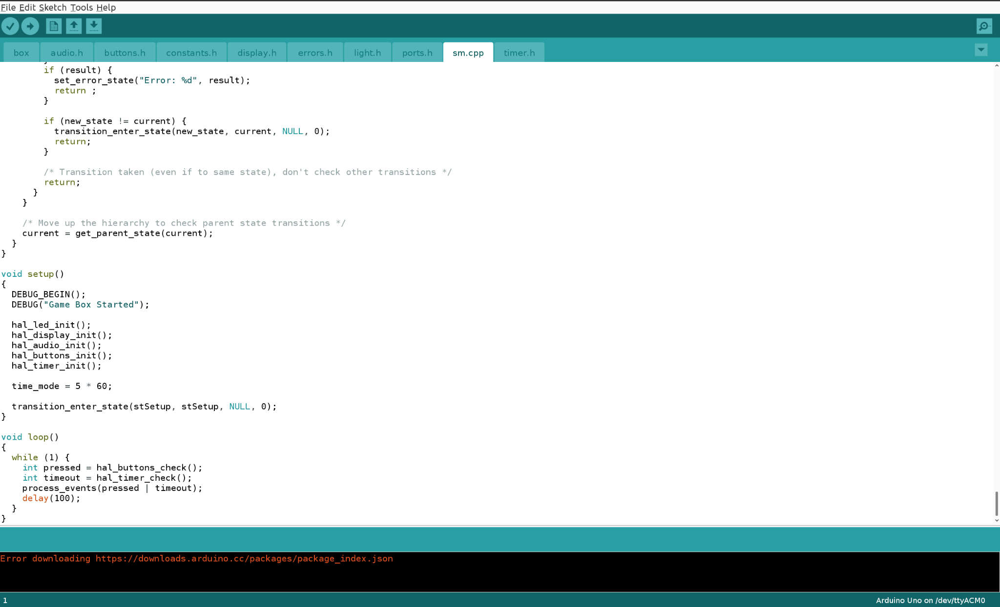

В единой среде Arduino IDE можно совмещать все этапы разработки программы:

1.  Написание самого кода, в т.ч. работа одновременно с несколькими файлами, составляющими
    программу.
2.  Загрузка и подключение дополнительных библиотек, например, для работы с цифровым
    дисплеем.
3.  Выбор модели платы, для которой будет компилироваться и прошиваться программа,
    например Arduino Uno.
4.  Компиляция кода и исправление ошибок.
5.  Прошивка платы итоговой программой.

Это сочетание функций позволяет IDE быть единственным и полноценным местом работы программиста.

Arduino IDE – это бесплатное ПО с открытым кодом. Среда устанавливается и работает
одинаково под различными операционными системами: Linux, Windows и MacOS X.

> **Вопрос:** Какие другие среды разработки вы знаете? Позволяют ли эти среды выполнять
> все перечисленные задачи программиста?

Откройте Arduino IDE и введите следующую программу. Сохраните ее в файл с расширением
`.ino`, как принято в проектах Arduino IDE.

```cpp
#define LED	2

int light;

void setup()
{
    pinMode(LED, OUTPUT);
    light = LOW;
}

void loop()
{
    digitalWrite(LED, light);
    if (light == HIGH) {
        light = LOW;
    } else {
        light = HIGH;
    }
    delay(1000);
}
```

Программа на Arduino немного отличается от типовой программы на языке C++. Вместо функции
`main` в ней предлагается две обязательные функции:

- `setup` – содержит инструкции по инициализации контроллера;
- `loop` – основной цикл программы, эта функция непрерывно запускается при работе
  контроллера.

В данном случае программа инициализирует порт номер `2` (задан в константе `LED`) вызовом
`pinMode`, к которому подключен светодиод, на выход (`OUTPUT`) – в зависимости от
программы на этом порту может быть задано высокое (`HIGH` или 5 В) или низкое напряжение
(`LOW`, 0 В). Обратите внимание, что в C и C++ символ проверки равенства (`==`) отличается
от символа присваивания переменной значения (`=`), их важно не путать! Кроме того
инициализируется глобальная переменная `light`, которая хранит текущее значение, выводимое
в порт.

На каждом цикле программа задает для порта 2 текущее значение `light` с помощью
специальной функции записи в цифровой порт `digitalWrite`, а затем меняет ее значение на
противоположное. После этого функцией `delay` устанавливается пауза на 1000 мс или 1 с,
что в итоге заставляет светодиод зажигаться и гаснуть раз в секунду.

Таким образом, Arduino IDE самостоятельно реализует функцию `main`, в которой один раз на
старте запускает определяемые программистом функцию `setup`, а затем в вечном цикле
функцию `loop`.

> **Задание для самопроверки**
>
> Напишите программу на C++ с функцией `main`, которая, в свою очередь, корректно вызывает
> принятые в Arduino IDE функции `setup` и `loop`.

### 7.2. Компиляция и загрузка программы на Arduino

После написания программы можно скомпилировать ее кнопкой:
. При этом в нижней части экрана Arduino IDE в
справочном окне будут выводиться ошибки компиляции. После устранения всех ошибок можно там
же увидеть статистику прошивки. Например, следующее:

```text
Sketch uses 946 bytes (2%) of program storage space. Maximum is 32256 bytes.
Global variables use 11 bytes (0%) of dynamic memory, leaving 2037 bytes for local variables. Maximum is 2048 bytes.
```

Видно, что программа в машинных кодах заняла всего 946 байт, что составляет всего 2% от
доступного для программ объема флеш-памяти контроллера. Кроме того используемые в
программе переменные занимают лишь 11 байт оперативной памяти, что конечно умещается в
доступные 2 Кб.

Перед прошивкой программы в контроллер убедитесь, что в меню Tools выбран верный
контроллер и порт его подключения (значение порта указано для Linux, для Windows тут будет
другая строка):

```text
Board: "Arduino Uno"
Port "/dev/ttyUSB0"
```

Загрузка скомпилированной программы (прошивки) на контроллер происходит по нажатию кнопки
. В процессе загрузки на самой плате Arduino
будут мигать встроенные светодиоды `L` и `RX`. После этого в Arduino IDE вы увидите
надпись `«Done uploading»`, а сама программа будет сразу запущена на контроллере. При
следующем включении питания Arduino, загруженная программа также начнет сразу исполняться.

### 7.3. Подключение дополнительных модулей при разработке программ для Arduino

Для контроллера Arduino разработано множество периферийного оборудования, такого как
датчики, экраны и пр. Для удобства работы с некоторыми устройствами разработчики создают
библиотеки, их можно вызывать из программы после установки в Arduino IDE.

В Arduino IDE можно открыть менеджер доступных библиотек через меню `Sketch > Include
Library > Manage Libraries…`

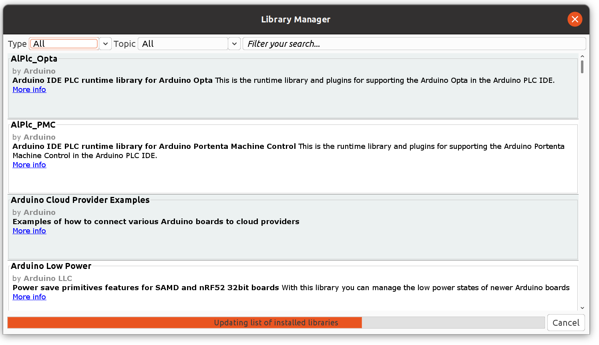

В этом интерфейсе можно выбрать и установить интересующую вас библиотеку. Альтернативный
способ – загрузить zip-архив с библиотекой и установить ее через пункт меню `Sketch >
Include Library > Add ZIP Library…`

В последующей практической работе нам понадобится библиотека для I2C-дисплея. Если у вас
есть соответствующее оборудование, загрузите ZIP-файл по ссылке и установите библиотеку
[LCD_I2C](https://github.com/blackhack/LCD_I2C/).

Подключенные библиотеки затем подключаются в программе с помощью директивы `#include`,
например, так:

```cpp
#include <LCD_I2C.h>
```

Также вы можете сохранить файлы библиотеке в общей директории с вашей программой (`.ino`
файл), тогда они будут считаться принадлежащими проекту и компилироваться вместе с вашей
основной программой. Локальные файлы и библиотеки подключаются похожим образом:

```cpp
#include "LCD_I2C.h"
```

Далее мы покажем, на примере этой библиотеки цифрового дисплея, как использовать
библиотеки для Arduino на языке C++.

### 7.4. Программирование дисплея для Arduino. Работа со строками в С++

Цифровой дисплей позволяет программе контроллера выводить символы и цифры, что значительно
расширяет возможности его пользовательского интерфейса. Например, на дисплей можно
выводить показания датчиков или делать интерактивные меню.

Для Arduino существует множество вариантов дисплеев, мы рассмотрим вариант дисплея,
который подключается к плате по протоколу I2C, и сопровождается библиотекой
[LCD_I2C](https://github.com/blackhack/LCD_I2C/).

Стандартная последовательность работы с дисплеем состоит из его инициализации при старте
программы, а затем выводе необходимой информации на дисплей по ходу выполнения программы.

Цифровой дисплей представляет собой матрицу символов, типовой размер такой матрицы: 2
строки и 16 колонок. Это очень похоже на побайтное хранение информации в памяти, о чем мы
говорили на прошлом занятии. Такой дисплей позволяет не только символ за символом выводить
отдельные слова и числа, но и показывать элементы управления.

На схеме показн порядок ячеек цифрового дисплея:


В С++ нумерация букв в строках и данных в таблицах начинается с нуля, поэтому в данном
случае любой элемент матрицы экрана может быть доступен по паре координат `(x; y)`, отсчет
координат начинается с левого верхнего угла с координатой `(0; 0)`.

Библиотека [LCD_I2C](https://github.com/blackhack/LCD_I2C/) предоставляет программисту
класс `LCD_I2C`, который содержит следующие полезные методы:

- `clear()` – очистить весь дисплей;
- `print(char* s)` – напечатать строку `s` на дисплее из текущего положения курсора, при
  этом курсор сдвигается на число напечатанных символов, аргумент `s` представляет собой
  указатель на область памяти, в которой хранится строка – типичный для C и C++ способ
  работы с текстовыми данными, позже мы еще вернемся к этому;
- `setCursor(int col, int row)` – перенести курсор в координаты `(col; row)` на дисплее.

Такой простой интерфейс позволяет выводить практически любую информацию на
дисплей. Осталось только разобраться, как превращать данные, получаемые при работе
программы, в наборы символов, которые будут выводиться на экран. Для этого на время
отвлечемся от дисплея и напишем простую программу на языке C++, которая конвертирует числа
в строку.

> **Электронный секундомер**
>
> Напишите программу на C++, которая будет выводить на экран число секунд, прошедших с
> момента старта программы в записи как в секундомере - ММ:СС, где ММ - две цифры минут
> (00-59), а СС – две цифры секунд (00-59).

Эта программа имеет две составляющих:

1.  перевод общего числа прошедших секунд в два числа – минут и секунд;
2.  запись полученных числа минут и секунд в строку.

Разберем их по очереди. Для получения числа минут достаточно разделить нацело общее число
секунд на 60 (операция `/` для int работает так), а для получения остатка секунд – взять
остаток от деления на 60 (здесь потребуется операция взятия остатка `%` для целых чисел):

```cpp
// допустим time == 127 сек, тогда:
int minutes = time / 60; // minutes == 2
int seconds = time % 60; // seconds == 7
```

Превращение чисел в строку мы начнем с возвращения к вопросу организации памяти в
программе на C. В языке программирования C вы можете иметь два типа строк: неизменные
строки, которые определяются еще в коде, выделенные символами двойных кавычек `"`, и
переменные строки, которые нужно хранить в однобайтовых массивах. Посмотрите, как эти
строки хранятся в памяти:

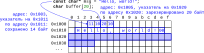

Указатель `msg` содержит адрес неизменной строки `Hello, world!` из 13 символов. В C/С++
тип `char` означает 1 байт, поэтому каждый символ кодируется 1 байтом, при этом для
кодирования первых 128 символов байта используется таблица
[ACSCII](https://www.industrialnets.ru/files/misc/ascii.pdf), а сохранение дополнительных
символов, в т.ч. русских букв потребует выбора конкретной кодировки, например, KOI8-R или
UTF-8 (в UTF-8 русские буквы будут кодироваться 2 байтами).

Важно, что в C/С++ константные строки заканчиваются нулевым байтом, который располагается
сразу после последнего символа строки. Поэтому такой формат хранения строк называют
*нуль-терминированными строками*. Итогово такая строка будет занимать в памяти 14
байт. Ранее мы уже сталкивались с неизменными строками в функциях `printf`, они хранили
конкретные сообщения для пользователя.

Если нам нужно работать меняющимися строками, потребуется указатель на изменяемую
память. Такой указатель можно объявить одновременно с размером требуемой памяти. В С/С++
такую запись также называют *объявлением массива*: `char buffer[20]`; – указатель `buffer`
будет хранить адрес начала зарезервированного блока памяти в 20 байт, куда можно будет
записывать, затем перезаписывать поверх символы.

Теперь все готово для сохранения секундомера в строку для последующего вывода на экран или
LCD-дисплей:

```cpp
char buffer[6];

// сформировать строку в памяти по указателю buffer
snprintf(buffer, 6, "%02d:%02d", minutes, seconds);

// вывести строку на экран в консоли
printf("Time: %s\n", buffer);

// вывести строку на LCD-дисплей
lcd.print("Time: ");
lcd.print(buffer);
```

В этом примере мы выделяем память для строк размером 6 символов, а затем с помощью
специальной функции `snprintf` выводим отформатированную строку `ММ:СС` в память `buffer`.

Функция `snprintf` принимает в качестве аргументов:

1.  адрес, куда записать строку, – `buffer`;
2.  ограничения по размеру памяти – 6 байт; обратите внимание, что нам понадобится 6-й
    байт для хранений 0-го заканчивающего строку байта;
3.  форматную строку, которая указывает как интерпретировать и выводить два числа (в
    данном случае – по 2 десятичных цифры на число) – `"%02d:%02d"` с промежуточным
    разделителем из двоеточия `:`;
4.  и перечень упомянутых в форматной строке аргументов – `minutes`, `seconds`.

После выполнения функции `snprintf` в строке `buffer` окажется строка, которую затем можно
выводить пользователя любыми доступными средствами.

Соберем вместе программу, которая выводит обновляющийся таймер на экран:

```cpp
#include <stdio.h>
#include <unistd.h>

int main(int argc, char** argv)
{
    int time = 0;
    
    while (1) {
        char buffer[6];
        int minutes = time / 60;
        int seconds = time % 60;
        snprintf(buffer, 6, "%02d:%02d", minutes, seconds);
        printf("Time: %s\n", buffer);
        time++;
        sleep(1);
    }
}
```

Выводом такой программы будет:

```text
Time: 00:00
Time: 00:01
Time: 00:02
Time: 00:03
Time: 00:04
Time: 00:05
```

и т.д.

Далее уже в рамках практической части будет обсуждаться аналогичная программа для LCD-дисплея.

### 7.5. Генерация кода C++ в Cyberiada IDE

На прошлых занятиях мы работали со средой разработки Cyberiada IDE, которая позволяла
программировать контроллеры Arduino с использованием диаграмм машин состояний.

На самом деле за каждой такой диаграммой скрывается код на C++, который в последующем
будет загружен на контроллер. Вы можете воспользоваться редактором Cyberiada IDE и создать
диаграмму, например, зажигающую светодиод по нажатию кнопки:

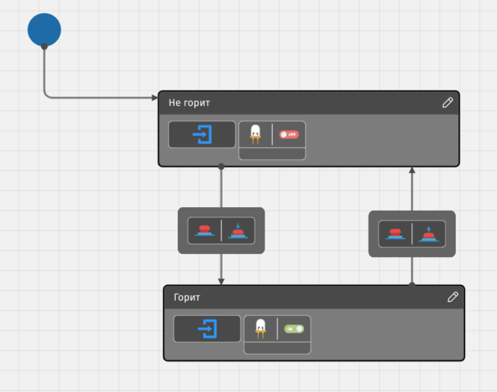

После этого вы можете перейти на закладку «Компилятор» и увидеть код на C++, который
генерируется для нарисованной диаграммы:

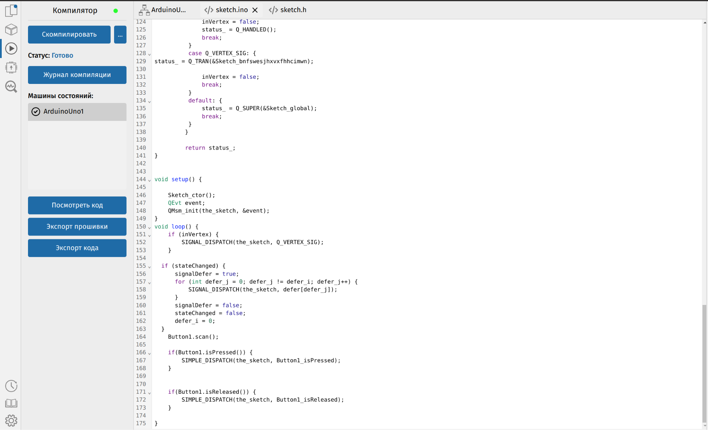

Можно заметить, что проект на Arduino Uno генерирует код на C++, который затем будет
компилироваться и загружаться на контроллер точно так же, как мы загружали код с
использованием Arduino IDE. Видно, что в цикле исполнения кода на Arduino – `loop` –
проверяются срабатывания событий, вызываются сообщения и т.п.

Вы можете также модифицировать сгенерированный код, чтобы он затем загружался
контроллер. Поэтому вы можете быстро прототипировать логику программы с использованием
диаграмм машин состояний, а затем дорабатывать уже получившийся код на C++.

Таким образом, программирование логики с использованием машин состояний обладает теми же
возможностями, что и программирование контроллеров на языке С++, но позволяет быстро
получать логику работы конечных приложений.

## Практическая часть

Для прохождения практической части вы можете использовать любой из доступных электронных
конструкторов, основанных на контроллере Arduino или воспользоваться самим контроллером и
простыми электронными компонентами. Также вы можете воспользоваться средой Arduino IDE для
написания и компиляции программы, последующей загрузки на контроллер.

### 7.6. Практика программирования на C++ для Arduino

Попробуем запустить простую программу на C++ для Arduino, которую обсуждали выше. Для
этого еще раз восстановим простую задачу про мигание светодиода и соответствующую схему из
модуля «Язык машин состояний (ПРИМС)» со светодиодом, подключенным к цифровому порту.

> **Помигать светодиодом**
>
> Напишите программу на C++ для Arduino, благодаря которой светодиод будет периодически
> мигать: загораться, через секунду гаснуть, затем снова загораться и так далее.

#### Сборка схемы на Arduino

На рисунке воспроизводится схема подключения компонентов к Arduino на макетной плате. К
светодиоду подключается порт номер 2.

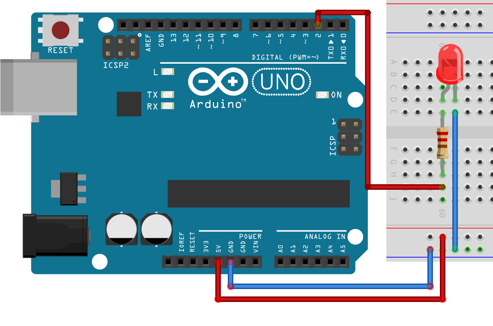

Для сборки вам понадобятся следующие компоненты:

- микроконтроллер Arduino Uno;
- резистор около 220 Ом – 1 штука;
- светодиод – 1 штука;
- провода папа-папа – 3 штуки;
- макетная плата – 1 штука.

#### Написание программы в Arduino IDE

Откройте Arduino IDE и восстановите написанную ранее программу, сохраненную ранее как `led.ino`:

```cpp
#define LED	2

int light;

void setup()
{
    pinMode(LED, OUTPUT);
    light = LOW;
}

void loop()
{
    digitalWrite(LED, light);
    if (light == HIGH) {
        light = LOW;
    } else {
        light = HIGH;
    }
    delay(1000);
}
```

После загрузки на контроллер вы получите работающую схему с мигающим светодиодом:

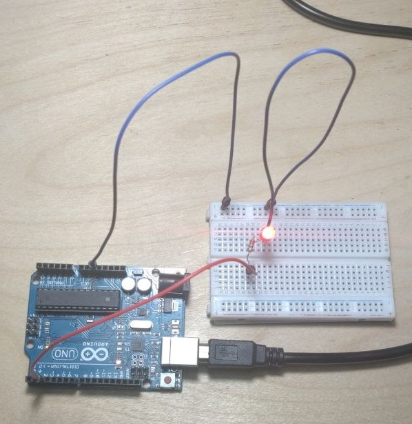

### 7.4. Пример программирования дисплея для Arduino

Следующая практическая задача связана с использованием LCD-дисплея.

> **Электронный секундомер**
>
> Соберите схему на Arduino с LCD-дисплеем и напишите программу для Arduino на C++,
> которая будет выводить на экран дисплея число секунд, прошедших с момента включения в
> записи как в секундомере - ММ:СС, где ММ - две цифры минут (00-59), а СС – две цифры
> секунд (00-59).

#### Сборка схемы на Arduino

Для сборки вам понадобятся следующие компоненты:

- микроконтроллер Arduino Uno;
- LCD-дисплей с подключением по I2C – 1 штука;
- провода папа-папа/папа-мама – 4 штуки.

На схеме показано, как может выглядеть подключение дисплея к плате контроллера:

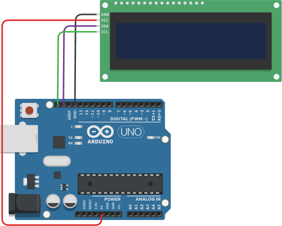

Дисплей подключается к контроллеру Arduino четырьмя проводами: к питанию 5 В, к земле
(`GND`), к двум разъемам для управления дисплеем и передачи данных (`SCL` и `SDA`).

#### Написание программы в Arduino IDE

Попробуем запрограммировать дисплей, который подключается к плате по протоколу
I2C. Программа по выводу секундомера на LCD-дисплей, подключенный к Arduino, может
выглядеть так:

```cpp
#include <Wire.h>
#include "LCD_I2C.h"

#define LCD_DEVICE   	0x27
#define LCD_ROWS     	16
#define LCD_COLUMNS  	2

LCD_I2C lcd(LCD_DEVICE, LCD_ROWS, LCD_COLUMNS);

int time;

void setup()
{
    lcd.begin();
    lcd.backlight();
    lcd.clear();
    lcd.print("Hello, World!");
    delay(1000);
    time = 0;
    lcd.clear();
    lcd.setCursor(0, 0);
    lcd.print("Time: ");
}

void loop()
{
	char buffer[6];
	int minutes = time / 60;
	int seconds = time % 60;
	snprintf(buffer, 6, "%02d:%02d", minutes, seconds);
	lcd.setCursor(6, 0);
	lcd.print(buffer);
	time++;
	delay(1000);
}
```

При старте на дисплей выводится текстовая строка с приветствием, а дальше происходит
обновление конкретной части дисплея, куда проецируется сгенерированная строка со временем.

В сборке это может выглядеть так:

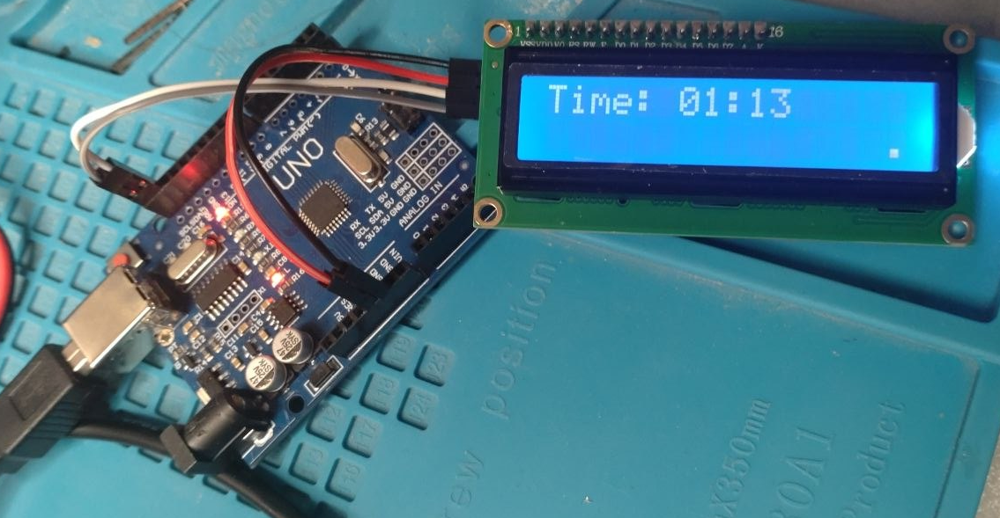

### 7.6. Решение задачи «Захват флага» на С++

Более сложный пример программирования Arduino на C++ можно найти в проекте по реализации
устройства обратного отсчета «Capture the Flag», которое мы рассматривали в рамках
предыдущего модуля.

Можно попробовать запрограммировать такой определитель победителя:

> **Захват флага на C++**
>
> Реализуйте устройство и напишите программу для игры «Захват флага», которая реализует
> следующую работу системы:
>
> - отсчитывает время игровой сессии (стандартно 5 минут, настраивается в интерактивном
>   меню с дисплеем);
> - ведет подсчет времени владения флагом для каждой из двух команд, показывая оставшееся
>   время и «счет» времени каждой из команд;
> - объявляет победителя, мигая соответствующим светодиодом и демонстрируя итоговое время
>   команд на дисплее.

Подробнее познакомиться с реализацией данного проекта в более полной версии можно на
GitHub — [Проект HSM-Box](https://github.com/dralex/hsm-box). В рамках этой реализации
собиралось устройство с 2 светодиодами и 2 кнопками для выбора ведущей команды, а также с
LCD-дисплеем и 3 кнопками управления. Внешний и внутренний вид разработанного устройства
представлен на фотографиях:

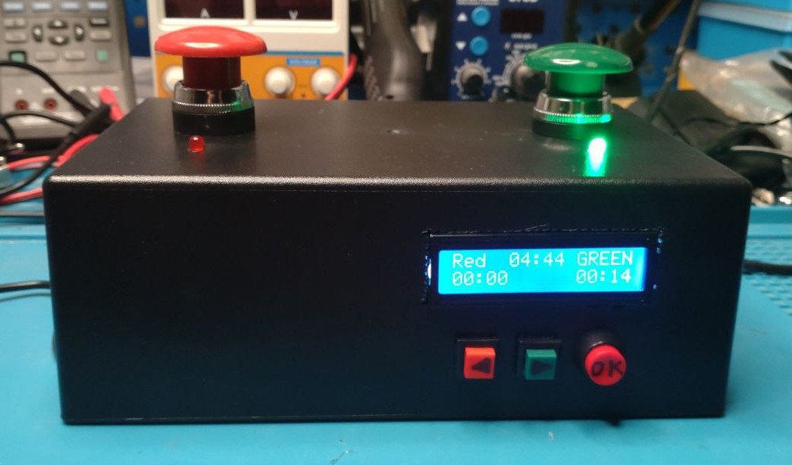

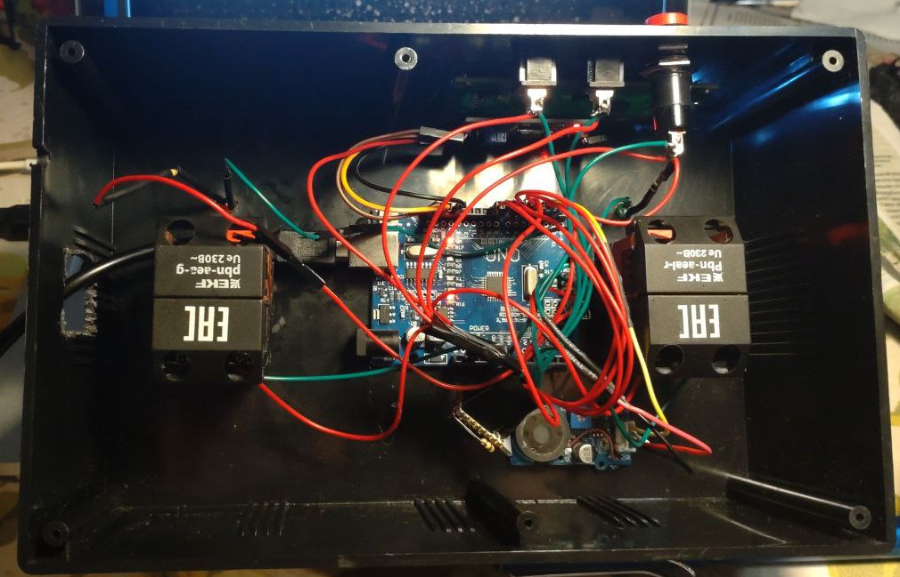

Программа реализует следующую диаграмму машины состояний:

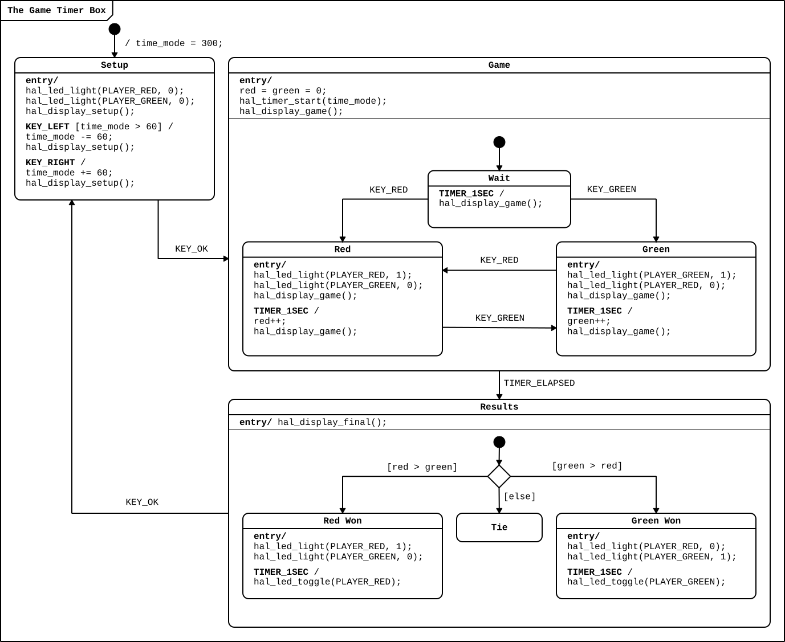

В диаграмме используется код на C++, который был реализован в отдельных модулях. Почти в
каждом состоянии на диаграмме происходит обновление дисплея (вызов функций
`hal_display_…`).

Разберем подробнее программный код модуля, реализующего работу LCD-дисплея (`display.h`).

Программа начинается с подключения заголовков с константами и инициализации объекта
дисплея `lcd`:

```cpp
#include "constants.h"
#include "errors.h"

#define LCD_DEVICE   	0x27
#define LCD_ROWS     	16
#define LCD_COLUMNS  	2

LCD_I2C lcd(LCD_DEVICE, LCD_ROWS, LCD_COLUMNS);
```

Следующая служебная функция конвертирует общее число прошедших секунд `sec` в строковый
буфер по указателю `buffer`. В программе нужно выводить время в виде строки в разных
местах интерфейса, поэтому удобно вынести этот код в отдельную функцию.

```cpp
void time_to_buffer(char* buffer, int sec)
{
    int min = sec / 60;
    sec = sec % 60;
    snprintf(buffer, 6, "%02d:%02d", min, sec);
}
```

Инициализация дисплея включает в себя включение фонового освещения дисплея и вывод
стартового сообщения:

```cpp
void hal_display_init()
{
    lcd.begin();
    lcd.backlight();
    lcd.clear();
    lcd.print("Game Timer Box");
}
```

Меню конфигурации игры позволяет задать время матча. Данная функция выводит текущее время
в стандартной форме:

```cpp
void hal_display_setup(int t, int clear)
{
    char buffer[6];
    if (clear) {
        lcd.clear();
        lcd.setCursor(0, 1);
        lcd.print("Press 'OK'");
    }
    time_to_buffer(buffer, t);
    lcd.setCursor(0, 0);
    lcd.print("SETUP  ");
    lcd.print(buffer);
    lcd.print(" min");
}
```

Старт матча сопровождается отдельным сообщением:

```cpp
void hal_display_game_start()
{
    lcd.clear();
    lcd.print("Starting MATCH..");
}
```

В ходе матча дисплей регулярно обновляется в соответствии с общим числом пройденных
секунд, а также счётом в секундах для каждой из команд. Интерфейс позволяет отразить
ведущую команду:

```cpp
void hal_display_game(uint32_t t, int red,
                      int green, int player, int clear)
{
    char buffer[6];
    if (clear) {
        lcd.clear();
    }
    time_to_buffer(buffer, t);
    lcd.setCursor(0, 0);
    if (player == PLAYER_RED) {
        lcd.print("RED  ");
        lcd.print(buffer);
        lcd.print(" Green");
    } else if (player == PLAYER_GREEN) {
        lcd.print("Red  ");
        lcd.print(buffer);
        lcd.print(" GREEN");
    } else {
        lcd.print("Red  ");
        lcd.print(buffer);
        lcd.print(" Green");
    }
    DEBUG_("Display time: ");
    DEBUG(buffer);
    lcd.setCursor(0, 1);
    time_to_buffer(buffer, red);
    lcd.print(buffer);
    lcd.setCursor(11, 1);
    time_to_buffer(buffer, green);
    lcd.print(buffer);
}
```

Окончание игры сопровождается отдельным сообщением:

```cpp
void hal_display_final_start()
{
    lcd.clear();
    lcd.print("MATCH is OVER!!!");
}
```

Вывод результатов игры включает в себя определение победителя и счет каждой из сторон:

```cpp
void hal_display_final(int winner, int red, int green)
{
    char buffer[6];
    lcd.clear();
    lcd.setCursor(0, 0);
    if (winner == PLAYER_RED) {
        lcd.print("RED WON!!!");
    } else if (winner == PLAYER_GREEN) {
        lcd.print("GREEN WON!!!");
    } else {
        lcd.print("TIE!!!");
    }
    lcd.setCursor(0, 1);
    lcd.print("R");
    time_to_buffer(buffer, red);
    lcd.print(buffer);
    lcd.print(" vs G");
    time_to_buffer(buffer, green);
    lcd.print(buffer);
}
```

На случай непредвиденных ситуаций предусмотрен вывод на дисплей сообщений об ошибках:

```cpp
void hal_display_error(const char* s)
{
	lcd.clear();
	lcd.setCursor(0, 0);
	lcd.print("Error:");
	lcd.setCursor(0, 1);
	lcd.print(s);
}
```

Данный код иллюстрирует возможности LCD-дисплея для реализации сложного пользовательского
интерфейса. В зависимости от состояния игры дисплей дает возможность выводить сообщения
пользователю и получать его обратную связь на работу системы.

Вы можете также познакомиться с другими исходными файлами данного проекта, чтобы увидеть
возможности языка C++ для управления контроллерами и созданными на их основе цифровыми
системами.

## Подведение итогов

В рамках занятия мы рассмотрели применение языка С++ для программирования контроллеров
Arduino. В реальных системах часто используются периферийные устройства и дополнительные
устройства, такие как LCD-дисплей. В рамках занятия было показано, как эти устройства
встраиваются в работу цифрового контроллера.

Следующее, заключительное, занятие будет посвящено управлению внешними устройствами –
такими как реле и сервоприводы, позволяющими автономной системе решать реальные задачи.

## Дополнительные материалы

- Samek, M. [https://www.state-machine.com/doc/PSiCC2.pdf](Practical UML statecharts in
  C/C++: event-driven programming for embedded systems. CRC Press), 2008.
