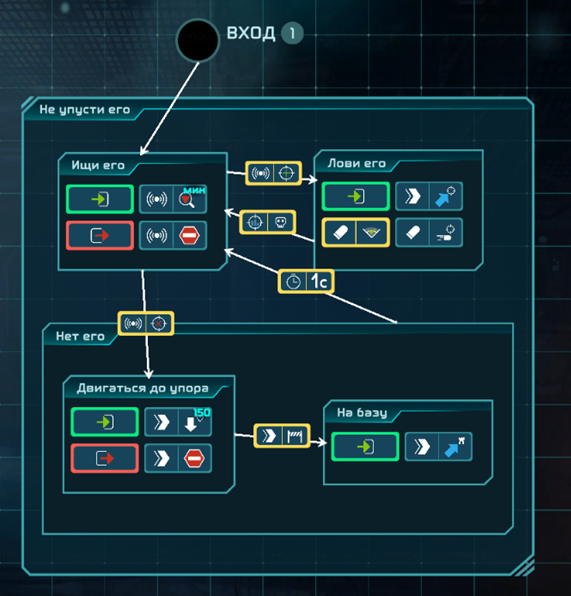
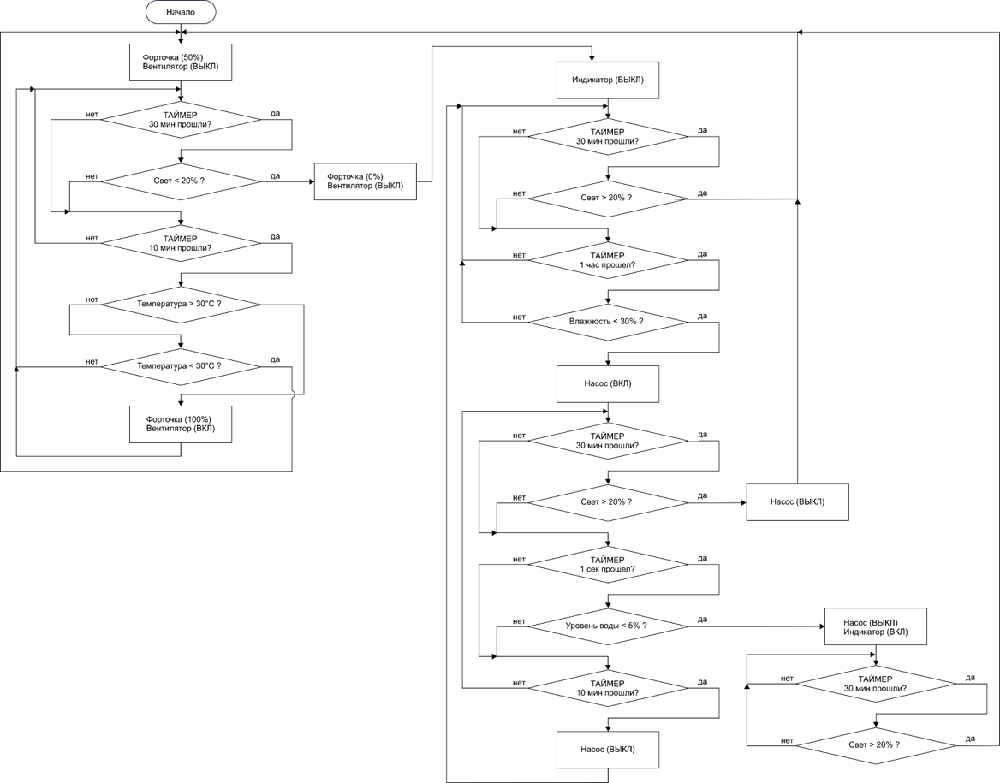
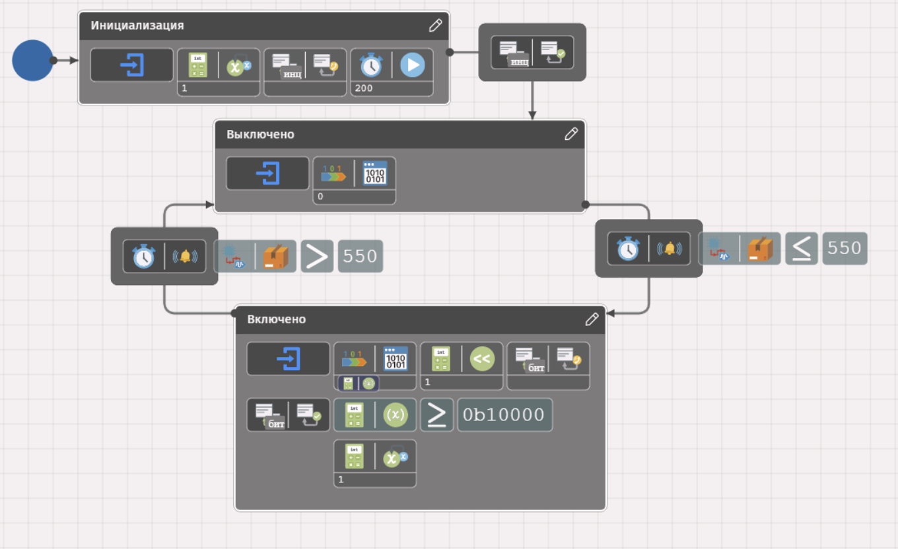
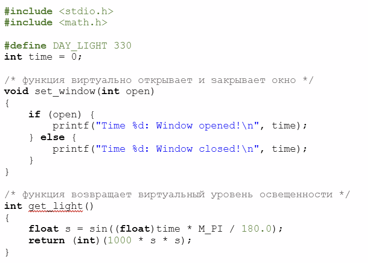
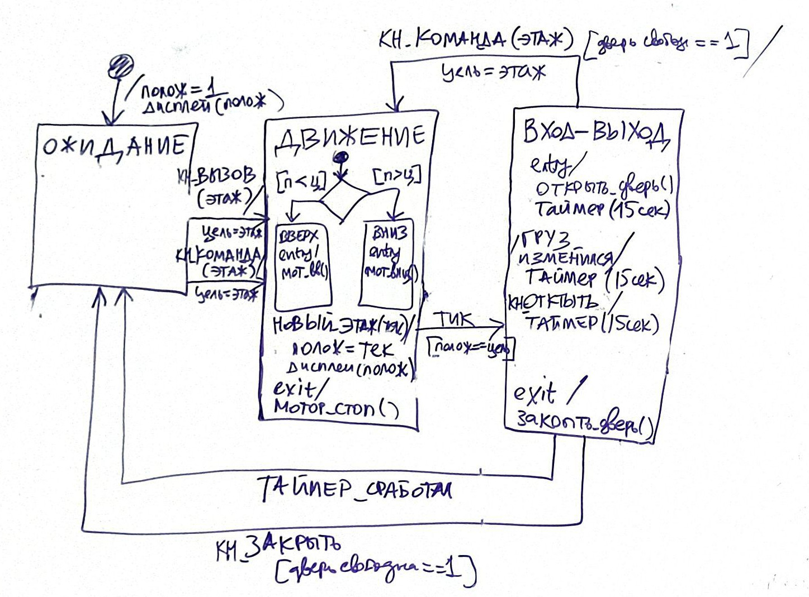
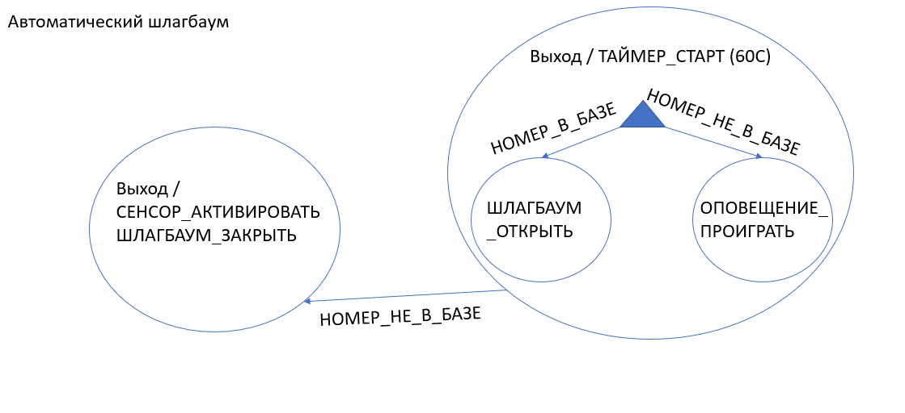

[Введение в программирование машин состояний (ПРИМС) в Arduino]: #
[Авторы курса: Алексей Федосеев aleksey@fedoseev.net и Анита Ходова anita-hodova@inbox.ru]: #
[Текст распространяется под лицензией GNU Free Documentation License (версия 1.3)]: #

# Финальный тест оценки знаний

## Вопрос 1

Что обычно представляет собой аналоговый сигнал?

1.  Физическую величину, например температуру или освещённость
2.  Набор программных команд
3.  Исключительно текстовую информацию
4.  Только последовательность нулей и единиц
5.  Адрес ячейки памяти

## Вопрос 2

Какие значения получает программа при чтении цифрового входа?

1.  Температуру или освещённость
2.  Только напряжение в вольтах
3.  Любое вещественное число
4.  LOW или HIGH
5.  Только числа от 0 до 1023

## Вопрос 3

Верно ли, что одну и ту же программу на C можно запускать без отдельной компиляции на
Arduino, смартфоне, Windows и Linux?

- верно
- неверно

## Вопрос 4

Какие из возможностей языка C++ появились как расширение языка С?

- возможность добавлять однострочные комментарии (с //)
- использование переменных-указателей, содержащих адрес другой переменной
- функция printf для вывода текста на экран
- объектно-ориентированное программирование и описание классов объектов

## Вопрос 5

Какие из следующих функций используются для управления цифровым портом и создания
временных задержек в программе Arduino? Выберите все правильные варианты:

- `delay`
- `print`
- `digitalWrite`
- `pinMode`

## Вопрос 6

Выберите, какие из программ ниже являются диаграммами машин состояний:

1.  
2.  
3.  
4.  
5.  
6.  

## Вопрос 7

Укажите ошибки, допущенные при создании данной диаграммы машины состяний:

## Правильные ответы

1.  **Физическую величину, например температуру или освещённость**
2. **LOW или HIGH**
3. **неверно**
4. **возможность добавлять однострочные комментарии (с //)** и **объектно-ориентированное
   программирование и описание классов объектов**
5. `delay`, `digitalWrite`, `pinMode`
6. **1**, **3**, **6**
7. Некоторые из ошибок:
  - неверная форма состояний (должны быть прямоугольники со скругленными углами);
  - не заданы имена состояний;
  - отсутствует начальное псевдосостояние диаграммы;
  - отсутствует начальное псевдосостояние в составном состоянии с выбором;
  - неверая форма псевдосостяния выбора (должен быть ромб);
  - нет входящего перехода в псевдосостояние выбора;
  - на выходе из псевдосостояния выбора должы быть ограждающие условия.
  - конфликт между двумя переходами по событию `НОМЕР_НЕ_В_БАЗЕ`, нет однозначности в переходе;
  - нарушена рекомендация использовать заглавные буквы для именования событий, а не для действий (как в диаграмме).
