[Введение в программирование машин состояний (ПРИМС) в Arduino]: #
[Авторы курса: Алексей Федосеев aleksey@fedoseev.net и Анита Ходова anita-hodova@inbox.ru]: #
[Текст распространяется под лицензией GNU Free Documentation License (версия 1.3)]: #

# 8. Управление внешними устройствами: использование двигателей и реле

Это завершающее занятие модуля, в рамках которого вам предстоит восстановить логику
исполнения машин состояний, проработать на практике ключевые понятия машин состояний
(процесс, состояние, событие и др.), а также связать процесс управления автономной
системой с физическими процессами в окружающем мире, которые ей приходится учитывать в
своей работе. В практической части мы соберем прототип теплицы, осуществляющей полив.

## Теоретическая часть

### 8.1. Умная теплица как киберфизическая система

На прошлых занятиях (см. занятие «Устройство микроконтроллера. Язык C++» ) мы
рассматривали умную теплицу в качестве примера для написания простой программы
переключения между дневным и ночным режимом работы. Однако для полноценного выращивания
культур требуется гораздо более сложная система, состоящая из различных автономных
модулей, каждый из которых выполняет свою функцию: измеряет параметры среды, управляет
насосами и т. п.

Подобные системы, которые осуществляют цифровое управление процессами в физическом мире
называются **киберфизическими**. Киберфизические системы обладают рядом характеристик,
представленных на схеме ниже:

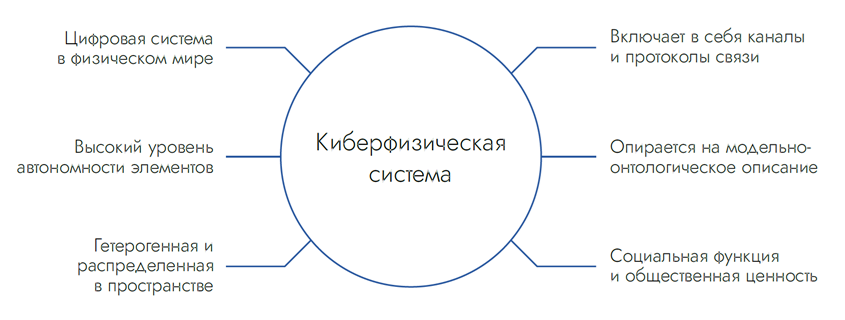

Каждая киберфизическая система — умная теплица не является исключением — создается и
программируется в опоре на определенное видение мира или, говоря научным языком,
*онтологию*. В зависимости от онтологии программист может создавать совершенно разные
программы управления.

Например, в сельском хозяйстве мы можем видеть два диаметрально противоположных примера,
требующих очень разных систем управления:

- **Промышленное сельское хозяйство**, в котором нам нужно минимизировать количество
  вариаций живых видов на территории, чтобы растению не мешали никакие вредители и
  болезнетворные бактерии. Качество работы такой системы будет оцениваться по
  произведенной биомассе.
- **Природосообразное сельское хозяйство**, или *пермакультура*, когда люди начинают
  выращивать растения, воссоздавая природные экосистемы, в т. ч. сочетать посадку
  нескольких сортов одного растения, привлекать естественных борцов с вредителями, таких
  как птицы.
  
Рассмотрим пример умной теплицы и опишем управление ей с помощью машины состояний.

### 8.2. Инфографика работы умной теплицы

На **рисунке А** представлена схема умной теплицы:

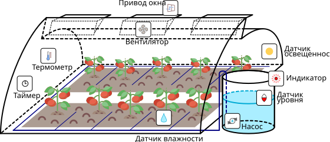

Умная теплица управляется автономной системой, которая опирается на данные от термометра,
датчиков освещенности и влажности почвы. Система управляет проветриванием и поливом почвы,
обеспечивая правильные условия для выращивания культуры.

> **Вопрос:** Как вы считаете, какая онтология заложена в эту модель теплицы —
> промышленная или природосообразная? Почему?

Предлагаем вам решить задачу, связанную с данной теплицей:

> **Работа умной теплицы**
>
> Перед вами теплица (рис. А), которую запрограммировали с помощью языка машин
> состояний. На верхних графиках (рис. Б) представлены показания датчиков, которые
> измеряют яркость солнечного света, температуру в теплице, влажность почвы и объем воды в
> баке. Нижние графики (рис. Б) показывают работу систем теплицы: как открывались окна,
> включались вентиляторы и насос и т. п. Используя доступные команды управления системой
> теплицы и доступное событие таймера (рис. В), изобразите диаграмму машины состояний,
> которая может реализовать такую последовательность управления умной теплицей.

#### Дополнительные рисунки к задаче с пояснениями

Полный график параметров работы системы умной теплицы представлен на **рисунке Б**:

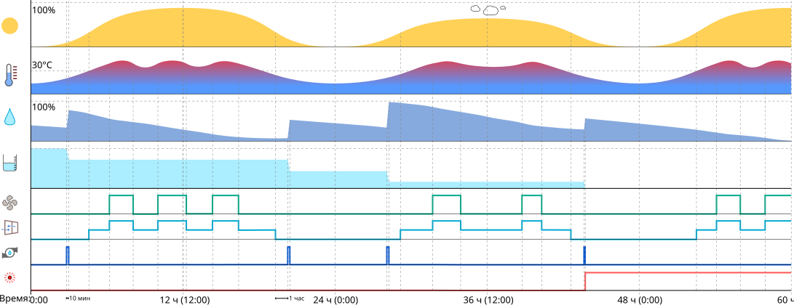

На графике показано изменение следующих параметров в течение 2½ суток:

- освещенность;
- температура воздуха в теплице;
- влажность почвы в теплице;
- уровень воды в баке;
- состояние вентилятора (включен/выключен);
- состояние окон (открыты полностью/открыты наполовину/закрыты);
- состояние насоса (включен/выключен);
- индикатор недостатка воды (горит/не горит).

На **рисунке В** показаны условные обозначения и доступные события и команды управления:

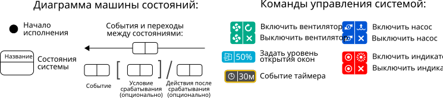

Здесь помимо общих элементов машины состояний представлены команды и событие таймера,
включенные в диаграмму машины состояний.

Опираясь на представленные графики изобразите диаграмму машины состояний для данной
теплицы. Рекомендуем сперва попробовать решить самостоятельно, и лишь затем знакомиться с
предложенным нами решением.

### 8.3. Решение задачи про умную теплицу

Опираясь на опыт четвертого модуля («Язык машин состояний (ПРИМС)»), разделим решение на
несколько шагов.

#### Шаг 1. Определение базовых отношений в работе системы управления теплицей

Первым простым способом описания процесса управления может быть выделение связей,
закономерностей и значимых воспроизводящихся блоков действия для будущей
программы. Например, из графиков видно, что работа вентиляторов и открывание окон связаны
между собой, к тому же эти изменения происходят только в светлое время суток — при
достижении определенных порогов температуры. В то время как полив происходит при
достижении низкого уровня влажности почвы, в темное время суток.

> **Вопрос:** Рассмотрите графики работы умной теплицы, включающий измеряемые параметры
> внешней среды и признаки изменения работы подсистем умной теплицы. Выпишите как можно
> больше закономерностей, связывающих отдельные величины на графиках работы умной теплицы.

Закономерности (отношения между величинами на графиках) можно разделить на следующие пять
типов:

1.  Изменение физических параметров приводит к управляющему воздействию (например, когда
    температура превышает 30 градусов, включается вентилятор, или когда освещенность
    падает ниже 30%, окна закрываются).
2.  Несколько управляющих воздействий происходит *одновременно* (например, окна
    открываются полностью вместе с включением вентилятора).
3.  Управляющее воздействие приводит к изменению физической величины (например, включение
    вентилятора приводит к изменению роста температуры и, в конечном счете, к ее
    уменьшению или включение насоса приводит к повышению влажности почвы и уменьшению
    уровня воды в баке).
4.  Продолжительность управляющего воздействия в течение определенного времени (например,
    насос работает 10 минут).
5.  Наличие дополнительного условия, без которого не происходит управляющее воздействие
    (например, насос включается только в темное время суток и не раньше чем через час
    после заката, даже если почва суше, чем необходимо).

#### Шаг 2. Связь работы системы с элементами диаграммы ПРИМС

Каждый из выделенных типов закономерностей соответствует определенным элементам и
структурам языка диаграмм машин состояний. Рассмотрим подробне, как могут выглядеть
элементы диаграммы для каждого из выделенных типов.

##### Тип 1: Переход

Происходит смена состояний, в новом состоянии начинают выполняться определенные действия.

Для этого в машине состояний могут использоваться два *состояния* (старое поведение и
новое), а также должно быть задано *событие* (возможно, с условием, которое указывается в
квадратных скобках), которое приводит к смене этих состояний. На входе в новое состояние
выполняются *команды*, связанные с этим состоянием.

Команду или набор команд можно выбрать из доступных пиктограмм (например, «Включить
вентилятор»). А вот событие по условию нам доступно только одно — срабатывание таймера.

Наиболее важный и творческий процесс при этом — *выбор наименований* для состояний,
поскольку в них заложена суть управляющих теплицей состояний.

Возможные варианты изображения на диаграмме машин состояний предствлены в таблице:

|  |  |
|----|----|

##### Тип 2: Одновременные команды

В этом случае машина состояний имеет состояние, которое объединяет в себе несколько
различных действий. Команды могут быть в определенном порядке или без обязательного
порядка выполнения. Главное, что эти команды должны выполниться без задержки выполнения
(например, включить что-то, не дожидаясь завершения работы).

В таблице представлены примеры, как входе в состояние выполняются последовательно больше
одной команды.
 
|  |  |
|----|----|

##### Тип 3: Воздействие на реальность

Этот тип зависимости не имеет прямого отношения к структуре диаграммы машины
состояний. Скорее такая зависимость говорит о том, что результатом управления теплицей с
помощью машины состояний стало какое-то изменение в окружающем мире.

В программе должны появиться команды, которые влияют на соответствующие измеряемые
параметры.

Включение вентилятора  как и открытое окно
 приведет к уменьшению температуры.

Включение насоса  приведет к повышению влажности
почвы.

##### Тип 4: Продолжительность во времени

Состояние связано с выполнением какого-то действия. Это должно завершиться через какое-то
время.

Для этого в машине состояний может быть задано два состояния, смена которых произойдет при
срабатывании события таймера.

Если на входе в первое состояние была выполнена команда, начинающая какую-то работу, а на
выходе из состояния эта работа завершалась, то при срабатывании таймера мы получим
выполнение какой-то работы заданное время.

В таблице представлены примеры, как можно запускать и останавливать продолжающийся
процесс:
 
|  | 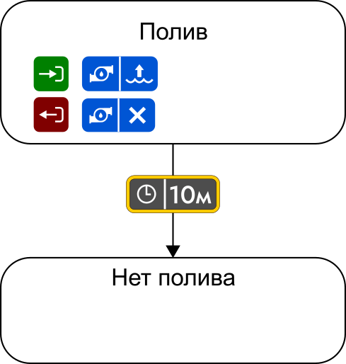 |
|----|----|

##### Тип 5: Условия

Условия изменений состояний в машине состояний могут реализовываться различными способами,
ниже представлены два из них.

Первый способ мы уже рассматривали выше — это ограждающее условие на событии, которое
могло бы привести к переходу (например, срабатывание таймера). Также действия можно
выполнить и на переходе.

В таблице представлены примеры использования условий:
 
|  | 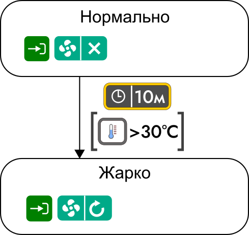 |
|----|----|

Второй способ более интересный и характерный именно для программирования машин
состояний. Условия выполнения могут быть заданы состояниями более верхнего уровня: если
машина состояний находится в другом родительском состоянии, то событие также не будет
срабатывать.

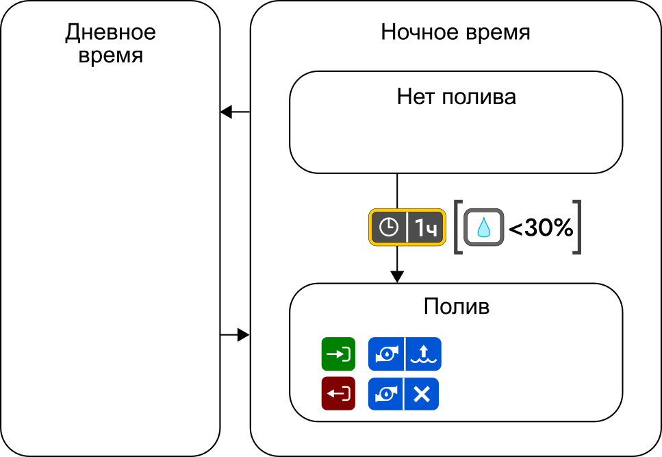

#### Шаг 3. Формирование структуры машины состояний

Составление диаграммы машины состояний, как и любой способ программирования, является творческим процессом. При формировании структуры ПРИМС рекомендуем опираться на следующие принципы:

1.  **Иерархичность** — состояния вложены друг в друга. Родительские состояния описывают
    наиболее общие характеристики работы системы, дочерние — более частные. Иерархичность
    должна сохраняться и в названиях состояний.
2.  **Повторное использование** — если две части диаграммы выполняют одни и те же
    действия, возможно, их стоит объединить для получения более компактной и читаемой
    структуры диаграммы.
3.  **Полнота** — машина состояний должна описывать все операции управления, которые мы
    можем обнаружить на графиках.

При использовании наших рекомендаций, у вас могла получится следующая диаграмма:

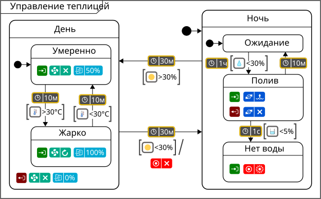

Альтернативно эту же диаграмму машины состояний умной теплицы можно представить так:

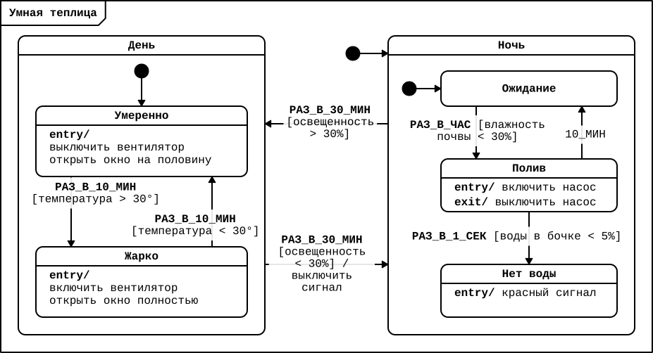

Если ваша диаграмма отличается, ничего страшного. Главное, чтобы ее воспроизведение (даже
мысленное) не противоречило графикам и устройству теплицы.

### 8.4. Управление системами в реальном мире

В теории управление теплицей кажется весьма понятным. Но как же все эти процессы
реализуются в физическом мире? В теплицах используется множество устройств, о которых мы
говорили — датчики влажности и освещенности, управляемые с помощью реле моторы,
вентиляторы, насосы и т.д. Рассмотрим реализацию прототипа умной теплицы на примере двух
функций теплицы — полива и проветривание.

На рисунке показан пример автоматизированного полива в реальном мире:

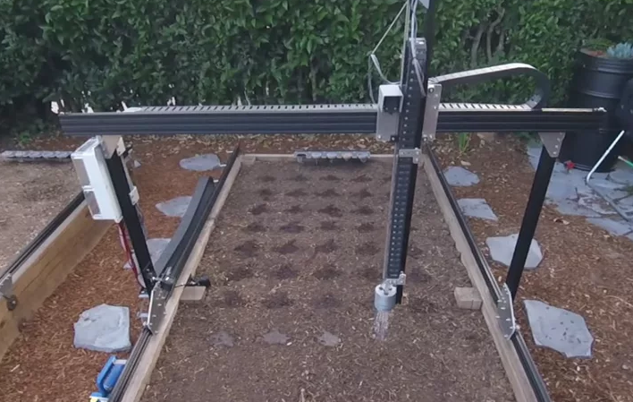

#### Полив

Для автоматизированного полива нам понадобится два технических компонента — насос, который
перекачивает воду из резервуара хранения, и реле. Реле — это одно из старейших
электрических устройств. В основе реле лежит катушка с магнитом, который может двигаться
благодаря электромагнитному эффекту и переключаться между двумя состояниями.

На рисунке показан принцип работы реле:

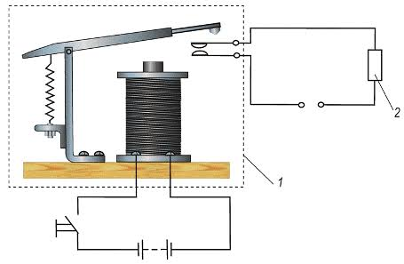

Управляющий контур (1) внизу подает небольшой ток на катушку, создаваемое магнитное поле
притягивает переключатель и тем самым замыкает цепь (2). Это позволяет полностью разнести
электрические цепи управления и нагрузки, например, цепь управления может быть реализована
на 5В постоянного тока Arduino, а цепь нагрузки включать насос с питанием от 220В
переменного тока (как в обычной розетке).

Благодаря этому эффекту реле распространились в устройствах управления. Раньше реле также
составляли основу работы телеграфа и телефона. На рисунке ниже показано реле Model K 1937 года,
которое было прототипом устройства, способного складывать одиночные биты информации:

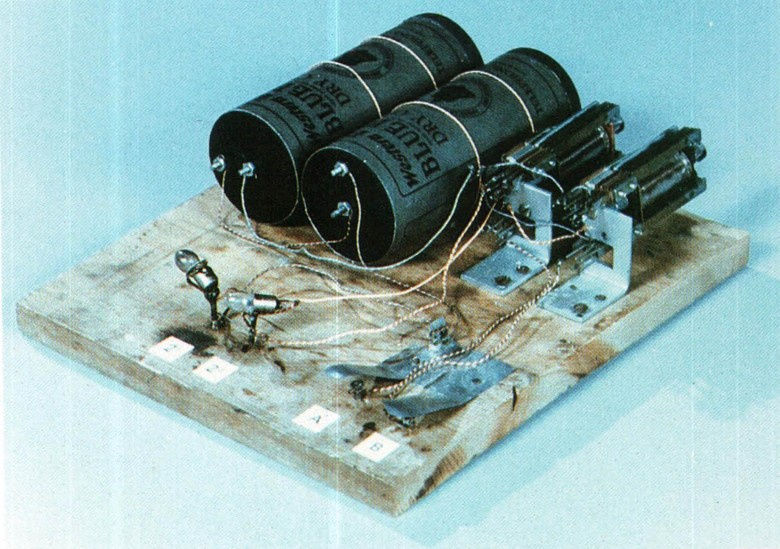

Современное реле – это компактное устройство, которое может переключать несколько каналов.

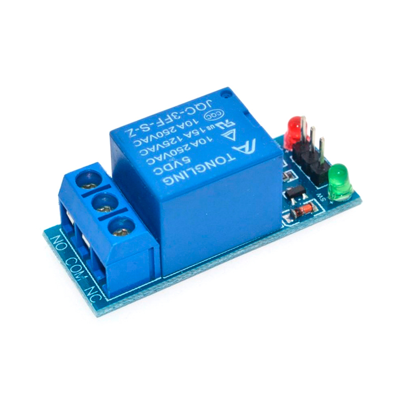

Разберем задачу на использование реле для управления поливом.

> **Полив с реле**
>
> Напишите диаграмму для работы теплицы, которая осуществляет полив с использованием реле
> — при нажатии на кнопку вода течет, при отжатии — останавливается.

Сперва попробуйте изобразить диаграмму самостоятельно, и лишь потом знакомиться с предложенным нами решением.

Наиболее логичным и простым решением кажется использование двух состояний — «Вкл» и «Выкл»
— на входе в которых насос включается и выключается соответственно. Однако подать такой
сигнал напрямую мы можем только, если у нас существует специальный высокоуровневый
компонент «Насос». Представим ситуацию, что у нас нет такого компонента — как же тогда,
используя реле, запустить насос?

Пример простой диаграммы для насоса:

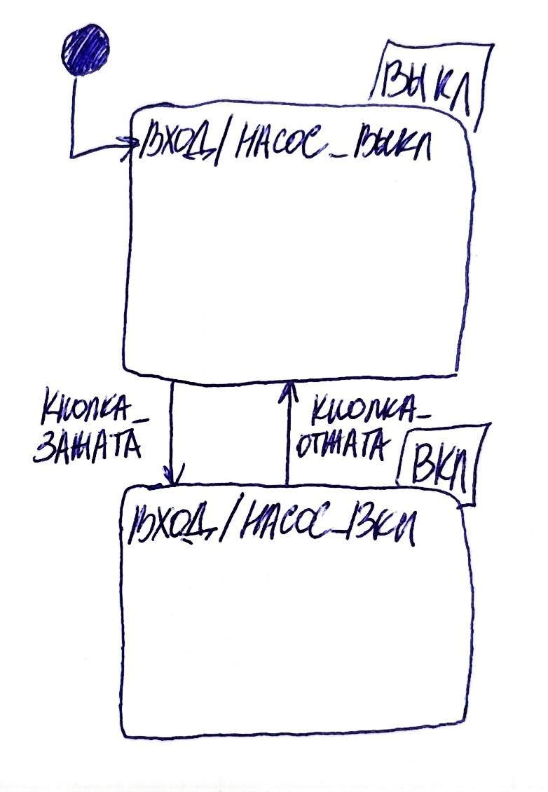

Альтернативно диаграмму можно изобразить следующим образом:

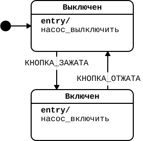

Для этого будет использоваться *цифровой вывод*, на котором мы будем контролировать
напряжение. Когда напряжение будет высоким (HIGH), контакт внутри реле защелкивается,
пуская ток к мотору и насосу — осуществляется полив. И, наоборот, когда напряжение низкое
(LOW) — реле остается на месте, и ток не проходит — насос не работает. Обновленная
диаграмма будет выглядеть следующим образом:

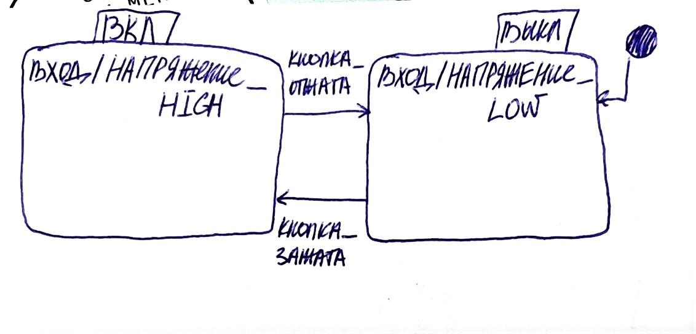

Альтернативно диаграмму можно изобразить следующим образом:

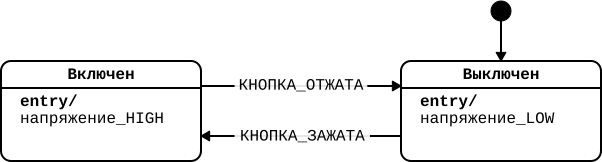

В практической части попробуем собрать простейшую программу, осуществляющую полив растений
в теплице с использованием реле.

#### Проветривание

Если для автоматического полива нам хватало обычного реле, которое работает по принципу
выключателя (подал напряжение — включился насос — полив начался; снял напряжение —
выключился насос — прекратился полив), то для управления микроклиматом задача
усложняется. Как, например, приоткрыть форточку в умной теплице ровно наполовину или
плавно отрегулировать скорость вентилятора?

Для тонкой настройки инженеры используют **сервопривод**. Пример сервопривода:

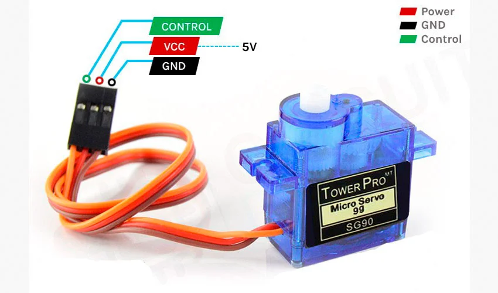

Если реле просто подает или отсекает энергию, то *сервопривод* непрерывно контролирует
собственное положение при помощи технологии **ШИМ — широтно-импульсной модуляции**. Она
управляет электроникой за счет изменения длительности импульсов тока на фиксированной
частоте.

##### Широтно-импульсная модуляция

Рассмотрим представленные ниже графики: они показывают, как ШИМ управляет яркостью лампы:

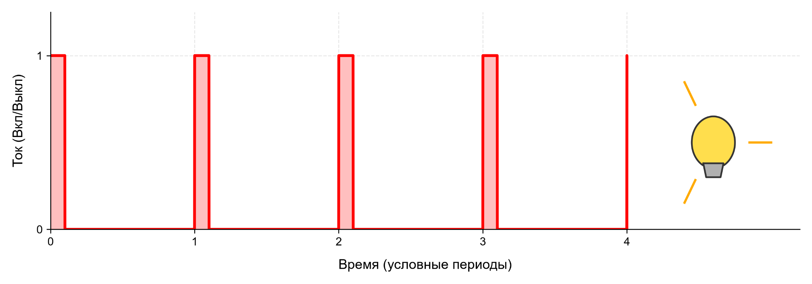

На первом графике заполнение ШИМ составляет всего 10%. Импульсы тока совсем узкие, поэтому
лампа горит еле-еле.

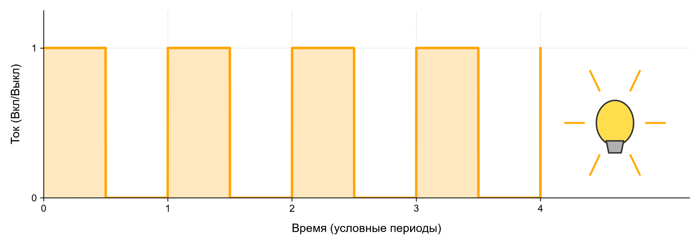

На втором графике ток подается уже ровно половину времени (заполнение 50%) — ширина
импульса равна паузе, и лампа светит в полсилы.

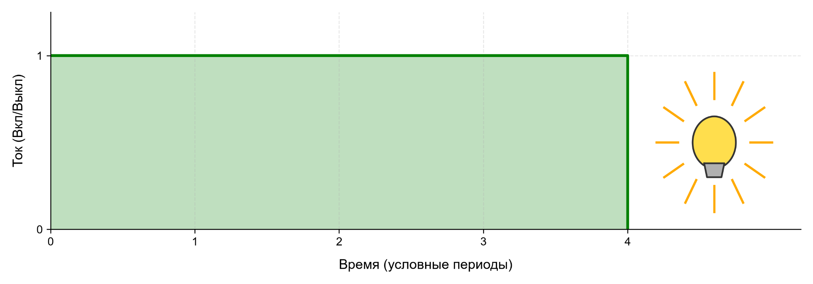

А на третьем графике зафиксировано заполнение 100%: пауз нет, и ток идет
непрерывно. Изменяя ширину этих импульсов, мы плавно дозируем энергию. Делать это вручную
человек физически не успеет — процесс микросекундных переключений полностью берет на себя
ШИМ.

Важно отметить, что микроконтроллер не умеет плавно менять величину постоянного тока — на
выходе пина всегда будет либо 0, либо полные 5 вольт. ШИМ же создает стабильную «гребенку»
из пятивольтовых импульсов, но за счет изменений продолжительности импульсов **среднее напряжение**
выходит разным:

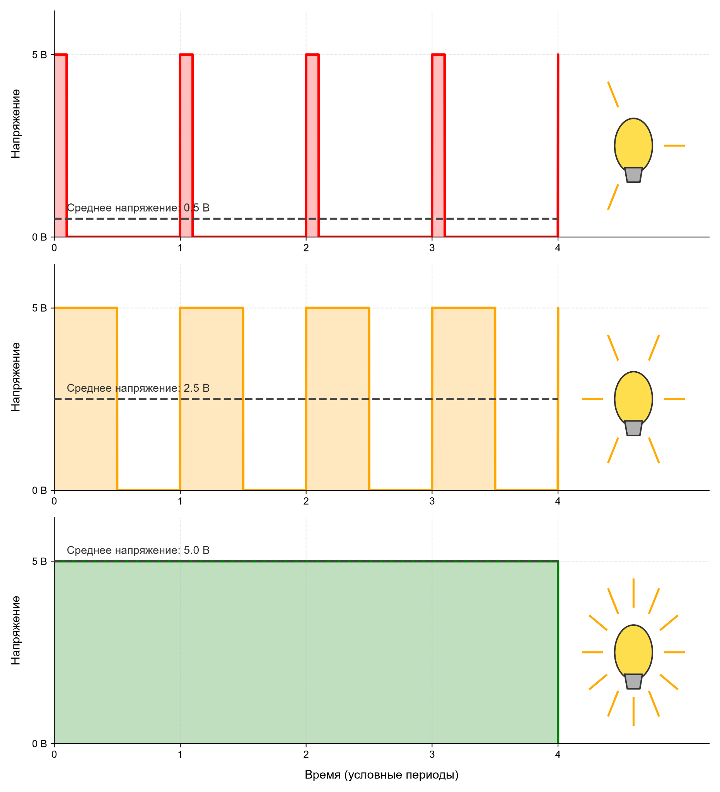

Например, на втором графике контроллер ровно 50% времени удерживает 5 Вольт, а оставшиеся
50% времени — 0 Вольт. Для устройства это становится эквивалентом постоянного напряжения
2,5 Вольта. Таким образом, с помощью ШИМ мы управляем *средним* напряжением, меняя ширину
импульсов тока.

Сегодня ШИМ используется повсюду:

- **управление моторами:** сигналы ШИМ плавно меняют скорость компьютерных вентиляторов
  охлаждения, колес электросамокатов (чтобы они разгонялись без опасных рывков) и даже
  огромных двигателей в поездах метро;
- **преобразование энергии:** зарядные устройства для телефонов и ноутбуков работают на
  ШИМ-контроллерах, а специальные приборы (инверторы) превращают ток солнечных батарей в
  привычные бытовые 220 В;
- **регулировка яркости**: светодиодные ленты меняют свет от тусклого до яркого без
  искажения цветов. Так же работают OLED-экраны смартфонов: на низкой яркости паузы между
  вспышками пикселей увеличиваются, и чуткие люди могут заметить мерцание.

> **Интерактив:** Попробуем поймать ШИМ своими глазами. Для этого выполним два теста с
> вашим смартфоном:
>
> 1.  «Карандашный веер»
>
> > Включите на смартфоне белый фон (например, пустую заметку) и скрутите яркость на самый
> минимум (10–15%). Возьмите в руку обычный карандаш или ручку за кончик и быстро машите
> им перед экраном, как веером. Если ШИМ сильная, вы увидите не сплошной размытый след от
> карандаша, а «шлейф» из нескольких четко различимых карандашей. Если ШИМ же нет, след
> будет плавно размытым.
>
> 2.  Тест через камеру другого телефона
>
> > Возьмите второй смартфон, включите на нем камеру и наведите на экран тестируемого
> телефона (где яркость выставлена на минимум).На экране камеры вы увидите черные бегущие
> полосы — это и есть те самые фазы, когда экран полностью гаснет. Чем ниже яркость, тем
> шире и отчетливее будут эти полосы.

##### Управление ШИМ В Cyberiada IDE

Когда вы начнете программировать на языке ПРИМС в редакторе Cyberiada IDE, вы заметите
удивительную вещь. В среде есть два разных компонента, и оба используют ШИМ, но
настраиваются совершенно по-разному! Дело в том, что использовать ШИМ можно для двух
принципиально разных задач:

###### Управление мощностью

Для этого используется компонент «ШИМ», позволяющий устанавливать напряжение на пин в
диапазоне от 0 до 255, где 0 — отсутствие напряжения, а 255 — максимально возможное. Число
255 выбрано потому, что память микроконтроллера хранит данные в байтах, а в один байт
помещается число от 0 до 255. Этот компонент мы берем, когда нам нужно плавно зажечь
светодиодную ленту, изменить скорость вентилятора или запустить мотор.

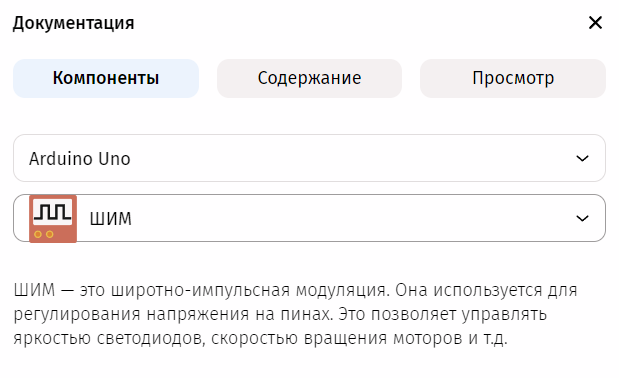

###### Передача команд

Внутри компонента «Сервопривод» тоже есть ширина импульса, однако здесь она задается в
микросекундах (от 544 до 2400 мкс). Сервопривод имеет собственные мотор и плату управления
— он не просит у Arduino энергию для работы по сигнальному проводу (питание у него
отдельное). Вместо этого ШИМ здесь используется как команда: если прилетел короткий сигнал
в 544 микросекунды — нужно повернуться на 0 градусов, а если длинный в 2400 микросекунд —
развернуться на 180 градусов.

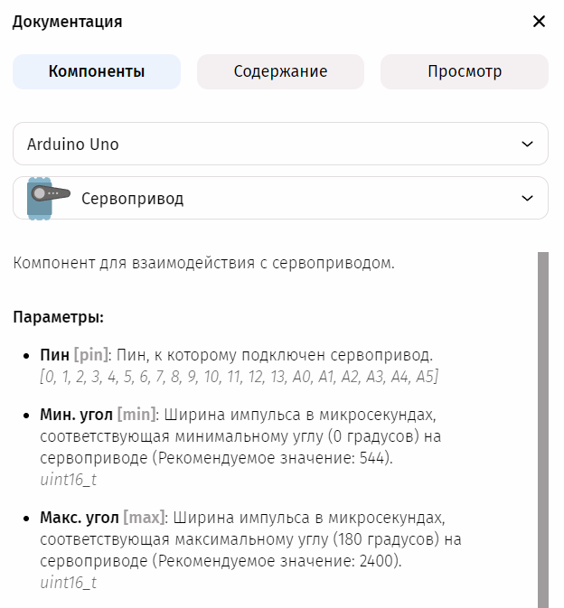

Таким образом, обычный ШИМ выдает силу, а ШИМ сервопривода передает информацию о точном
угле поворота. Первый будет использоваться в простых устройствах, контролирующих
интенсивность — ярче, быстрее, громче (мощность 0–255). А второй — в более
интеллектуальных устройствах, имеющих собственные платы управления и ждущих команд точного
положения: куда повернуться, в какую сторону ехать, и т.д. (микросекунды от 544 до 2400)

> **Интерактив**: В каком из следующих случаев величину ШИМ стоит задавать в уровнях
> мощности (от 0 до 255), а в каком — в микросекундах (от 544 до 2400):
>
> 1.  Плавно изменить скорость вращения вытяжного вентилятора охлаждения;
> 2.  Повернуть раму форточки теплицы ровно на 45 градусов для проветривания;
> 3.  Сделать фитолампу досветки в два раза тусклее;
> 4.  Изменить яркость свечения аварийного индикатора недостатка воды в баке.
>
> Единственный из представленных вариантов, который требует строгого положения — это
> второй. Для него корректнее задавать длительность импульса в микросекундах: углу 45°
> соответствует длительность импульса примерно 1008 мкс.
>
> Остальные случаи управляют общей интенсивностью, поэтому используют уровни мощности.

В практической части подробнее разберемся с работой компонентов «ШИМ» и «Сервопривод» в
контексте прикладных задач.

## Практическая часть

### 8.5. Полив с помощью реле

Решим следующую задачу:

> **Полив по кнопке**
>
> Напишите программу для теплицы, в которой полив осуществляется по нажатию
> кнопки. Соберите прототип такой теплицы с помощью микроконтроллера Arduino.

#### Сборка на Arduino

Для сборки теплицы вам понадобятся следующие компоненты:

- микроконтроллер Arduino Uno;
- модуль реле 5В (например, TONGLING JQC-3FF-S-Z) — 1 штука;
- тактовая кнопка — 1 штука;
- резистор около 10 кОм — 1 штука;
- блок батареек (должен на выходе иметь 3В) — 1 штука
- насос 3В — 1 штука;
- провода папа-папа;
- макетная плата – 1 штука;
- вода и земля для полива.

Для тестирования и отладки программы соберите следующую схему на макетной плате:

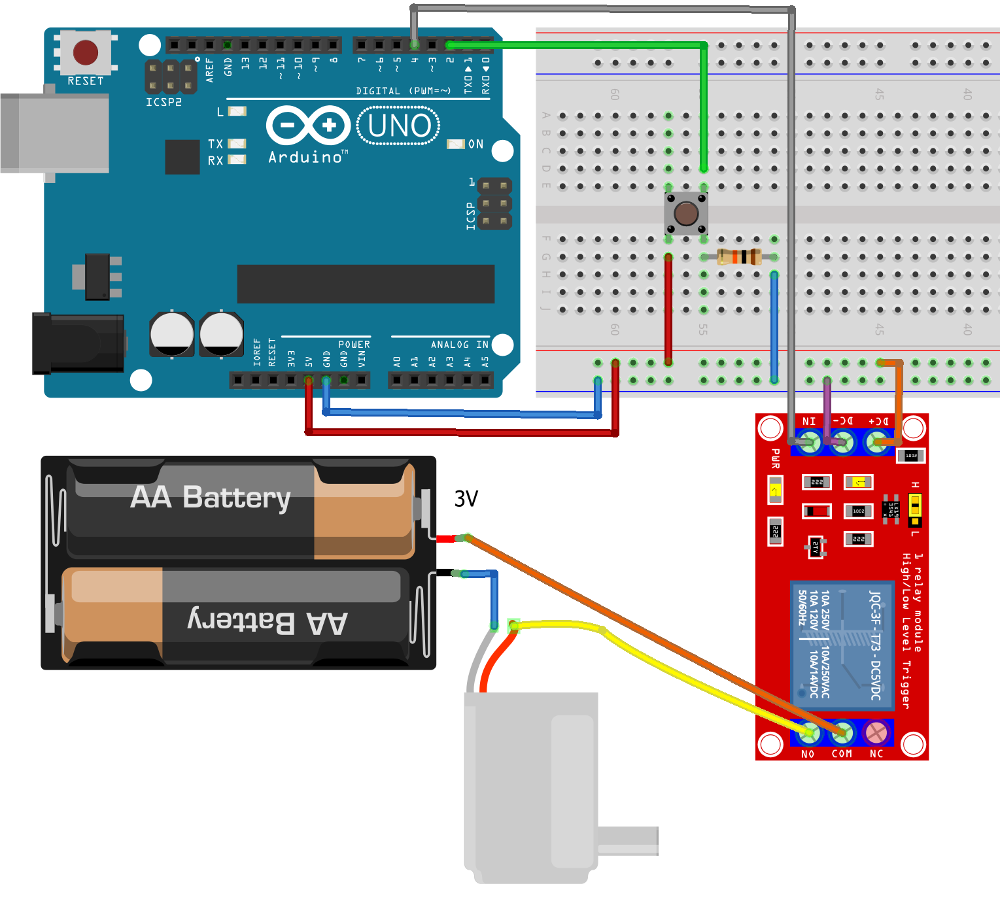

Это соответствует электрической схеме:

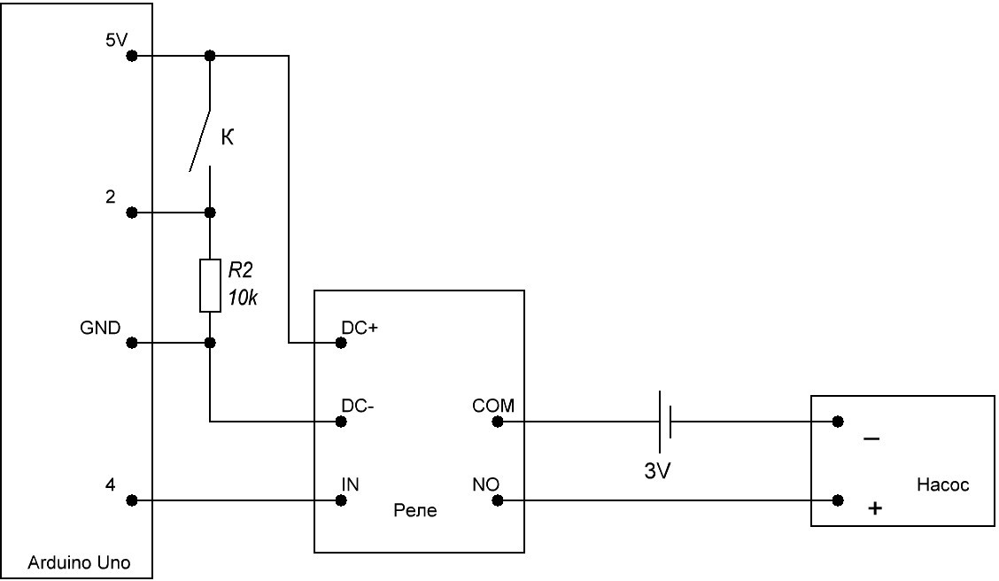

#### Программа в Cyberiada IDE

Попробуйте сперва написать программу самостоятельно, и лишь потом знакомиться с
предложенным нами решением.

Откройте редактор «Cyberiada IDE» и создайте новый файл на платформе «Arduino
Uno». Добавьте в программу необходимые компоненты:

- Кнопка;
- Цифровой вывод (далее будет фигурировать в программе как ПинРеле).

Наиболее простой вариант программы включает в себя два состояния:

- «`Выключено`»: на входе для компонента «`ПинРеле`» реализуется действие «`В низкое
  напряжение`»;
- «`Включено`»: на входе для компонента «`ПинРеле`» реализуется действие «`В высокое
  напряжение`».
  
Переход из «`Выключено`» в «`Включено`» происходит по зажатию кнопки, а обратный — по отжатию.

Получившаяся диаграмма в Cyberiada IDE:

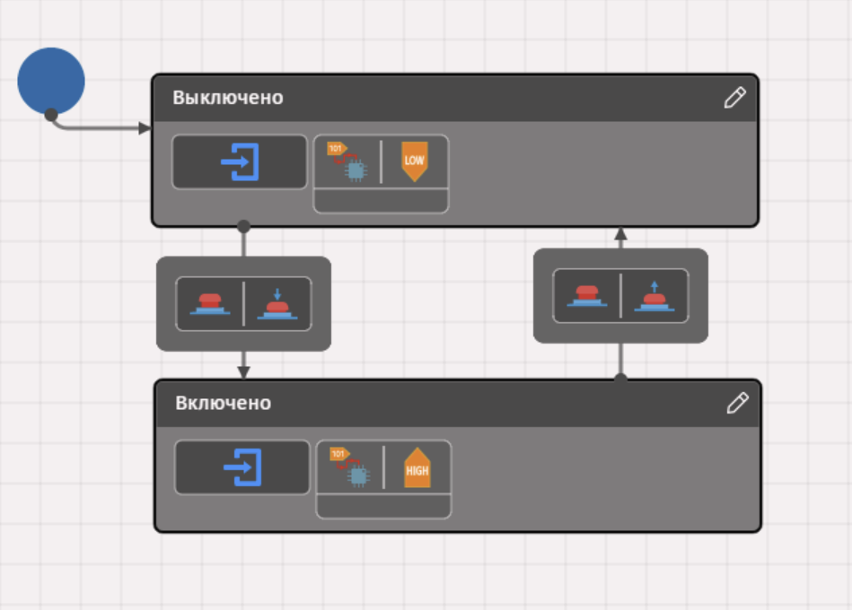

Такая нехитрая схема позволяет передавать необходимое напряжение на пин реле, которое в
свою очередь запускает насос. В дальнейшем можно совершенствовать автоматизацию теплицы —
например, подключать датчики (например, освещенности или влажности почвы) и ЖК-дисплей, на
который можно выводить текущее состояние почвы, дату последнего полива и т.д.

### 8.6. Контроль освещения через ШИМ

Решим следующую задачу:

> **Яркость светодиода**
>
> Напишите программу для лампы в умной теплице, которая имеет три уровня освещенности,
> переключающихся по нажатию кнопки:
>
> - приглушенный;
> - умеренный;
> - максимально яркий.
>
> Работу программы продемонстрируйте на примере светодиода с помощью микроконтроллера
> Arduino.

#### Сборка на Arduino

Для сборки теплицы вам понадобятся следующие компоненты:

- микроконтроллер Arduino Uno;
- светодиод — 1 штука;
- резистор 220 ОМ — 1 штука
- резистор 10 кОм — 1 штука
- провода папа-папа;
- макетная плата – 1 штука.

Для тестирования и отладки программы соберите следующую схему на макетной плате:

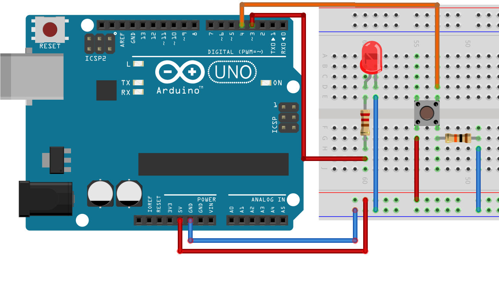

Это соответствует следующей электрической схеме:

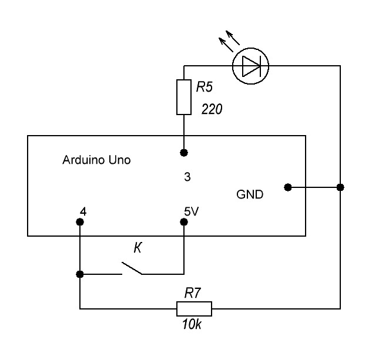

#### Программа в Cyberiada IDE

Поскольку задача требует лишь изменение интенсивности, мы будем использовать компонент
«ШИМ» и настраивать необходимые уровни через контроль напряжения. И здесь есть небольшая
подсказка — наиболее удобно использовать шаг в 51 единицу, поскольку он равен одному
вольту.

Попробуйте сперва написать программу самостоятельно, и лишь потом знакомиться с
предложенным нами решением.

Откройте редактор «Cyberiada IDE» и создайте новый файл на платформе «Arduino
Uno». Добавьте в программу необходимые компоненты:

- Светодиод;
- ШИМ;
- Кнопка.

Простой вариант программы включает в себя четыре состояния:

- «`Выключен`»: на входе для компонента «`ШИМ`» реализуется действие «`Установить (0)`»;
- «`Приглушенный`»: на входе для компонента «`ШИМ`» реализуется действие «`Установить
  (51)`»;
- «`Умеренный`»: на входе для компонента «`ШИМ`» реализуется действие «`Установить
  (153)`»;
- «`Максимально яркий`»: на входе для компонента «`ШИМ`» реализуется действие «`Установить
  (255)`».
  
Переход между состояниями происходит по событию «`Кнопка.Клик`».

Итоговая диаграмма в Cyberiada IDE может выглядеть так:

Обратите внимание, что для корректной работы программы ШИМ и светодиод должны быть
подключены к одному пину. При необходимости, можно усовершенствовать программу, добавив
вторую, понижающую кнопку.

### 8.7. Поворот форточки через сервопривод

Решим следующую задачу:

> **Форточка на 45°**
>
> Напишите программу для форточки в умной теплице, которая имеет три уровня открытия,
> переключающихся по нажатию кнопки:
>
> - плотно закрыта;
> - открыта на 45 градусов;
> - полностью открыта;
>
> Работу программы продемонстрируйте на примере сервопривода с помощью микроконтроллера Arduino.

#### Сборка на Arduino

Для сборки теплицы вам понадобятся следующие компоненты:

- микроконтроллер Arduino Uno;
- сервопривод — 1 штука;
- тактовая кнопка — 1 штука;
- резистор 10 кОм — 1 штука;
- батарейка AAA — 4 штуки;
- провода папа-папа;
- макетная плата – 1 штука;

Для тестирования и отладки программы соберите следующую схему на макетной плате:

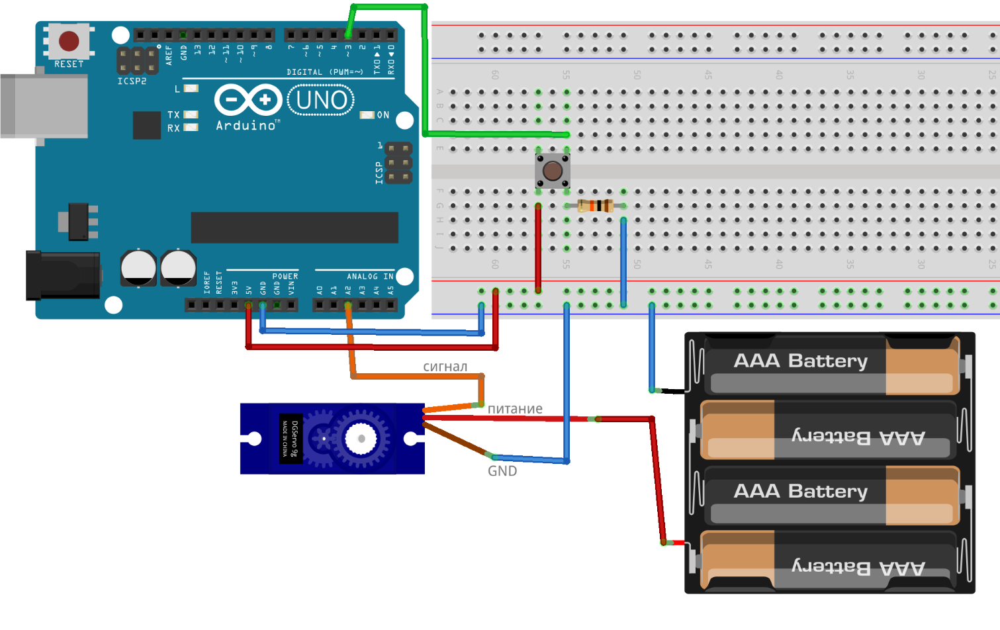

Соответствующая электрическая схема:

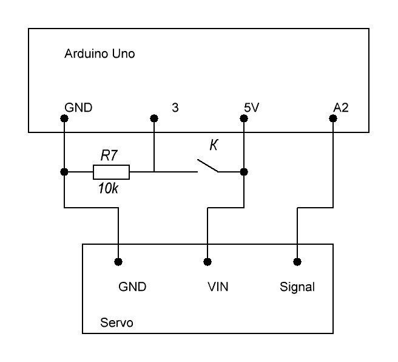

#### Программа в Cyberiada IDE

Данная задача уже более требовательна к конкретному положению угла, поэтому мы не будем
добавлять отдельный компонент «ШИМ», а поработаем с «Сервоприводом» напрямую.

Попробуйте сперва написать программу самостоятельно, и лишь потом знакомиться с
предложенным нами решением.

Откройте редактор «Cyberiada IDE» и создайте новый файл на платформе «Arduino
Uno». Добавьте в программу необходимые компоненты:

- Сервопривод;
- Кнопка.

Благодаря тому, что «Сервопривод» — интеллектуальный модуль, программа может быть
реализована двумя способами:

##### Задать угол напрямую

Угол поворота сервопривода можно задавать напрямую через команду «`Установить
угол`». Тогда программа будет состоять из трех последовательных состояний:

- «`Плотно закрыта`» — 0°;
- «`Открыта на 45 градусов`» — 45°;
- «`Полностью открыта`» — 180°.

Вариант программы через задачу угла градусами:

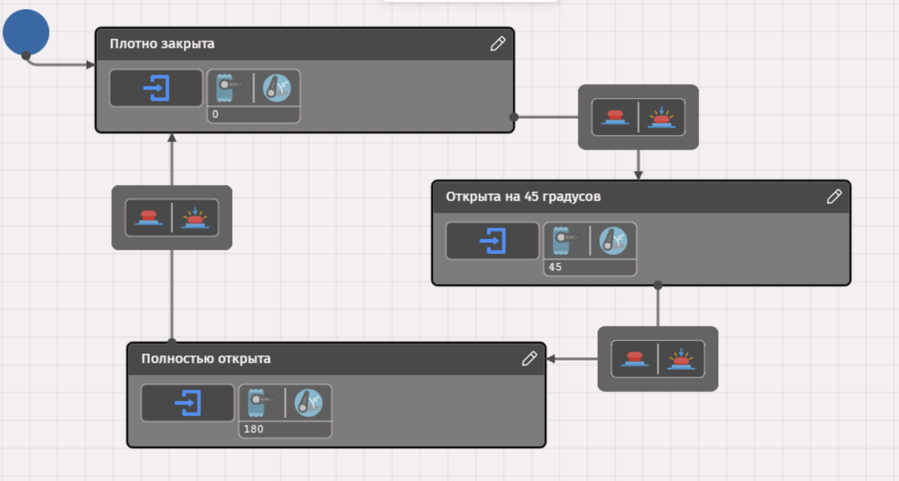

##### Задать угол через ширину импульса

Второй вариант — задать угол через ширину импульса, используя команду «`Установить
период`». Рекомендуемые значения, отраженные в документации Cyberiada IDE, для 0 и 180
градусов поворота — это 544 и 2400 мкс соответственно. Остается рассчитать необходимую
ширину импульса для 45 градусов:

- Шаг на один градус: (2400-544)/180 ≈ 10.311 мкс/градус;
- Расчет для 45°: 544 + (10.311 х 45) = 1008 мкс.

После выполненных расчетов легко воссоздать программу, состоящую из трех
состояний-режимов.

Вариант программы через задачу угла периодом импульса:

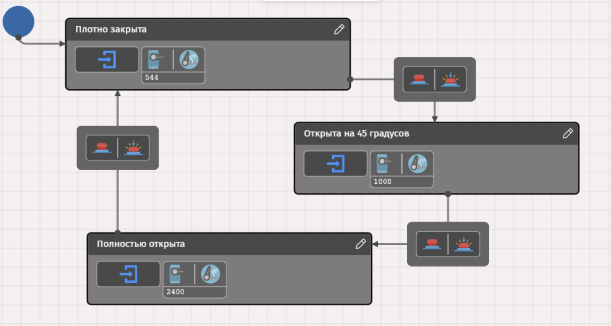

## Подведение итогов

На этом занятии мы перешли от разбора готовой инфографики к моделированию и созданию
прототипа собственной теплицы. В рамках данного курса мы с вами прошли от первого опыта
программирования в игре до сложных понятий вроде «киберфизических систем» и «нового
инженерного мышления». Надеемся, что вы продолжите этот путь вместе с нами или
самостоятельно. Удачи вам!

## Дополнительные материалы

- [Вводный курс по цифровой электронике «Основы
  схемотехники»](https://platform.kruzhok.org/tpost/axxie2oba1-osnovi-shemotehniki);
- Макдональд К. История реле. Как компьютер появился из радио, телефона и телеграфа. М:
  ДМК Пресс, 2022.
